# homelab2 Roadmap & Architecture Vision

This repository builds **homelab2**, a resilient, declarative-first personal server platform designed to run on bare-metal Arch Linux with minimal operational toil.

The complete architectural blueprint, phased implementation roadmap, application ramifications, and operational lifecycle are detailed in the official documentation:

👉 **[Read the Full Architecture & System Roadmap](file:///C:/Users/micro/projects/homelab2/docs/roadmap.md)**

---

## Continuous Quality Mandate (Constitution v1.1.0)

> [!IMPORTANT]
> **Mandatory Backup & Telemetry Gates**:
> In accordance with ratified Principles III and V, **backups and telemetry are NOT deferred to the end of the project**.
> - **Every infrastructure phase** must confirm its backup posture and telemetry integration as a mandatory gate before completion.
> - **In Phase 5 (Application Platform)**, **each individual application** must verify its backup strategy (persistence/snapshot coverage) and telemetry integration (health check assertions, structured logs, observability metrics) before that application can be signed off as complete.

---

## Quick Phase Overview

```mermaid
flowchart LR
    P1["Phase 1: Base OS Bootstrap\n(Completed)"] --> P2["Phase 2: Core Hardening & IaC\n(Completed)"]
    P2 --> P3["Phase 3: Network & Remote Access\n(Completed)"]
    P3 --> P4["Phase 4: Storage Array & Pooling\n(Completed)"]
    P4 --> P5["Phase 5: Application Platform &\nBackblaze Offsite Backups\n(In Progress)"]
    P5 --> P6["Phase 6: Game Streaming & GPU"]
    P6 --> P7["Phase 7: Local Backup Server Migration"]
    P7 --> P8["Phase 8: Platform Telemetry & Ops"]

    style P1 fill:#16a34a,stroke:#15803d,color:#fff
    style P2 fill:#16a34a,stroke:#15803d,color:#fff
    style P3 fill:#16a34a,stroke:#15803d,color:#fff
    style P4 fill:#16a34a,stroke:#15803d,color:#fff
    style P5 fill:#2563eb,stroke:#1d4ed8,color:#fff
    style P6 fill:#475569,stroke:#334155,color:#fff
    style P7 fill:#475569,stroke:#334155,color:#fff
    style P8 fill:#475569,stroke:#334155,color:#fff
```

- **Phase 1: Bare-Metal Live Bootstrap & Base OS Provisioning** *(Completed)*: Boot Arch live ISO, run idempotent bootstrap installer, reboot headlessly into verified SSH-ready target host. *Gates: Git profile recovery & pre/post-reboot health verification (internal bootstrap exception).*
- **Phase 2: Base System Hardening & Configuration Management** *(Completed)*: Ansible setup, SSH hardening, sudo privileges, core diagnostic daemons, persistent udev hardware rules. Gitignored secrets with committed `*.example` templates. *Gates: Gitignored secrets posture & smartd/chrony/journald telemetry verified.*
- **Phase 3: Network & Remote Access Overlay** *(Completed)*: Tailscale mesh VPN, nftables firewall, reverse proxy (Caddy) with modular drop-ins, automated ACME TLS, WebSocket upgrade support, and health check assertion suite. *Gates: TLS config backup, HTTP/Tailscale telemetry, and NET-01 through NET-08 verification.*
- **Phase 4: Storage Pooling & Data Resiliency Layer** *(Completed)*: Multi-drive layout, MergerFS pool (`/mnt/storage`), SnapRAID parity snapshots, fast NVMe app tier (`/opt/services`), and isolated scratch path (`/mnt/scratch`). *Gates: Parity sync & MergerFS mount/diff telemetry, STO-01 through STO-10 verification passed.*
- **Phase 5: Application Platform & Continuous Backblaze Backups** *(In Progress)*: Containerized service platform (Docker CE + Compose managed via systemd). Every stateful workload and host secret configuration is continuously backed up offsite to Backblaze B2 via Restic client-side encryption. **Each app requires individual backup & telemetry verification:**
  - **Backblaze B2 & Restic Pipeline** *(Feature 006 - Completed & Verified)*: Centralized client-side encrypted backup service capturing `/etc/homelab/vault.yml`, host secrets, and all app snapshot streams with automated disaster recovery restore tooling. All 8 BK assertions verified passing.
  - **Vaultwarden** *(Completed)*: Deployed on loopback `127.0.0.1:8088`, Tailscale Funnel ingress with public TLS, transactional SQLite backup (`VACUUM INTO` + integrity check) with 30-day pruning, and systemd backup timer. Checks VW-01 through VW-09 verified.
- **Feature 007: Target Host Antigravity & Remote Control Layer** *(Implemented)*: Google Antigravity CLI deployment, headless systemd user daemon supervision (`antigravity-cli-daemon.service` / `agy-remote-control.service`), boot persistence via user lingering (`loginctl enable-linger admin`), autonomous tool permissions (`"toolPermission": "always-proceed"`), Git workspace and worktree isolation (`/home/admin/homelab2/.worktrees`), dedicated GitHub deploy key authentication, centralized Backblaze B2 backup integration, and 8-point automated acceptance suite (AG-001 through AG-008). See [Operational Runbook](docs/operations.md).
  - **Home Assistant & ZWaveJS**: Backup (config + DB snapshot) & Telemetry (healthcheck, API endpoint, udev tracking).
  - **Immich**: Backup (`pg_dump` + photo sync) & Telemetry (server ping, ML status, GPU transcode metric).
  - **Frigate NVR**: Backup (event DB + config; CCTV excluded) & Telemetry (Coral latency, stream FPS, API check).
  - **FileBrowser**: Backup (DB + settings) & Telemetry (web response, storage mount assertion).
  - **Mealie, Vikunja, Memos**: Backup (individual DB/attachment dumps) & Telemetry (HTTP health endpoints).
  - **Arr Stack (Partial)**: Backup (app configs/DBs) & Telemetry (Gluetun VPN IP check, UI response).
- **Phase 6: Steam Library & Local Game Streaming**: Dedicated fast game storage (`/mnt/games`), Sunshine game streaming server (NVENC/VAAPI, PipeWire, `uinput` virtual controllers), headless virtual display emulation for streaming to Steam Deck (1280x800 @ 90Hz) and TV box (4K). *Gates: Sunshine configs backup & encoder/stream telemetry.*
- **Phase 7: Dedicated Local Backup Server & LAN Repositories**: Migration or addition of a local on-premises backup server (e.g., TrueNAS, MinIO, or Proxmox Backup Server) to reduce Backblaze B2 egress costs and accelerate LAN disaster recovery drills (< 15 min). *Gates: Local repository sync & dual-target replication verification.*
- **Phase 8: Platform Observability & Annual Maintenance**: Centralized dashboard, healthchecks, telemetry alerts, annual upgrade cadence. *Gates: Active failure simulation alert verification.*

---

## Planned Application Ramifications Matrix

| Application | Key Hardware / Network Dependencies | Storage Tier & Path | Backup & Telemetry Completion Gate |
|---|---|---|---|
| **Home Assistant & ZWaveJS** | USB Z-Wave Stick (`/dev/serial/by-id`), `network_mode: host` | NVMe (`/opt/services/{homeassistant,zwavejs}`) | Daily config/DB snapshot; container & API `/api/` health check; udev symlink verified. |
| **Immich** | GPU hardware decoding/ML (`/dev/dri`) | NVMe (DB/cache) + MergerFS (`/mnt/storage/media/photos`) | Atomic `pg_dump` + library sync; `/api/server/ping` check; GPU transcode metric. |
| **Frigate NVR** | Coral TPU (`/dev/apex_0` or USB) + GPU video decoding | NVMe (DB) + RAM tmpfs (`/dev/shm`) + Scratch HDD (`/mnt/scratch`) | Event DB backup (CCTV footage excluded); Coral TPU latency & camera FPS telemetry. |
| **Vaultwarden** | Reverse proxy with valid TLS + WebSockets (`/notifications/hub`) | NVMe (`/opt/services/vaultwarden`) | Hourly/daily transactional SQLite `.backup` vacuum dump; `/alive` & WebSocket check. |
| **FileBrowser** | Read/write mount to MergerFS with storage group PUID/PGID | NVMe (config) + MergerFS (`/mnt/storage`) | `filebrowser.db` backup; HTTP 200 response & storage mount reachability check. |
| **Mealie, Vikunja, Memos** | Standard web ingress via reverse proxy | NVMe (`/opt/services/...`) | Automated DB & attachment backups; HTTP health endpoint assertions (`/api/...`). |
| **Arr Stack (Partial)** | Gluetun VPN container killswitch | NVMe (configs) + MergerFS (media + staging) | App config/DB backups; Gluetun external IP check assertion & UI healthchecks. |
| **Steam & Sunshine Streaming** | Discrete GPU / iGPU encoder, `/dev/uinput`, PipeWire | Dedicated Fast SSD (`/mnt/games`) | Sunshine config & mapping backup; GPU encoder status & stream loss logging. |

---

## Declarative Architecture & System Inventory Map

To eliminate configuration ambiguity and ensure operators and autonomous agents locate resources rapidly with zero discovery toil, the codebase establishes single sources of truth across explicit inventory domains:

| Inventory Domain | Primary Location & Source of Truth | Key Managed Resources & Defaults | Convergence / Deployment |
|---|---|---|---|
| **Base Software Inventory** | [`ansible/inventory/group_vars/all/vars.yml`](file:///C:/Users/micro/projects/homelab2/ansible/inventory/group_vars/all/vars.yml) (`common_packages`) | Core administration CLI tools (`vim`, `tmux`, `htop`, `git`, `curl`, `jq`, `uv`). | `ansible-playbook -i inventory/hosts.yml playbooks/site.yml --tags packages` |
| **Host & Network Inventory** | [`ansible/inventory/hosts.yml`](file:///C:/Users/micro/projects/homelab2/ansible/inventory/hosts.yml) | Target host IP (`192.168.4.57`), admin user, Python interpreter, host groups. | `ansible-playbook -i inventory/hosts.yml playbooks/site.yml` |
| **Storage & Drive Topology** | [`ansible/inventory/host_vars/homelab2/storage.yml`](file:///C:/Users/micro/projects/homelab2/ansible/inventory/host_vars/homelab2/storage.yml) | Drive UUIDs, filesystems (`ext4`), mount paths (`/mnt/disks/data*`, `/mnt/scratch`), pool roles (`data`, `parity`, `scratch`). | `ansible-playbook -i inventory/hosts.yml playbooks/storage.yml` |
| **Secrets & Credential Inventory** | [`ansible/inventory/group_vars/all/vault.yml`](file:///C:/Users/micro/projects/homelab2/ansible/inventory/group_vars/all/vault.yml) | Encrypted SOPS/Age credentials (Tailscale auth key, Vaultwarden token, Backblaze B2 keys, Restic password). | Gitignored; decrypted into memory during execution. |
| **Platform Safeguards & Policies** | [`ansible/inventory/group_vars/all/vars.yml`](file:///C:/Users/micro/projects/homelab2/ansible/inventory/group_vars/all/vars.yml) | SSH hardening, Fail2ban jails, `systemd-oomd` memory limits, journald bounds, Chrony NTP pools. | `ansible-playbook -i inventory/hosts.yml playbooks/harden.yml` |
| **Application Platform & Stacks** | `/opt/services/<app>/docker-compose.yml` & [`ansible/roles/<app>`](file:///C:/Users/micro/projects/homelab2/ansible/roles/) | Container Compose stacks, loopback port bindings, persistent NVMe storage paths. | `ansible-playbook -i inventory/hosts.yml playbooks/<app>.yml` |
| **Backup Hook Inventory** | `/etc/homelab/backup.d/*.sh` & [`ansible/roles/backup`](file:///C:/Users/micro/projects/homelab2/ansible/roles/backup/) | Transactional database dump scripts, backup inclusion paths, and snapshot retention schedules. | `ansible-playbook -i inventory/hosts.yml playbooks/backup.yml` |

---

## Key References

- [Constitution](file:///C:/Users/micro/projects/homelab2/.specify/memory/constitution.md) - Ratified principles and operational standards (v1.1.0).
- [Current Feature Spec](file:///C:/Users/micro/projects/homelab2/specs/001-initial-arch-install/spec.md) - Specification for the initial Arch live installer bootstrap.
- [Detailed Roadmap](file:///C:/Users/micro/projects/homelab2/docs/roadmap.md) - Full end-to-end architecture, hardware passthrough, storage tiering, and phase breakdown.
