# homelab2 Roadmap & Architecture Vision

This repository builds **homelab2**, a resilient, declarative-first personal server platform designed to run on bare-metal Arch Linux with minimal operational toil.

The complete architectural blueprint, phased implementation roadmap, application ramifications, and operational lifecycle are detailed in the official documentation:

👉 **[Read the Full Architecture & System Roadmap](file:///C:/Users/micro/projects/homelab2/docs/roadmap.md)**

---

## Continuous Quality Mandate (Constitution v1.1.0)

> [!IMPORTANT]
> **Mandatory Backup & Telemetry Gates**:
> In accordance with ratified Principles III and V, **backups and telemetry are NOT deferred to the end of the project**.
> - **Every infrastructure phase** must confirm its backup posture and telemetry integration as a mandatory gate before completion.
> - **In Phase 5 (Application Platform)**, **each individual application** must verify its backup strategy (persistence/snapshot coverage) and telemetry integration (health check assertions, structured logs, observability metrics) before that application can be signed off as complete.

---

## Quick Phase Overview

```mermaid
flowchart LR
    P1["Phase 1: Base OS Bootstrap\n(Completed)"] --> P2["Phase 2: Core Hardening & IaC\n(Completed)"]
    P2 --> P3["Phase 3: Network & Remote Access\n(Completed)"]
    P3 --> P4["Phase 4: Storage Array & Pooling\n(Completed)"]
    P4 --> P5["Phase 5: Application Platform\n(Next)"]
    P5 --> P6["Phase 6: Game Streaming & GPU"]
    P6 --> P7["Phase 7: Central Offsite Backups"]
    P7 --> P8["Phase 8: Platform Telemetry & Ops"]

    style P1 fill:#16a34a,stroke:#15803d,color:#fff
    style P2 fill:#16a34a,stroke:#15803d,color:#fff
    style P3 fill:#16a34a,stroke:#15803d,color:#fff
    style P4 fill:#16a34a,stroke:#15803d,color:#fff
    style P5 fill:#2563eb,stroke:#1d4ed8,color:#fff
    style P6 fill:#475569,stroke:#334155,color:#fff
    style P7 fill:#475569,stroke:#334155,color:#fff
    style P8 fill:#475569,stroke:#334155,color:#fff
```

- **Phase 1: Bare-Metal Live Bootstrap & Base OS Provisioning** *(Completed)*: Boot Arch live ISO, run idempotent bootstrap installer, reboot headlessly into verified SSH-ready target host. *Gates: Git profile recovery & pre/post-reboot health verification (internal bootstrap exception).*
- **Phase 2: Base System Hardening & Configuration Management** *(Completed)*: Ansible setup, SOPS/age secrets integration, SSH hardening, sudo privileges, core diagnostic daemons, persistent udev hardware rules. *Gates: Vault/key backup & smartd/chrony/journald telemetry verified.*
- **Phase 3: Network & Remote Access Overlay** *(Completed)*: Tailscale mesh VPN, nftables firewall, reverse proxy (Caddy) with modular drop-ins, automated ACME TLS, WebSocket upgrade support, and health check assertion suite. *Gates: TLS config backup, HTTP/Tailscale telemetry, and NET-01 through NET-08 verification.*
- **Phase 4: Storage Pooling & Data Resiliency Layer** *(Completed)*: Multi-drive layout, MergerFS pool (`/mnt/storage`), SnapRAID parity snapshots, fast NVMe app tier (`/opt/services`), and isolated scratch path (`/mnt/scratch`). *Gates: Parity sync & MergerFS mount/diff telemetry, STO-01 through STO-10 verification passed.*
- **Feature 007: Target Host Antigravity & Remote Control Layer** *(Implemented)*: Google Antigravity CLI deployment, headless systemd user daemon supervision (`agy-remote-control.service`), boot persistence via user lingering (`loginctl enable-linger admin`), autonomous tool permissions (`"toolPermission": "always-proceed"`), Git workspace and worktree isolation (`/home/admin/homelab2/.worktrees`), dedicated GitHub deploy key authentication, centralized Backblaze B2 backup integration, and 8-point automated acceptance suite (AG-001 through AG-008). See [Operational Runbook](file:///C:/Users/micro/projects/homelab2/docs/operations.md).
- **Phase 5: Application Platform** *(Next)*: Rootless container stacks (Docker/Podman Compose). **Each app requires individual backup & telemetry verification:**
  - **Home Assistant & ZWaveJS**: Backup (config + DB snapshot) & Telemetry (healthcheck, API endpoint, udev tracking).
  - **Immich**: Backup (`pg_dump` + photo sync) & Telemetry (server ping, ML status, GPU transcode metric).
  - **Frigate NVR**: Backup (event DB + config; CCTV excluded) & Telemetry (Coral latency, stream FPS, API check).
  - **Vaultwarden**: Backup (transactional SQLite `.backup` dump) & Telemetry (`/alive` check, WebSocket status).
  - **FileBrowser**: Backup (DB + settings) & Telemetry (web response, storage mount assertion).
  - **Mealie, Vikunja, Memos**: Backup (individual DB/attachment dumps) & Telemetry (HTTP health endpoints).
  - **Arr Stack (Partial)**: Backup (app configs/DBs) & Telemetry (Gluetun VPN IP check, UI response).
- **Phase 6: Steam Library & Local Game Streaming**: Dedicated fast game storage (`/mnt/games`), Sunshine game streaming server (NVENC/VAAPI, PipeWire, `uinput` virtual controllers), headless virtual display emulation for streaming to Steam Deck (1280x800 @ 90Hz) and TV box (4K). *Gates: Sunshine configs backup & encoder/stream telemetry.*
- **Phase 7: Centralized Offsite Backups & Disaster Recovery Drills**: Restic/Borg encrypted offsite backups (Backblaze B2), daily systemd timers, tested disaster recovery runbooks. *Gates: Full < 60 min DR restore drill verification.*
- **Phase 8: Platform Observability & Annual Maintenance**: Centralized dashboard, healthchecks, telemetry alerts, annual upgrade cadence. *Gates: Active failure simulation alert verification.*

---

## Planned Application Ramifications Matrix

| Application | Key Hardware / Network Dependencies | Storage Tier & Path | Backup & Telemetry Completion Gate |
|---|---|---|---|
| **Home Assistant & ZWaveJS** | USB Z-Wave Stick (`/dev/serial/by-id`), `network_mode: host` | NVMe (`/opt/services/{homeassistant,zwavejs}`) | Daily config/DB snapshot; container & API `/api/` health check; udev symlink verified. |
| **Immich** | GPU hardware decoding/ML (`/dev/dri`) | NVMe (DB/cache) + MergerFS (`/mnt/storage/media/photos`) | Atomic `pg_dump` + library sync; `/api/server/ping` check; GPU transcode metric. |
| **Frigate NVR** | Coral TPU (`/dev/apex_0` or USB) + GPU video decoding | NVMe (DB) + RAM tmpfs (`/dev/shm`) + Scratch HDD (`/mnt/scratch`) | Event DB backup (CCTV footage excluded); Coral TPU latency & camera FPS telemetry. |
| **Vaultwarden** | Reverse proxy with valid TLS + WebSockets (`/notifications/hub`) | NVMe (`/opt/services/vaultwarden`) | Hourly/daily transactional SQLite `.backup` vacuum dump; `/alive` & WebSocket check. |
| **FileBrowser** | Read/write mount to MergerFS with storage group PUID/PGID | NVMe (config) + MergerFS (`/mnt/storage`) | `filebrowser.db` backup; HTTP 200 response & storage mount reachability check. |
| **Mealie, Vikunja, Memos** | Standard web ingress via reverse proxy | NVMe (`/opt/services/...`) | Automated DB & attachment backups; HTTP health endpoint assertions (`/api/...`). |
| **Arr Stack (Partial)** | Gluetun VPN container killswitch | NVMe (configs) + MergerFS (media + staging) | App config/DB backups; Gluetun external IP check assertion & UI healthchecks. |
| **Steam & Sunshine Streaming** | Discrete GPU / iGPU encoder, `/dev/uinput`, PipeWire | Dedicated Fast SSD (`/mnt/games`) | Sunshine config & mapping backup; GPU encoder status & stream loss logging. |

---

## Key References

- [Constitution](file:///C:/Users/micro/projects/homelab2/.specify/memory/constitution.md) - Ratified principles and operational standards (v1.1.0).
- [Current Feature Spec](file:///C:/Users/micro/projects/homelab2/specs/001-initial-arch-install/spec.md) - Specification for the initial Arch live installer bootstrap.
- [Detailed Roadmap](file:///C:/Users/micro/projects/homelab2/docs/roadmap.md) - Full end-to-end architecture, hardware passthrough, storage tiering, and phase breakdown.
