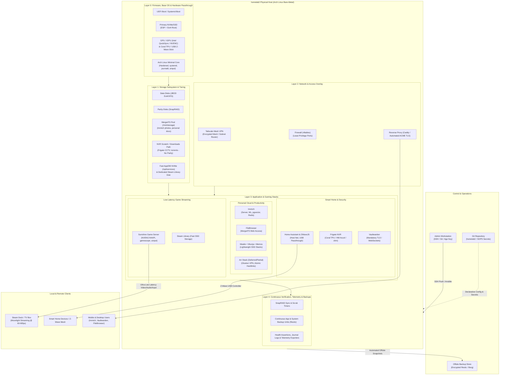

# homelab2 Architecture & System Roadmap

**Status**: Active Living Document  
**Version**: 1.2.0  
**Last Updated**: 2026-10-11  
**Governance**: Governed by [.specify/memory/constitution.md](file:///C:/Users/micro/projects/homelab2/.specify/memory/constitution.md) (v1.1.0)

---

## 1. Executive Summary & Vision

`homelab2` is a resilient, declarative-first, self-healing personal server platform designed to run on bare-metal hardware with minimal ongoing operational toil. Guided by the [homelab2 Constitution](file:///C:/Users/micro/projects/homelab2/.specify/memory/constitution.md), the system prioritizes rock-solid stability, headless reliability, and an annual maintenance cadence over bleeding-edge complexity.

### The North Star
> *"A homelab should serve the household quietly and reliably, not demand constant weekly tinkering or fragile maintenance chores."*

If the physical server or its OS drive completely fails, an operator must be able to boot an Arch Linux live USB on replacement hardware, run the automated bootstrap scripts, converge via Ansible, restore persistent data from verified backups, and return to full operation in under 60 minutes with zero data loss.

### Constitutional Quality Mandate (v1.1.0 Amendment)
> [!IMPORTANT]
> **Continuous Backup & Telemetry Verification Gates**:
> In accordance with Constitution Principles III and V, **backups and telemetry are NOT deferred to the end of the project**. Every infrastructure phase—and in Phase 5, **each individual application**—must verify and confirm its backup strategy (persistence/snapshot coverage and restore readiness) and telemetry integration (health check assertions, structured logs, and observability endpoints) as a mandatory gate before it can be declared complete.

---

## 2. What the Final Finished Product Looks Like

The converged end state of `homelab2` is a fully automated, layered operating platform supporting self-hosted household services, AI-assisted media/NVR workloads, and local game streaming:



---

## 3. End-to-End Operational Lifecycle

The finished platform operates across four clear operational states:

```mermaid
sequenceDiagram
    autonumber
    actor Admin as Operator
    participant Live as Live USB Session
    participant Target as Target Host (Arch)
    participant Ansible as Ansible / Secrets
    participant Cloud as Remote Backups

    Note over Admin,Target: Day 0: Initial Bootstrap
    Admin->>Live: Boot Arch Live ISO & SSH in
    Admin->>Live: Clone homelab2 repo & provide age key
    Admin->>Live: Execute install bootstrap script
    Live->>Live: Verify disk guard, partition & pacstrap base OS
    Live->>Target: Write bootloader, network & SSH keys
    Live->>Admin: Pre-reboot verification passes; safely reboot

    Note over Admin,Target: Day 1: Headless Convergence
    Target->>Target: Boots headlessly; brings up DHCP & SSH
    Admin->>Target: Connects via SSH (no passwords, key auth)
    Admin->>Target: Runs Ansible site playbook with SOPS secrets
    Ansible->>Target: Configures MergerFS, SnapRAID, GPU/TPU rules, Tailscale, Containers
    Target->>Target: Automated health & telemetry assertions pass

    Note over Target,Cloud: Day 2: Zero-Toil Operation
    loop Periodic Timers
        Target->>Target: SnapRAID daily diff & sync (excluding CCTV / scratch)
        Target->>Cloud: Restic automated encrypted volume snapshot
        Target->>Admin: Silent operation (alerts only on failure)
    end

    Note over Admin,Target: Disaster Recovery (Total Hardware Loss)
    Admin->>Target: Replace disk -> Boot Live USB -> Repeat Day 0 & 1
    Admin->>Target: Run restore playbook from Restic backup
    Target->>Admin: Full system converged back to exact state (< 60m)
```

---

## 4. Application Portfolio & Architectural Ramifications

Each planned workload brings distinct dependencies, storage placement, and explicit **Backup and Telemetry Acceptance Gates**:

### 4.1 Home Assistant & ZWaveJS
- **Role**: Core smart home hub, automation engine, and Z-Wave mesh controller.
- **State & Storage**: App configs, entity states, and SQLite/PostgreSQL database stored on fast NVMe (`/opt/services/homeassistant`, `/opt/services/zwavejs`).
- **Ramifications**:
  - **Hardware Passthrough**: Persistent USB device mapping for the physical Z-Wave USB stick (`/dev/serial/by-id/...`) via udev rules with `dialout` group permissions so container restarts never lose the controller.
  - **Network Mode**: Requires `network_mode: host` for automatic discovery of local devices (mDNS, SSDP, HomeKit, Matter/Thread, Cast).
  - **High I/O Frequency**: Real-time sensor state writes must reside on SSD storage to keep spinning disks asleep.
- **Backup & Telemetry Gate**:
  - *Backup Confirmed*: Automated daily snapshot of configuration, custom components, and SQLite/Postgres DB via Restic/backup script.
  - *Telemetry Confirmed*: Container healthcheck active; systemd unit status verified; Home Assistant `/api/` health check endpoint responding; journald logging structured and monitored.

### 4.2 Immich
- **Role**: High-performance self-hosted photo and video management (Google Photos alternative).
- **State & Storage**:
  - **Database & Indices**: PostgreSQL with `pgvector`, Redis cache, thumbnails, and ML models on fast NVMe (`/opt/services/immich`).
  - **Media Library**: Original full-resolution photos and videos on pooled MergerFS storage (`/mnt/storage/media/photos`).
- **Ramifications**:
  - **Multi-Container Stack**: Immich Server, Immich Machine Learning, PostgreSQL + pgvector, and Redis.
  - **Hardware Acceleration**: Video transcoding and ML image classification (CLIP, facial recognition, search) require GPU/iGPU passthrough (`/dev/dri` for Intel QuickSync or NVIDIA NVENC/CUDA).
- **Backup & Telemetry Gate**:
  - *Backup Confirmed*: Automated periodic `pg_dump` of PostgreSQL (including pgvector embeddings) synchronized with photo volume snapshots.
  - *Telemetry Confirmed*: Server ping endpoint (`/api/server/ping`) asserted; container healthchecks active; GPU transcoding hardware metric confirmed.

### 4.3 Frigate NVR
- **Role**: Real-time CCTV Network Video Recorder with AI object detection (people, cars, animals).
- **State & Storage**:
  - **Config & DB**: SQLite database and configs on fast NVMe (`/opt/services/frigate`).
  - **Frame Buffer**: High-speed tmpfs shared memory (`/dev/shm`, minimum 1GB-2GB) for live camera processing.
  - **Footage & Clips**: Continuous video recordings stored on dedicated non-parity disk path (`/mnt/scratch/frigate`).
- **Ramifications**:
  - **Critical SnapRAID Separation**: 24/7 camera streams generate continuous write volume. CCTV footage **must be strictly excluded from SnapRAID parity sync** to avoid constant disk thrashing and daily parity calculation overhead.
  - **Hardware Acceleration / Coral TPU**: Real-time object detection requires Google Coral TPU (`/dev/apex_0` or USB) or dedicated GPU offload. Video decoding requires hardware VAAPI/QuickSync.
- **Backup & Telemetry Gate**:
  - *Backup Confirmed*: Config file and SQLite event database backed up; video clip scratch directory explicitly verified as excluded from backup overhead.
  - *Telemetry Confirmed*: Frigate `/api/version` health endpoint responding; Coral TPU inference latency (< 15ms) verified; camera RTSP stream FPS / drop rate tracked in logs.

### 4.4 Vaultwarden
- **Role**: Lightweight Bitwarden-compatible password and secret manager.
- **State & Storage**: Encrypted vault database and attachments on NVMe (`/opt/services/vaultwarden`).
- **Ramifications**:
  - **Strict TLS Enforcement**: Bitwarden browser extensions and mobile clients strictly require valid HTTPS/TLS via WebCrypto APIs; reverse proxy with automated ACME certificate renewal is mandatory.
  - **WebSocket Support**: Reverse proxy must route WebSocket traffic (`/notifications/hub`) for instantaneous vault synchronization across devices.
- **Backup & Telemetry Gate**:
  - *Backup Confirmed*: Tier 1 mission-critical backup. Automated transactional SQLite `.backup` vacuum dump generated hourly/daily and verified restorable.
  - *Telemetry Confirmed*: `/alive` health endpoint reporting healthy; reverse proxy WebSocket connection status confirmed; security audit logs redirected to journald.

### 4.5 FileBrowser
- **Role**: Web-based graphical file manager for managing homelab files, shares, and uploads.
- **State & Storage**: Config/DB on NVMe; data mounts directly mapped to MergerFS storage pools (`/mnt/storage`) and user shares.
- **Ramifications**:
  - **Consistent Permissions**: Must be configured with explicit user/group IDs (PUID/PGID matching the homelab storage group) to prevent writing root-owned files that other services or SMB shares cannot access.
- **Backup & Telemetry Gate**:
  - *Backup Confirmed*: `filebrowser.db` database and settings included in automated daily backup.
  - *Telemetry Confirmed*: Web listener HTTP 200 health assertion; storage mount accessibility check.

### 4.6 Mealie, Vikunja & Memos
- **Role**: Recipe manager (Mealie), task/project management (Vikunja), and micro-notes (Memos).
- **State & Storage**: Application databases and static assets on NVMe (`/opt/services/{mealie,vikunja,memos}`).
- **Ramifications**:
  - Highly efficient, lightweight services with negligible CPU footprint.
- **Backup & Telemetry Gate**:
  - *Backup Confirmed*: Automated SQLite/Postgres dumps and attachment snapshots verified for each app.
  - *Telemetry Confirmed*: HTTP health endpoints (`/api/app/about` for Mealie, `/api/v1/info` for Vikunja, ping endpoint for Memos) responding with HTTP 200.

### 4.7 Arr Stack (Deferred / Partial Deployment)
- **Role**: Automated media management (e.g., Radarr, Sonarr, Prowlarr, download client).
- **State & Storage**: Configuration directories on NVMe; media libraries on MergerFS; temporary downloads on scratch storage.
- **Ramifications**:
  - **Atomic Moves & Hardlinks**: MergerFS configured with `atomic_rename` enabled across downloads and media library to eliminate duplicate disk space usage and I/O thrashing.
  - **Network Isolation & VPN**: Download client routed through a containerized VPN with kill-switch (e.g., Gluetun).
  - **Parity Exclusion**: Active, incomplete torrent downloads reside outside SnapRAID parity monitoring.
- **Backup & Telemetry Gate**:
  - *Backup Confirmed*: App config directories and databases backed up; download cache excluded.
  - *Telemetry Confirmed*: Gluetun external IP check assertion verified; Arr API health endpoints responding.

### 4.8 Steam Library & Local Game Streaming (to Steam Deck / TV Box)
- **Role**: Central game installation repository and low-latency headless game streaming host rendering games for the Steam Deck or living room TV box.
- **Architecture**: **Sunshine** host streaming to **Moonlight** clients over the local network.
- **Ramifications**:
  - **Dedicated GPU & Drivers**: Discrete GPU / iGPU with hardware video encoding (NVENC / AMF / VAAPI) for ultra-low latency (< 5ms encoding time).
  - **Headless Display & Input**: Virtual display emulation matching client aspect ratios (1280x800 @ 90Hz for Steam Deck OLED, 4K for TV box); `uinput` permissions for controller emulation; PipeWire virtual audio capture.
  - **Dedicated Fast Storage**: Steam games reside on a dedicated fast SSD/NVMe volume (`/mnt/games`), never on spinning MergerFS pools.
- **Backup & Telemetry Gate**:
  - *Backup Confirmed*: Sunshine configuration, controller mappings, and custom application launch definitions backed up. (Game binaries excluded as re-downloadable).
  - *Telemetry Confirmed*: Sunshine web administration interface responding; GPU encoder availability verified; streaming frame loss / latency logs directed to journald.

---

## 5. Storage Tiering & Peripheral Passthrough Matrix

To satisfy Constitution Principle I (Pragmatic Architecture), Principle II (Idempotency), and Principle VI (Decoupled Design), storage and hardware resources are partitioned into clear operational tiers:

### 5.1 Storage Tiering Allocation

| Storage Tier | Target Medium | Mount Path | Workloads & Contents | Parity / Backup Strategy |
|---|---|---|---|---|
| **Tier 0: Fast NVMe App Data** | Primary NVMe SSD | `/opt/services/<app>` | Postgres, SQLite DBs, Redis, Home Assistant, Vaultwarden, Immich indices, Frigate config | **Restic Daily Backup** to offsite object store (encrypted). |
| **Tier 0G: Game Storage** | Dedicated Fast NVMe / SSD | `/mnt/games` | Steam library games, Sunshine streaming staging | Excluded from backup (re-downloadable via Steam). |
| **Tier 1: Bulk Storage Pool** | Pooled JBOD HDDs (MergerFS) | `/mnt/storage` | Immich original photos, documents, personal archives, finalized media | **SnapRAID Parity Protection** (local) + Restic offsite backup for critical personal data. |
| **Tier 2: Scratch & CCTV Buffer** | Unmonitored HDD / Temp SSD | `/mnt/scratch` | Frigate continuous 24/7 video recordings, active torrent downloads | **Explicitly Excluded** from SnapRAID parity and offsite backups to prevent parity churn and SSD wear. |
| **Tier 3: In-Memory Buffers** | RAM tmpfs | `/dev/shm` | Frigate live video decoding frame buffer (1GB - 2GB) | Volatile memory; zero disk write wear. |

### 5.2 Hardware & Peripheral Passthrough Matrix

| Peripheral / Device | Host Node | Target Container / Service | Purpose & Access Mode |
|---|---|---|---|
| **Z-Wave USB Controller** | `/dev/serial/by-id/...` | `zwavejs` container | Persistent udev symlink; `dialout` group; smart home mesh communication. |
| **Coral Edge TPU** | `/dev/apex_0` or `/dev/bus/usb/...` | `frigate` container | Real-time AI object detection (people, cars, animals). |
| **GPU (Video Decoder / Transcoder)** | `/dev/dri/renderD128` | `frigate`, `immich` | Hardware video decoding (VAAPI / QuickSync) and thumbnail generation. |
| **Discrete GPU (Hardware Encoder)** | `/dev/dri`, `/dev/nvidia*` | `sunshine` (host or container) | Low-latency 60-120fps NVENC/VAAPI HEVC/AV1 encoding for game streaming. |
| **Virtual Gamepad / Input Device** | `/dev/uinput` | `sunshine` service | Emulating controller inputs from Steam Deck / TV box into host games. |

---

## 6. Implementation Phases

```mermaid
flowchart LR
    P1["Phase 1\nBase OS Bootstrap\n(Completed)"] --> P2["Phase 2\nCore Hardening & IaC\n(Completed)"]
    P2 --> P3["Phase 3\nNetwork & Ingress Overlay\n(Next)"]
    P3 --> P4["Phase 4\nStorage Array & Pooling"]
    P4 --> P5["Phase 5\nApplication Platform"]
    P5 --> P6["Phase 6\nGame Streaming & GPU"]
    P6 --> P7["Phase 7\nCentral Offsite Backups"]
    P7 --> P8["Phase 8\nPlatform Telemetry & Ops"]

    style P1 fill:#16a34a,stroke:#15803d,color:#fff
    style P2 fill:#16a34a,stroke:#15803d,color:#fff
    style P3 fill:#2563eb,stroke:#1d4ed8,color:#fff
    style P4 fill:#475569,stroke:#334155,color:#fff
    style P5 fill:#475569,stroke:#334155,color:#fff
    style P6 fill:#475569,stroke:#334155,color:#fff
    style P7 fill:#475569,stroke:#334155,color:#fff
    style P8 fill:#475569,stroke:#334155,color:#fff
```



### Phase Definition of Done (Mandatory Intra-Phase Quality Gate)
> **Every phase MUST confirm:**
> 1. **Phase Deliverables**: All functional components configured and converged.
> 2. **Backup Posture**: Relevant configurations, keys, or state captured in backup routines or documented recovery procedures.
> 3. **Telemetry & Health Verification**: Target states verified functional via automated health assertions, journal logging, or status checks.

---

### Phase 1: Bare-Metal Live Bootstrap & Base OS Provisioning *(Completed)*
- **Spec**: [`specs/001-initial-arch-install/spec.md`](file:///C:/Users/micro/projects/homelab2/specs/001-initial-arch-install/spec.md)
- **Primary Goal**: Boot an Arch live USB, run an automated bootstrap script, and achieve a working, bootable, headless Arch OS installation reachable over SSH.
- **Key Deliverables**:
  - Live environment pre-flight validation (UEFI mode, connectivity, disk enumeration).
  - Explicit destructive disk confirmation guard (Constitution Principle II).
  - Partitioning and filesystem creation (ESP + unencrypted root).
  - Base pacstrap (kernel, firmware, base utilities, Python runtime).
  - Safe unmount and reboot readiness.
- **Phase 1 Completion Gates**:
  - *Exception Documented*: Phase 1 hosts no persistent user application data or services; external telemetry agents and offsite backup pipelines are deferred until subsequent layers.
  - *Backup Gate*: Repository and installation profile recovery verified from git; secrets bundle extraction and restoration confirmed.
  - *Telemetry Gate*: Pre-reboot validation assertions pass (fstab, bootloader, user/SSH keys); post-reboot systemd journal logs and SSH availability confirmed.

### Phase 2: Base System Hardening & Configuration Management Foundation *(Completed)*
- **Spec**: [`specs/002-core-hardening-iac/spec.md`](file:///C:/Users/micro/projects/homelab2/specs/002-core-hardening-iac/spec.md)
- **Primary Goal**: Establish the declarative Ansible configuration framework and apply base system hardening.
- **Key Deliverables**:
  - Ansible project structure, inventory definitions, and linting pipeline (`ansible-lint`).
  - SOPS + age secrets integration for encrypting variables and credentials at rest.
  - SSH daemon hardening (public key only, disable root password, fail2ban / rate limiting).
  - Administrative user privileges and clean sudoers configuration (persisting passwordless wheel sudo for automated, frictionless operations).
  - Core system services: time synchronization (`chrony`), drive diagnostics (`smartd`), memory safeguards (`systemd-oomd`).
  - Udev rules for persistent hardware device symlinks (Z-Wave controller, Coral TPU).
- **Phase 2 Completion Gates**:
  - *Backup Gate*: Ansible inventory and encrypted host vault verified committed to version control; age master key backed up out-of-band (`docs/recovery/age-key-backup.md`).
  - *Telemetry Gate*: `smartd` health logging verified; `chrony` time tracking verified; journald persistent storage assertions pass; automated assertion runner (`scripts/verify-phase2.sh`, `ansible/playbooks/verify.yml`).

### Phase 3: Network & Remote Access Overlay
- **Primary Goal**: Provide zero-friction, secure remote access without punching holes in router firewalls, establishing ingress before storage and application deployments.
- **Key Deliverables**:
  - Tailscale integration for encrypted mesh networking, remote management, and optional subnet routing.
  - Host-level firewall rules (`nftables`) locking down physical interfaces to required homelab subnets.
  - Reverse proxy deployment (Caddy / Traefik) providing automated Let's Encrypt / ACME TLS certificates via DNS-01 verification.
  - Local internal DNS and service routing.
  - WebSocket support configured for real-time vault synchronization and dashboard updates.
- **Phase 3 Completion Gates**:
  - *Backup Gate*: Caddyfile / reverse proxy configuration and TLS state backup verified.
  - *Telemetry Gate*: Reverse proxy HTTP/HTTPS health checks pass; Tailscale node status and subnet routes verified active; TLS certificate expiry check operational.

### Phase 4: Storage Pooling & Data Resiliency Layer
- **Primary Goal**: Build out the multi-drive storage architecture combining bulk storage pooling with parity protection and scratch exclusion.
- **Key Deliverables**:
  - Partitioning, formatting, and persistent mount management for data and parity drives via UUIDs.
  - MergerFS configuration pooling bulk drives into a single unified mount point (`/mnt/storage`) with balanced write policies.
  - Dedicated scratch filesystem setup (`/mnt/scratch`) for Frigate NVR CCTV and torrent downloads.
  - SnapRAID configuration for parity protection across bulk drives, explicitly excluding `/mnt/scratch`.
  - Automated systemd timer units for SnapRAID daily sync and weekly scrubbing with health assertions.
  - Fast NVMe directory structure for container databases (`/opt/services`).
- **Phase 4 Completion Gates**:
  - *Backup Gate*: Drive UUID fstab entries and MergerFS/SnapRAID configuration files verified in version control; parity sync operational.
  - *Telemetry Gate*: MergerFS mount accessibility assertion passes; SnapRAID diff/sync exit status telemetry logged and reported to journald.

### Phase 5: Container Workloads & Application Platform
- **Primary Goal**: Deploy core household applications using modular, isolated container stacks.
- **Key Deliverables**:
  - Container engine installation (Docker / Podman) with non-root security standards.
  - Standardized declarative compose structure: `/opt/services/<service-name>/compose.yml`.
  - Deployment of planned workloads: Home Assistant + ZWaveJS, Frigate NVR, Vaultwarden, Immich, FileBrowser, Mealie, Vikunja, Memos, and Arr stack (partial).
- **Phase 5 Mandatory Per-Application Completion Gates**:
  - *Gate Policy*: **No application in Phase 5 may be marked complete until both its backup and telemetry criteria are independently verified:**
    1. **Home Assistant + ZWaveJS**: Backup (config + DB snapshot) & Telemetry (healthcheck, API endpoint, udev device tracking) confirmed.
    2. **Immich**: Backup (`pg_dump` + photo library sync) & Telemetry (server ping, ML engine status, GPU transcode) confirmed.
    3. **Frigate NVR**: Backup (config + event DB; footage scratch excluded) & Telemetry (API health, Coral latency, stream FPS) confirmed.
    4. **Vaultwarden**: Backup (transactional SQLite `.backup` vacuum dump) & Telemetry (`/alive` endpoint, WebSocket health) confirmed.
    5. **FileBrowser**: Backup (DB + config) & Telemetry (web response, storage pool mount test) confirmed.
    6. **Mealie**: Backup (recipe JSON / DB dump) & Telemetry (HTTP 200 health endpoint) confirmed.
    7. **Vikunja**: Backup (DB dump + attachments) & Telemetry (`/api/v1/info` endpoint) confirmed.
    8. **Memos**: Backup (`memos_prod.db` snapshot) & Telemetry (health ping, container status) confirmed.
    9. **Arr Stack (Partial)**: Backup (app configs/DBs) & Telemetry (Gluetun VPN IP check, UI response) confirmed.

### Phase 6: Steam Library & Low-Latency Game Streaming
- **Primary Goal**: Enable local high-performance game streaming to the Steam Deck and TV box.
- **Key Deliverables**:
  - GPU graphics driver stack (NVIDIA proprietary or AMD Mesa) on host with hardware encoding support (NVENC/VAAPI).
  - Dedicated fast storage allocation for the Steam library (`/mnt/games`).
  - Sunshine game server configuration with PipeWire virtual audio sinks and `/dev/uinput` permissions.
  - Headless display emulation (virtual resolution matching Steam Deck 1280x800 and TV box 4K).
  - Local Steam transfer / cache optimization for high-speed LAN game installations.
- **Phase 6 Completion Gates**:
  - *Backup Gate*: Sunshine configuration, controller mappings, and virtual resolution presets committed to backup.
  - *Telemetry Gate*: Sunshine web admin UI reachable; GPU encoder session verified; stream FPS/latency stats logging operational.

### Phase 7: Centralized Offsite Backups & Disaster Recovery Drills
- **Primary Goal**: Consolidate intra-phase backups into a centralized, automated offsite repository with rehearsed disaster recovery drills.
- **Key Deliverables**:
  - Centralized Restic orchestration uniting all individual application and system backup streams.
  - Offsite encrypted replication target (e.g., Backblaze B2).
  - Systemd timer units for daily deduplicated snapshots and periodic retention pruning.
  - Documented and executed disaster recovery runbook: rebuilding the node end-to-end from git + backup.
- **Phase 7 Completion Gates**:
  - *Backup Gate*: Full disaster recovery drill executed in a VM or clean disk test, verifying complete system convergence in under 60 minutes.
  - *Telemetry Gate*: Automated backup job exit codes, snapshot sizes, and pruning results tracked and alerted.

### Phase 8: Platform Observability, Telemetry & Annual Maintenance Cadence
- **Primary Goal**: Consolidate telemetry into a central observability dashboard and establish proactive failure alerts.
- **Key Deliverables**:
  - Centralized telemetry dashboard (e.g., Grafana / VictoriaMetrics or lightweight alternative).
  - Dead-man switch / healthcheck notifications (e.g., Healthchecks.io) for backup runs, parity syncs, and system health.
  - Pinned repository package versions and annual major upgrade playbooks with rollback verification.
- **Phase 8 Completion Gates**:
  - *Backup Gate*: Dashboard definitions and alert rules committed to version control.
  - *Telemetry Gate*: End-to-end alert verification: simulating a failed unit or missed timer triggers an immediate operator notification.

---

## 7. Constitutional Compliance Matrix

Every phase and feature implemented in `homelab2` must explicitly satisfy the ratified principles from the [Constitution](file:///C:/Users/micro/projects/homelab2/.specify/memory/constitution.md) (v1.1.0):

| Constitutional Principle | Implementation in Finished Product |
|---|---|
| **I. Pragmatic Declarative-First Automation** | All system state is described in Ansible playbooks and Compose manifests. Storage partitioning, MergerFS, and GPU drivers fall back to clean, idempotent shell modules. |
| **II. Strict Idempotency & Safe Convergence** | Any script or playbook can be executed repeatedly with zero unwanted drift. Disk formatting is guarded behind mandatory interactive or opt-in confirmation checks. |
| **III. Automated Verification & Acceptance Gates** | Continuous telemetry and health assertions (systemd unit status, listening sockets, health endpoints) must be verified within every phase and for each app in Phase 5 before completion. |
| **IV. Zero Cleartext Secrets & Isolated Config** | Secrets are encrypted using SOPS with age. Keys are managed out-of-band and never committed to version control in plaintext. |
| **V. Disaster Recovery & Backup by Design** | Continuous backup readiness: every phase and every application in Phase 5 confirms automated snapshot coverage and restore viability before sign-off. Untested backups are considered non-existent. |
| **VI. Modular & Decoupled Architecture** | Services run in isolated compose stacks with decoupled storage volumes; storage pooling, networking, CCTV scratch, gaming, and applications operate independently. |
| **VII. Stability-First & Annual Maintenance** | Defaulting to stable/pinned packages, quiet background operation, zero daily maintenance toil, and planned annual maintenance windows. |

---

## 8. Document Navigation

- [Constitution](file:///C:/Users/micro/projects/homelab2/.specify/memory/constitution.md) - Ratified principles and operational standards (v1.1.0).
- [Active Feature: 001-initial-arch-install](file:///C:/Users/micro/projects/homelab2/specs/001-initial-arch-install/spec.md) - Current Phase 1 specification for live Arch bootstrap.
- [Feature Checklist](file:///C:/Users/micro/projects/homelab2/specs/001-initial-arch-install/checklists/requirements.md) - Requirements validation checklist for the active feature.
