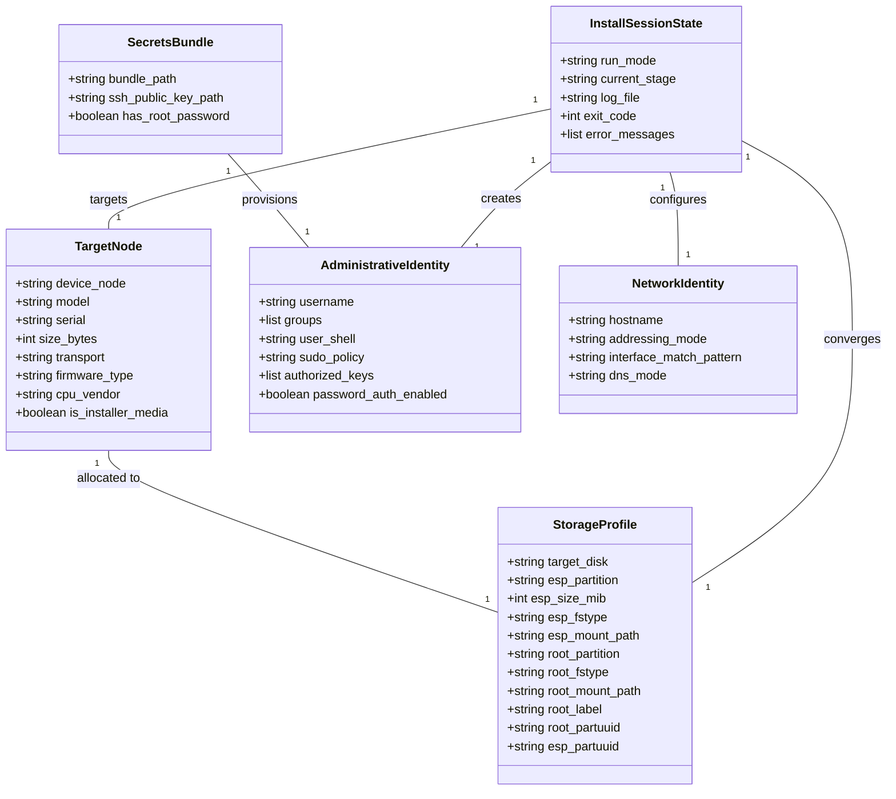
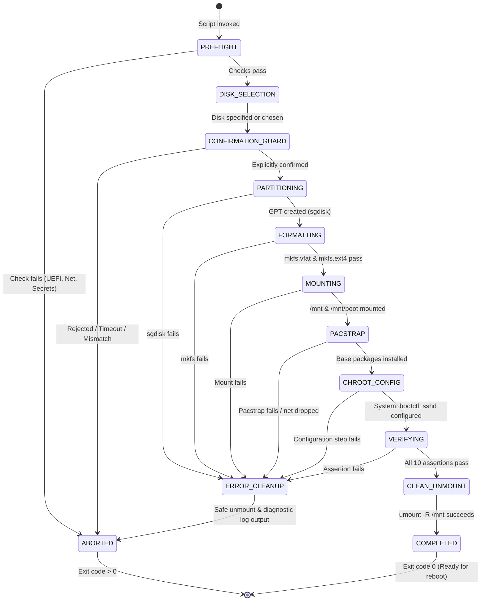

# Data Model: Initial Arch Linux Installation Bootstrap

**Feature Branch**: `001-initial-arch-install`  
**Date**: 2026-10-11  
**Spec Reference**: [`specs/001-initial-arch-install/spec.md`](file:///C:/Users/micro/projects/homelab2/specs/001-initial-arch-install/spec.md)

---

## 1. Entity Overview

The installation bootstrap workflow operates on five core entities and tracks an explicit execution lifecycle state machine:

---

## 2. Entities & Field Definitions

### 2.1 TargetNode
Represents the physical server hardware and the selected storage block device detected by the live environment.

| Field | Type | Required | Description | Validation Rules |
|---|---|---|---|---|
| `device_node` | String | Yes | Canonical path to device node (e.g., `/dev/nvme0n1`, `/dev/sda`) | Must be an active block device (`test -b`); cannot be empty. |
| `model` | String | No | Drive vendor/model string from `lsblk` | Informational display for confirmation guard. |
| `serial` | String | No | Drive serial number | Informational display for confirmation guard. |
| `size_bytes` | Integer | Yes | Disk size in bytes | Must be >= 17,179,869,184 (>= 16 GiB). |
| `transport` | String | No | Bus type (`nvme`, `sata`, `usb`) | Extracted via `lsblk -d -o TRAN`. |
| `firmware_type` | String | Yes | Firmware boot mode | Must be exactly `uefi` (`test -d /sys/firmware/efi`). |
| `cpu_vendor` | String | Yes | Detected CPU vendor (`intel`, `amd`, `unknown`) | Extracted from `/proc/cpuinfo`; determines microcode package. |
| `is_installer_media` | Boolean | Yes | Flag indicating if disk holds the live Arch ISO | Must be `false`. Devices mounted at `/run/archiso/bootmnt` are rejected. |

---

### 2.2 StorageProfile
Represents the target partition layout, filesystem designations, and mount hierarchy.

| Field | Type | Default | Description | Validation Rules |
|---|---|---|---|---|
| `target_disk` | String | None | Block device path (e.g., `/dev/nvme0n1`) | Must equal `TargetNode.device_node`. |
| `esp_partition` | String | Derived | Device node for partition 1 (e.g., `/dev/nvme0n1p1` or `/dev/sda1`) | Automatically derived based on naming convention. |
| `esp_size_mib` | Integer | `1024` | Size of EFI System Partition in MiB | Minimum 512, default 1024. |
| `esp_fstype` | String | `vfat` | Filesystem type for ESP | Must be `vfat` (FAT32, `-F 32`). |
| `esp_mount_path`| String | `/mnt/boot` | Target mount point during installation | Mounted after root partition at `/mnt/boot`. |
| `root_partition`| String | Derived | Device node for partition 2 (e.g., `/dev/nvme0n1p2` or `/dev/sda2`) | Automatically derived based on naming convention. |
| `root_fstype` | String | `ext4` | Filesystem type for root partition | Must be `ext4`. |
| `root_mount_path`| String | `/mnt` | Target mount point during installation | Must be mounted first at `/mnt`. |
| `root_label` | String | `arch_root` | Filesystem volume label | Max 16 characters. |
| `root_partuuid` | String | Derived | GPT PARTUUID for root partition | Extracted post-partitioning via `lsblk -no PARTUUID`. |
| `esp_partuuid` | String | Derived | GPT PARTUUID for ESP partition | Extracted post-partitioning via `lsblk -no PARTUUID`. |

---

### 2.3 AdministrativeIdentity
Represents the unprivileged user account provisioned for initial management, sudo privileges, and public key authentication.

| Field | Type | Default | Description | Validation Rules |
|---|---|---|---|---|
| `username` | String | `admin` | User account login name | Matches `^[a-z_][a-z0-9_-]{1,31}$`. Cannot be `root`. |
| `groups` | List[String] | `["wheel"]` | Supplementary group memberships | Must include `wheel`. |
| `user_shell` | String | `/bin/bash` | Default login shell | Must exist in `/etc/shells`. |
| `sudo_policy` | String | `wheel_nopasswd` | Sudo elevation rule in `/etc/sudoers.d/` | Strictly `wheel_nopasswd` (`%wheel ALL=(ALL:ALL) NOPASSWD: ALL`). Persisted permanently across all phases for frictionless automation (Ansible) and user management. |
| `authorized_keys` | List[String] | None | OpenSSH public key strings | Must contain at least 1 valid OpenSSH key (Ed25519/RSA). |
| `password_auth_enabled` | Boolean | `false` | SSH password authentication flag | MUST be `false` (FR-009). |

---

### 2.4 NetworkIdentity
Defines host network naming and addressing policy for headless first boot.

| Field | Type | Default | Description | Validation Rules |
|---|---|---|---|---|
| `hostname` | String | `homelab` | System host name written to `/etc/hostname` | RFC 1123 format (`^[a-zA-Z0-9]([a-zA-Z0-9\-]{0,61}[a-zA-Z0-9])?$`). |
| `addressing_mode` | String | `dhcp` | IP configuration mode | Must be `dhcp` for base install (FR-005). |
| `interface_match_pattern` | String | `en* eth*` | Systemd network matching wildcard | Configured in `/etc/systemd/network/20-wired.network`. |
| `dns_mode` | String | `systemd-resolved` | Local resolver configuration | Symlink `/etc/resolv.conf` to `/run/systemd/resolve/stub-resolv.conf`. |

---

### 2.5 SecretsBundle
Defines the staging inputs sourced from the live environment.

| Field | Type | Default | Description | Validation Rules |
|---|---|---|---|---|
| `bundle_path` | String | `./secrets` | Path to secrets directory in live session | Must exist and be readable. |
| `ssh_public_key_path` | String | Derived | Path to operator's public SSH key | File must exist and contain at least one valid key line. |
| `has_root_password` | Boolean | `false` | Whether root password is set | Default `false` (root account locked with `passwd -l root`). |

---

## 3. State Machine & Execution Lifecycle

### Stage Details and Invariants

1. **PREFLIGHT**:
   - Invariant: No storage block devices are written to.
   - Guard: Verify UEFI boot (`/sys/firmware/efi`), ping gateway/DNS, check secrets availability.
2. **CONFIRMATION_GUARD**:
   - Invariant: Zero bytes modified on disk until confirmation token matches.
   - Guard: Interactive typed token or explicit `--disk <dev> --confirm-destructive`.
3. **PARTITIONING & FORMATTING**:
   - Invariant: Existing partition tables and signatures are wiped cleanly via `wipefs -a`.
   - Tool: `sgdisk -Z` + `sgdisk -n 1:0:+1024M -t 1:ef00` + `sgdisk -n 2:0:0 -t 2:8304`.
4. **MOUNTING**:
   - Invariant: Root partition mounted at `/mnt`, ESP partition mounted at `/mnt/boot`.
5. **PACSTRAP**:
   - Invariant: Mandatory baseline package set (`base`, `base-devel`, `linux`, `linux-firmware`, microcode, `systemd`, `systemd-sysvcompat`, `openssh`, `sudo`, `python`, `git`) plus optional user packages specified via `EXTRA_PACKAGES` (e.g., `tmux`, `vim`).
6. **CHROOT_CONFIG**:
   - Invariant: Timezone, locale, hostname, `20-wired.network`, `sshd_config`, `admin` user, `authorized_keys`, and `bootctl` installed.
7. **VERIFYING**:
   - Invariant: Strict assertion gate. All 10 health checks must return exit code 0.
8. **CLEAN_UNMOUNT**:
   - Invariant: `umount -R /mnt` executed cleanly before exit.
