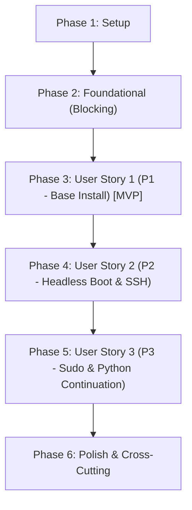

# Tasks: Initial Arch Linux Installation Bootstrap

**Input**: Design documents from [`specs/001-initial-arch-install/`](file:///C:/Users/micro/projects/homelab2/specs/001-initial-arch-install/)  
**Prerequisites**: [`plan.md`](file:///C:/Users/micro/projects/homelab2/specs/001-initial-arch-install/plan.md), [`spec.md`](file:///C:/Users/micro/projects/homelab2/specs/001-initial-arch-install/spec.md), [`research.md`](file:///C:/Users/micro/projects/homelab2/specs/001-initial-arch-install/research.md), [`data-model.md`](file:///C:/Users/micro/projects/homelab2/specs/001-initial-arch-install/data-model.md), [`contracts/`](file:///C:/Users/micro/projects/homelab2/specs/001-initial-arch-install/contracts/)  
**Organization**: Tasks are grouped by user story to enable independent implementation and testing of each story.

## Format: `[ID] [P?] [Story] Description`

- **[P]**: Can run in parallel (different files, no dependencies)
- **[Story]**: Which user story this task belongs to (`[US1]`, `[US2]`, `[US3]`)
- Exact file paths are specified in every task description

---

## Phase 1: Setup (Shared Infrastructure)

**Purpose**: Project initialization, directory structure, configuration templates, and developer tooling.

- [X] T001 Create installer directory structure and script module layout in `scripts/install/` and `scripts/install/lib/`
- [X] T002 [P] Create default configuration profile template with full schema comments in `scripts/install/install.conf.example` per [`contracts/install-config.md`](file:///C:/Users/micro/projects/homelab2/specs/001-initial-arch-install/contracts/install-config.md)
- [X] T003 [P] Configure shellcheck linting configuration and script execution validation in `.shellcheckrc`

---

## Phase 2: Foundational (Blocking Prerequisites)

**Purpose**: Core logging, error handling, pre-flight environment checks, candidate disk detection, and CLI orchestrator framework.

**⚠️ CRITICAL**: No user story work can begin until this phase is complete.

- [X] T004 Implement common logging functions (`log_info`, `log_warn`, `log_error`, `log_success`), color definitions, exit code constants (`0: SUCCESS`, `1: ERR_PREFLIGHT`, `2: ERR_CONFIRMATION_REJECTED`, `3: ERR_DISK_PREP`, `4: ERR_PACSTRAP`, `5: ERR_CHROOT_CONFIG`, `6: ERR_VERIFICATION`, `130: ERR_INTERRUPTED`), and logging sink to `/var/log/homelab-install.log` in `scripts/install/lib/common.sh`
- [X] T005 [P] Implement signal and error trap handlers for `SIGINT` (exit 130) and `ERR`, guaranteeing safe cleanup and unmounting of `/mnt` mounts upon abnormal exit in `scripts/install/lib/common.sh`
- [X] T006 Implement pre-flight environment validators in `scripts/install/lib/preflight.sh` enforcing `TargetNode.firmware_type` constraint "Must be exactly `uefi` (`test -d /sys/firmware/efi`)", verifying active internet connectivity via gateway/DNS ping, checking root UID (0), and validating `SecretsBundle.bundle_path` constraint "Must exist and be readable." (exiting with code 1 `ERR_PREFLIGHT` on failure)
- [X] T007 [P] Implement candidate disk detection and validation in `scripts/install/lib/preflight.sh` inspecting block devices where `TargetNode.device_node` constraint "Must be an active block device (`test -b`); cannot be empty.", `TargetNode.size_bytes` constraint "Must be >= 17,179,869,184 (>= 16 GiB).", `TargetNode.is_installer_media` constraint "Must be `false`. Devices mounted at `/run/archiso/bootmnt` are rejected.", and detecting `TargetNode.cpu_vendor` constraint "Extracted from `/proc/cpuinfo`; determines microcode package." (`intel`, `amd`, `unknown`)
- [X] T008 Implement CLI argument parsing, configuration loading, environment variable overrides, and usage documentation in `scripts/install/install.sh` per [`contracts/installer-cli.md`](file:///C:/Users/micro/projects/homelab2/specs/001-initial-arch-install/contracts/installer-cli.md) and [`contracts/install-config.md`](file:///C:/Users/micro/projects/homelab2/specs/001-initial-arch-install/contracts/install-config.md)

**Checkpoint**: Core framework, pre-flight validators, disk inspection, and CLI option parsing ready — user story implementation can now begin.

---

## Phase 3: User Story 1 - Safe and Automated Base OS Installation from Live Environment (Priority: P1) 🎯 MVP

**Goal**: Provide safe disk inspection, confirmation safety guard, disk wiping, GPT partitioning, filesystem formatting, mount hierarchy setup, pacstrap base OS installation, fstab generation, and clean unmount.

**Independent Test**: Boot an Arch Linux live environment or test VM, execute `./scripts/install/install.sh --disk <device>`, verify declining confirmation exits cleanly with code 2 (`ERR_CONFIRMATION_REJECTED`) with zero disk modifications. Then execute with confirmation, verifying disk partitioning (1 GiB ESP + Ext4 root), filesystem creation, base package bootstrapping, fstab generation, and clean unmount without errors.

### Implementation for User Story 1

- [X] T009 [US1] Implement interactive destructive confirmation safety guard in `scripts/install/lib/disk.sh` displaying target drive model, serial, size, and transport, requiring typing the exact drive basename or honoring `--confirm-destructive` CLI flag, aborting with exit code 2 (`ERR_CONFIRMATION_REJECTED`) on mismatch, where `StorageProfile.target_disk` constraint "Must equal `TargetNode.device_node`."
- [X] T010 [US1] Implement partition wiping and GPT partition table creation in `scripts/install/lib/disk.sh` using `wipefs -a` and `sgdisk`, allocating `StorageProfile.esp_partition` with `StorageProfile.esp_size_mib` constraint "Minimum 512, default 1024." and type code `EF00`, and `StorageProfile.root_partition` occupying 100% remaining space with type code `8304`
- [X] T011 [US1] Implement filesystem formatting and mounting in `scripts/install/lib/disk.sh` formatting ESP where `StorageProfile.esp_fstype` constraint "Must be `vfat` (FAT32, `-F 32`).", formatting root where `StorageProfile.root_fstype` constraint "Must be `ext4`." with `StorageProfile.root_label` constraint "Max 16 characters." (default `arch_root`), mounting root where `StorageProfile.root_mount_path` constraint "Must be mounted first at `/mnt`.", and mounting ESP where `StorageProfile.esp_mount_path` constraint "Mounted after root partition at `/mnt/boot`."
- [X] T012 [P] [US1] Implement mirror ranking and base system bootstrap in `scripts/install/lib/bootstrap.sh` installing mandatory baseline packages (`base`, `base-devel`, `linux`, `linux-firmware`, microcode based on `TargetNode.cpu_vendor`, `systemd`, `systemd-sysvcompat`, `openssh`, `sudo`, `python`, `git`) and optional user packages (`EXTRA_PACKAGES`, e.g., `tmux`, `vim`), failing fast with exit code 4 (`ERR_PACSTRAP`) on package or network failure
- [X] T013 [US1] Implement fstab generation and UUID validation in `scripts/install/lib/bootstrap.sh` using `genfstab -U /mnt > /mnt/etc/fstab` and validating UUID entries exist for `/` and `/boot`
- [X] T014 [US1] Implement clean filesystem unmount procedure in `scripts/install/lib/disk.sh` executing `umount -R /mnt` and verifying no open file handles or busy mounts remain before exit
- [X] T015 [US1] Integrate User Story 1 workflow stages (pre-flight checks, disk inspection, confirmation guard, partition, format, mount, pacstrap, fstab, and safe unmount) into orchestrator in `scripts/install/install.sh`

**Checkpoint**: User Story 1 complete — base operating system filesystems, packages, and fstab can be partitioned and installed safely from the live environment.

---

## Phase 4: User Story 2 - Headless First Boot with Verified Remote Access (Priority: P2)

**Goal**: Configure target system networking (wired DHCP), host identity, timezone, administrative user, authorized SSH public key, secure SSH daemon (password authentication disabled), UEFI `systemd-boot` bootloader, and execute pre-reboot in-chroot verification assertions.

**Independent Test**: Execute post-install configuration inside `arch-chroot`; verify `bootctl is-installed` returns 0; verify network unit `/etc/systemd/network/20-wired.network` and enabled units; verify administrative user exists in `wheel` with `0600` authorized keys; verify sshd drop-in config blocks password authentication; run verification assertion harness in `scripts/install/lib/verify.sh` returning exit code 0.

### Implementation for User Story 2

- [X] T016 [P] [US2] Implement network service configuration in `scripts/install/lib/configure.sh` writing `/mnt/etc/systemd/network/20-wired.network` with `NetworkIdentity.interface_match_pattern` constraint "Configured in `/etc/systemd/network/20-wired.network`" (default `en* eth*`) and `NetworkIdentity.addressing_mode` constraint "Must be `dhcp` for base install (FR-005).", enabling `systemd-networkd.service` and `systemd-resolved.service`, and configuring `NetworkIdentity.dns_mode` constraint "Symlink `/etc/resolv.conf` to `/run/systemd/resolve/stub-resolv.conf`."
- [X] T017 [P] [US2] Implement host identity, timezone, and locale configuration in `scripts/install/lib/configure.sh` writing `NetworkIdentity.hostname` with constraint "RFC 1123 format (`^[a-zA-Z0-9]([a-zA-Z0-9\-]{0,61}[a-zA-Z0-9])?$`)" to `/mnt/etc/hostname`, creating timezone symlink in `/mnt/etc/localtime`, generating locale in `/mnt/etc/locale.gen` and `/mnt/etc/locale.conf`, and writing `/mnt/etc/vconsole.conf`
- [X] T018 [US2] Implement administrative user provisioning and authorized SSH key installation in `scripts/install/lib/configure.sh` validating `SecretsBundle.ssh_public_key_path` constraint "File must exist and contain at least one valid key line.", creating user `AdministrativeIdentity.username` matching constraint "Matches `^[a-z_][a-z0-9_-]{1,31}$`. Cannot be `root`.", adding groups where `AdministrativeIdentity.groups` constraint "Must include `wheel`.", setting shell `AdministrativeIdentity.user_shell` constraint "Must exist in `/etc/shells`." (default `/bin/bash`), locking root password where `SecretsBundle.has_root_password` constraint "Default `false` (root account locked with `passwd -l root`).", and installing SSH public key to `/mnt/home/<username>/.ssh/authorized_keys` with mode `0600`, directory mode `0700`, and `<username>:wheel` ownership where `AdministrativeIdentity.authorized_keys` constraint "Must contain at least 1 valid OpenSSH key (Ed25519/RSA)."
- [X] T019 [P] [US2] Implement SSH daemon security configuration in `scripts/install/lib/configure.sh` writing drop-in config `/mnt/etc/ssh/sshd_config.d/10-homelab.conf` enforcing `AdministrativeIdentity.password_auth_enabled` constraint "MUST be `false` (FR-009)." (`PasswordAuthentication no`, `KbdInteractiveAuthentication no`), disabling root login (`PermitRootLogin no`), enabling `PubkeyAuthentication yes`, and enabling `sshd.service`
- [X] T020 [US2] Implement `systemd-boot` installation and loader configuration in `scripts/install/lib/configure.sh` running `bootctl --path=/boot install` inside `arch-chroot`, writing `/mnt/boot/loader/loader.conf` with `default arch.conf` and `timeout 3`, extracting `StorageProfile.root_partuuid` constraint "Extracted post-partitioning via `lsblk -no PARTUUID`.", and generating `/mnt/boot/loader/entries/arch.conf` with Linux kernel `/vmlinuz-linux`, CPU microcode initrd, `/initramfs-linux.img`, and `options root=PARTUUID=<root_partuuid> rw`
- [X] T021 [US2] Implement in-chroot pre-reboot verification assertion harness in `scripts/install/lib/verify.sh` executing assertions for bootctl installation, kernel/initramfs presence, loader entry PARTUUID match, valid fstab UUIDs, admin user wheel group membership, authorized_keys 0600 permissions, sshd enabled, and systemd-networkd enabled, exiting with code 6 (`ERR_VERIFICATION`) on any assertion failure
- [X] T022 [US2] Integrate User Story 2 configuration and verification stages into orchestrator in `scripts/install/install.sh`

**Checkpoint**: User Stories 1 and 2 complete — system boots headlessly, acquires DHCP address, starts SSH daemon, and authenticates administrative user with authorized keys.

---

## Phase 5: User Story 3 - Execution Continuation Readiness (Priority: P3)

**Goal**: Provision sudo escalation policy, verify Python runtime and administration utilities, and establish handoff readiness for downstream Phase 2 Ansible configuration management.

**Independent Test**: Connect via SSH or chroot into the target system; execute `sudo whoami` to verify privilege escalation without password prompts; execute `python3 --version` to confirm Python 3 runtime is functional; confirm `git --version` executes cleanly.

### Implementation for User Story 3

- [X] T023 [US3] Implement sudo policy configuration in `scripts/install/lib/configure.sh` writing `/mnt/etc/sudoers.d/10-wheel` enforcing `AdministrativeIdentity.sudo_policy` constraint `wheel_nopasswd` (`%wheel ALL=(ALL:ALL) NOPASSWD: ALL`), setting permissions `0440`, and validating syntax with `visudo -cf`
- [X] T024 [US3] Implement runtime dependency and continuation verification checks in `scripts/install/lib/verify.sh` verifying `python3 --version` returns exit code 0, verifying `git --version` returns exit code 0, and validating target host readiness for Phase 2 Ansible handoff
- [X] T025 [US3] Integrate User Story 3 sudo policy and runtime verification checks into orchestrator in `scripts/install/install.sh` and pre-reboot assertion suite

**Checkpoint**: All user stories functional — the target system is fully provisioned, verified, and ready for headless reboot and Phase 2 Ansible execution.

---

## Phase 6: Polish & Cross-Cutting Concerns

**Purpose**: Static analysis, documentation, permission hardening, and end-to-end scenario validation.

- [X] T026 [P] Run shellcheck static analysis across `scripts/install/install.sh` and all library modules in `scripts/install/lib/*.sh`, resolving any warnings or syntax defects
- [X] T027 [P] Create operator guide and documentation in `scripts/install/README.md` documenting live USB prerequisites, CLI usage, configuration schema, and recovery steps
- [X] T028 Validate end-to-end installation scenarios and overarching post-reboot integration verification gate (FR-013) against [`specs/001-initial-arch-install/quickstart.md`](file:///C:/Users/micro/projects/homelab2/specs/001-initial-arch-install/quickstart.md) and set executable permissions on `scripts/install/install.sh`

---

## Dependencies & Execution Order

### Phase Dependencies

- **Setup (Phase 1)**: No dependencies — can start immediately.
- **Foundational (Phase 2)**: Depends on Setup completion — BLOCKS all user stories.
- **User Stories (Phase 3+)**: All depend on Foundational phase completion.
  - Phase 3 (US1 - Base OS Installation): Foundational prerequisite for disk formatting and package installation.
  - Phase 4 (US2 - Headless First Boot & Remote Access): Depends on US1 (requires partitioned/mounted filesystems and pacstrapped base OS).
  - Phase 5 (US3 - Execution Continuation Readiness): Depends on US2 (requires provisioned user and in-chroot environment).
- **Polish (Phase 6)**: Depends on all user stories (Phases 3-5) being complete.

### User Story Dependencies



- **User Story 1 (P1)**: Can start after Phase 2 (Foundational). Delivers MVP base partitioning, formatting, pacstrap, and clean unmount.
- **User Story 2 (P2)**: Builds upon mounted and pacstrapped system from US1. Delivers bootloader, network, administrative user, SSH keys, and pre-reboot verification assertions.
- **User Story 3 (P3)**: Builds upon US2. Configures sudo escalation policies and verifies Python/git runtimes for downstream Ansible handoff.

### Within Each User Story

- Disk safety checks and confirmation before partitioning/formatting.
- Filesystems formatted and mounted before pacstrap.
- Base packages installed before in-chroot configuration (`arch-chroot`).
- In-chroot configuration complete before running verification assertions (`scripts/install/lib/verify.sh`).
- Verification assertions pass before executing clean unmount (`umount -R /mnt`).

### Parallel Opportunities

- Within Phase 1: `T002` (config template) and `T003` (shellcheckrc) can run in parallel with `T001`.
- Within Phase 2: `T005` (cleanup traps) and `T007` (candidate disk detection) can run in parallel with `T006`.
- Within Phase 3 (US1): `T012` (mirror ranking / pacstrap helper) can be authored in parallel with `T010` and `T011`.
- Within Phase 4 (US2): `T016` (networkd config), `T017` (host identity/locale), and `T019` (sshd config) can be implemented in parallel.
- Within Phase 6: `T026` (shellcheck analysis) and `T027` (documentation) can run in parallel.

---

## Parallel Execution Examples

### User Story 1

```bash
# Implement mirror optimization and pacstrap base packages in parallel with disk helpers:
Developer A / Task: "Implement mirror ranking and base system bootstrap in scripts/install/lib/bootstrap.sh" (T012)
Developer B / Task: "Implement partition wiping and GPT partition table creation in scripts/install/lib/disk.sh" (T010)
```

### User Story 2

```bash
# Launch independent in-chroot configuration modules together:
Task: "Implement network service configuration in scripts/install/lib/configure.sh" (T016)
Task: "Implement host identity, timezone, and locale configuration in scripts/install/lib/configure.sh" (T017)
Task: "Implement SSH daemon security configuration in scripts/install/lib/configure.sh" (T019)
```

---

## Implementation Strategy

### MVP First (User Story 1 Only)

1. Complete Phase 1: Setup (`T001` - `T003`)
2. Complete Phase 2: Foundational (`T004` - `T008`)
3. Complete Phase 3: User Story 1 (`T009` - `T015`)
4. **STOP and VALIDATE**: Test User Story 1 in Arch Linux live environment:
   - Run `./scripts/install/install.sh --disk /dev/nvme0n1` and decline prompt → verify exit code 2 and zero disk changes.
   - Run with confirmation → verify partitioning, formatting, pacstrap base packages, fstab generation, and clean unmount.

### Incremental Delivery

1. Complete Setup + Foundational → Core CLI framework and safety pre-flight ready.
2. Add User Story 1 → Safe disk wiping, partitioning, formatting, base OS install (MVP).
3. Add User Story 2 → Systemd-boot bootloader, wired DHCP networkd, admin user, authorized SSH key, and in-chroot verification assertions.
4. Add User Story 3 → Sudo policy configuration, Python runtime verification, and Phase 2 Ansible readiness.
5. Add Phase 6 Polish → Shellcheck linting, operator documentation, and quickstart scenario validation.

---

## Notes

- `[P]` tasks = different files, no dependencies on incomplete tasks.
- `[Story]` label maps task directly to specific user story from [`spec.md`](file:///C:/Users/micro/projects/homelab2/specs/001-initial-arch-install/spec.md) for full traceability.
- Field validation rules from [`data-model.md`](file:///C:/Users/micro/projects/homelab2/specs/001-initial-arch-install/data-model.md) are quoted verbatim in task descriptions.
- Exit codes strictly adhere to [`contracts/installer-cli.md`](file:///C:/Users/micro/projects/homelab2/specs/001-initial-arch-install/contracts/installer-cli.md).
- Commit after each task or logical task grouping.
