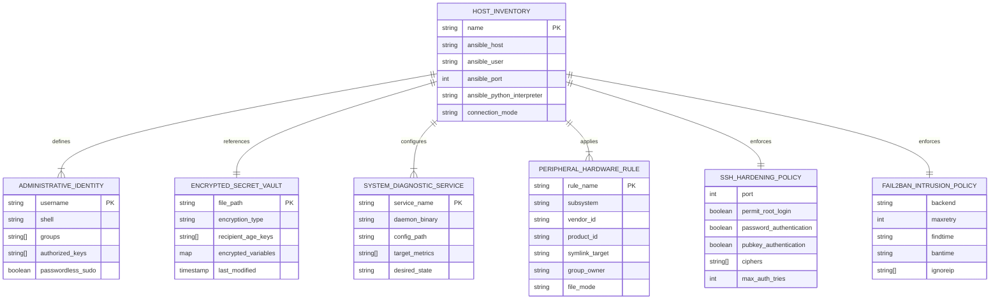

# Data Model: Core Hardening & Configuration Management Foundation

**Feature**: Core Hardening & Configuration Management Foundation  
**Branch**: `002-core-hardening-iac`  
**Date**: 2026-11-01  

This document defines the core logical and configuration entities, their attributes, validation constraints, and lifecycle state transitions for Phase 2 of `homelab2`, targeting production machine `admin@192.168.4.57`.

---

## 1. Entity Overview & Relationships

---

## 2. Entity Specifications

### 2.1 Host Inventory (`HostInventory`)
Represents the managed production node, connection parameters, variable scopes, and target architecture.

- **Attributes**:
  - `name`: string (`homelab2`)
  - `ansible_host`: string (`192.168.4.57`)
  - `ansible_user`: string (`admin`)
  - `ansible_port`: integer (`22`)
  - `ansible_python_interpreter`: string (`/usr/bin/python3`)
  - `connection_mode`: enum (`ssh`, `local`)
  - `group_memberships`: list of strings (`[homelab_nodes, arch_linux]`)
- **Validation Rules**:
  - `ansible_host` must be reachable over SSH.
  - Target host must run Python 3.10+ (target has 3.14.9).
  - Target host must have passwordless `sudo` privileges configured for `ansible_user`.
- **Lifecycle States**:
  - `Bootstrapped` -> `Reachable` -> `Hardening Applied` -> `Converged & Verified`.

---

### 2.2 Encrypted Secret Vault (`EncryptedSecretVault`)
Represents sensitive operational parameters (tokens, credentials, passphrases) encrypted at rest using asymmetric public key cryptography via SOPS.

- **Attributes**:
  - `file_path`: string (`ansible/inventory/group_vars/all/vault.sops.yml`)
  - `format`: enum (`yaml`, `json`)
  - `sops_metadata`:
    - `age_recipients`: list of age public keys (`age1...`)
    - `last_modified`: ISO8601 timestamp
    - `version`: string (SOPS version)
    - `mac`: string (cryptographic message authentication code)
  - `payload`: dictionary of key-value pairs (ciphertext at rest, plaintext in memory during playbook execution)
- **Validation Rules**:
  - Unencrypted files matching `*.sops.yml` MUST NEVER be committed to git.
  - Secret payloads must pass MAC integrity checks upon decryption.

---

### 2.3 Administrative Identity (`AdministrativeIdentity`)
Represents the operator account authorized to administer the host.

- **Attributes**:
  - `username`: string (`admin`)
  - `shell`: string (`/bin/bash`)
  - `groups`: list of strings (`[wheel, uucp, input, video]`)
  - `authorized_keys`: list of OpenSSH public key strings
  - `passwordless_sudo`: boolean (`true`)
- **Validation Rules**:
  - `wheel` group drop-in MUST be verified with `/usr/sbin/visudo -cf %s` before application.
  - File permissions for `/etc/sudoers.d/*` drop-ins MUST be `0440`.
  - Operator's existing public key MUST remain in `authorized_keys`.

---

### 2.4 SSH Hardening & Intrusion Prevention (`SshHardeningPolicy` & `Fail2banPolicy`)
Represents OpenSSH daemon drop-in settings and fail2ban intrusion detection rules.

- **Attributes (SSH)**:
  - `config_path`: `/etc/ssh/sshd_config.d/10-hardening.conf`
  - `port`: integer (`22`)
  - `permit_root_login`: boolean (`false`)
  - `password_authentication`: boolean (`false`)
  - `pubkey_authentication`: boolean (`true`)
  - `ciphers`: list (`[chacha20-poly1305@openssh.com, aes256-gcm@openssh.com, aes128-gcm@openssh.com]`)
- **Attributes (Fail2ban)**:
  - `config_path`: `/etc/fail2ban/jail.local`
  - `backend`: string (`systemd`)
  - `maxretry`: integer (`3`)
  - `findtime`: string (`10m`)
  - `bantime`: string (`1h`)
  - `ignoreip`: list of CIDRs (`['127.0.0.1/8', '192.168.4.0/24']`)
- **Validation Rules**:
  - OpenSSH configuration drop-in MUST pass `/usr/bin/sshd -t -f %s` syntax check before reload.
  - Subnet `192.168.4.0/24` MUST be included in `ignoreip` to prevent operator lockout.

---

### 2.5 System Diagnostic Services (`SystemDiagnosticService`)
Represents background services for time synchronization, disk health, memory pressure, and logging.

| Service Name | Package | Config Path | Systemd Unit | Validation Command |
|---|---|---|---|---|
| `chrony` | `chrony` | `/etc/chrony.conf` | `chronyd.service` | `chronyc tracking` |
| `smartmontools` | `smartmontools` | `/etc/smartd.conf` | `smartd.service` | `systemctl is-active smartd` |
| `systemd-oomd` | `systemd` | `/etc/systemd/oomd.conf` | `systemd-oomd.service` | `oomctl` |
| `journald` | `systemd` | `/etc/systemd/journald.conf.d/00-retention.conf` | `systemd-journald.service` | `journalctl --disk-usage` |

---

### 2.6 Peripheral Hardware Rules (`PeripheralHardwareRule`)
Represents persistent device symlinks and access permissions managed via udev.

- **Attributes**:
  - `config_path`: `/etc/udev/rules.d/99-homelab-peripherals.rules`
  - Target rules:
    - Z-Wave USB Stick (`SUBSYSTEM=="tty"`, symlink `/dev/zwave`, group `uucp`, mode `0660`)
    - Google Coral TPU (`SUBSYSTEM=="usb"`, group `uucp`, mode `0660`)
    - Uinput (`KERNEL=="uinput"`, group `input`, mode `0660`)
- **Validation Rules**:
  - Rules file MUST be syntactically valid and reload cleanly with `udevadm control --reload-rules && udevadm trigger`.
  - Non-presence of physical hardware dongles MUST NOT fail execution.
