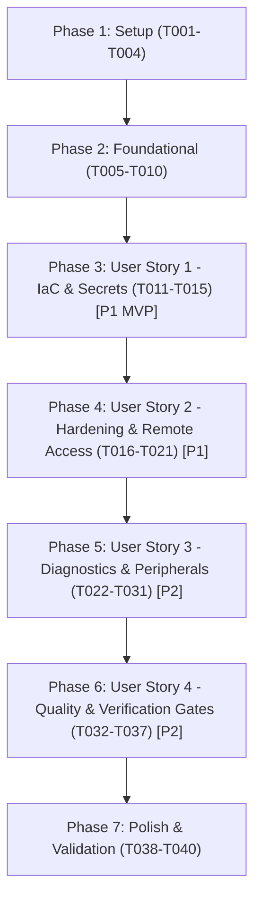

# Tasks: Core Hardening & Configuration Management Foundation

**Input**: Design documents from [`specs/002-core-hardening-iac/`](file:///C:/Users/micro/projects/homelab2/specs/002-core-hardening-iac/)
- **Plan**: [`plan.md`](file:///C:/Users/micro/projects/homelab2/specs/002-core-hardening-iac/plan.md)
- **Specification**: [`spec.md`](file:///C:/Users/micro/projects/homelab2/specs/002-core-hardening-iac/spec.md)
- **Data Model**: [`data-model.md`](file:///C:/Users/micro/projects/homelab2/specs/002-core-hardening-iac/data-model.md)
- **Contracts**: [`contracts/`](file:///C:/Users/micro/projects/homelab2/specs/002-core-hardening-iac/contracts/)
- **Research**: [`research.md`](file:///C:/Users/micro/projects/homelab2/specs/002-core-hardening-iac/research.md)
- **Quickstart**: [`quickstart.md`](file:///C:/Users/micro/projects/homelab2/specs/002-core-hardening-iac/quickstart.md)

---

## Format: `- [ ] [ID] [P?] [Story?] Description with file path`

- **[P]**: Can run in parallel (different files, no dependencies)
- **[Story]**: Which user story this task belongs to ([US1], [US2], [US3], [US4])
- Exact file paths included in all descriptions

---

## Phase 1: Setup (Shared Infrastructure)

**Purpose**: Initialize Ansible framework, directory structure, requirements, and linting configurations.

- [X] T001 Initialize Ansible directory tree (`inventory/`, `roles/`, `playbooks/`, `scripts/`) per implementation plan in `ansible/`
- [X] T002 Configure base Ansible settings (`pipelining = True`, `stdout_callback = yaml`, `become = True`) in `ansible/ansible.cfg`
- [X] T003 [P] Declare external Ansible collection requirements (`community.sops`) in `ansible/requirements.yml`
- [X] T004 [P] Configure Ansible linting rules and exclude paths in `.ansible-lint`

---

## Phase 2: Foundational (Blocking Prerequisites)

**Purpose**: Core inventory definitions, variable scoping, and SOPS age key infrastructure that MUST be completed before ANY user story playbooks can execute.

**⚠️ CRITICAL**: No user story work can begin until this phase is complete.

- [X] T005 Define target host inventory, connection parameters (`ansible_host: 192.168.4.57`, `ansible_user: admin`, `ansible_python_interpreter: /usr/bin/python3`, `group_memberships: [homelab_nodes, arch_linux]`) in `ansible/inventory/hosts.yml`
- [X] T006 [P] Configure SOPS file encryption creation rules matching `path_regex: .*\.sops\.ya?ml$` with age recipient in `.sops.yaml`
- [X] T007 [P] Define global non-sensitive variables and hardware defaults (`fail2ban_ignoreip: ['127.0.0.1/8', '192.168.4.0/24']`) in `ansible/inventory/group_vars/all/vars.yml`
- [X] T008 [P] Setup encrypted secrets vault template structure with dummy/development age-encrypted payload (`vault_admin_username: admin`, `vault_admin_authorized_keys`) in `ansible/inventory/group_vars/all/vault.sops.yml`
- [X] T009 Implement cross-platform PowerShell runner `scripts/apply-phase2.ps1` for Windows workstation orchestration to push and execute playbooks against `admin@192.168.4.57`
- [X] T010 [P] Implement cross-platform POSIX runner `scripts/apply-phase2.sh` for Linux/macOS orchestration to push and execute playbooks against `admin@192.168.4.57`

**Checkpoint**: Foundation ready - Ansible inventory, SOPS encryption pipeline, and orchestrator scripts established; user stories can begin.

---

## Phase 3: User Story 1 - Declarative Configuration Management & Secrets Pipeline (Priority: P1) 🎯 MVP

**Goal**: Establish the base configuration management playbook and common utility role with SOPS/age secret loading, verifying strict idempotency and zero cleartext secrets.

**Independent Test**: Execute `ansible-playbook -i inventory/hosts.yml playbooks/site.yml` against `admin@192.168.4.57`; verify all common packages install cleanly and secrets load in memory. Re-running the playbook reports `changed=0` (clean no-op). Verifying without age key halts execution with clear diagnostic error.

### Implementation for User Story 1

- [X] T011 [US1] Create pre-run validation tasks in `ansible/playbooks/site.yml` to verify `SOPS_AGE_KEY_FILE` existence and abort with diagnostic error if key is missing
- [X] T012 [P] [US1] Create common packages task list deploying core administration tools (`vim`, `tmux`, `htop`, `git`, `curl`, `jq`) in `ansible/roles/common_packages/tasks/main.yml`
- [X] T013 [US1] Implement secret vault ingestion task using `community.sops.load_vars` in `ansible/playbooks/site.yml`
- [X] T014 [US1] Wire `common_packages` role into main orchestration playbook in `ansible/playbooks/site.yml`
- [X] T015 [US1] Validate idempotency of base site playbook ensuring second execution yields `changed=0` in `ansible/playbooks/site.yml`

**Checkpoint**: User Story 1 functional - Ansible runs, decrypts secrets, deploys common packages, and converges idempotently.

---

## Phase 4: User Story 2 - Host Hardening & Secure Remote Access Control (Priority: P1)

**Goal**: Harden remote SSH access against password brute forcing and unauthorized root logins, deploy fail2ban rate limiting with local subnet whitelist, and configure passwordless wheel sudoers for non-interactive automation.

**Independent Test**: Connect via SSH with password and verify rejection (`Permission denied (publickey)`); connect with authorized key and verify login in < 3s; execute `sudo -n true` and verify exit code 0 without password prompt; confirm fail2ban ignores `192.168.4.0/24`.

### Implementation for User Story 2

- [X] T016 [P] [US2] Create sudoers wheel drop-in template `ansible/roles/admin_user/templates/sudoers_wheel.j2` containing verbatim `%wheel ALL=(ALL:ALL) NOPASSWD: ALL`
- [X] T017 [US2] Implement admin user management tasks in `ansible/roles/admin_user/tasks/main.yml` enforcing groups (`wheel`, `uucp`, `input`, `video`), authorized SSH public keys, and deploying sudoers drop-in with `validate: '/usr/sbin/visudo -cf %s'` and mode `0440`
- [X] T018 [P] [US2] Create OpenSSH hardening drop-in template `ansible/roles/ssh_hardening/templates/sshd_hardening.conf.j2` enforcing verbatim `PasswordAuthentication no`, `PermitRootLogin no`, `PubkeyAuthentication yes`, `KbdInteractiveAuthentication no`, `MaxAuthTries 3`, and ciphers `chacha20-poly1305@openssh.com,aes256-gcm@openssh.com,aes128-gcm@openssh.com`
- [X] T019 [P] [US2] Create fail2ban jail configuration template `ansible/roles/ssh_hardening/templates/jail.local.j2` configuring sshd jail with verbatim `backend = systemd`, `maxretry = 3`, `findtime = 10m`, `bantime = 1h`, and `ignoreip = 127.0.0.1/8 192.168.4.0/24`
- [X] T020 [US2] Implement SSH hardening and intrusion prevention tasks in `ansible/roles/ssh_hardening/tasks/main.yml` deploying config drop-in to `/etc/ssh/sshd_config.d/10-hardening.conf` with `validate: '/usr/bin/sshd -t -f %s'`, enabling `fail2ban.service`, and reloading `sshd.service`
- [X] T021 [US2] Create standalone hardening playbook in `ansible/playbooks/harden.yml` and import `admin_user` and `ssh_hardening` roles into `ansible/playbooks/site.yml`

**Checkpoint**: User Stories 1 AND 2 complete - Host is hardened, password logins disabled, fail2ban active with subnet safety, and passwordless sudo operational for automation.

---

## Phase 5: User Story 3 - Core Diagnostics, Health Daemons & Device Symlinks (Priority: P2)

**Goal**: Configure and activate continuous system health daemons (`chronyd` time sync, `smartd` drive monitoring, `systemd-oomd` memory safeguards, bounded `journald` logs) and persistent `udev` device rules for smart home and AI peripherals.

**Independent Test**: Verify `systemctl is-active` returns active for `chronyd`, `smartd`, `systemd-oomd`, and `systemd-journald`; verify `chronyc tracking` shows synchronization (offset < 50ms); verify `/etc/udev/rules.d/99-homelab-peripherals.rules` is syntactically valid and non-blocking if hardware is unplugged.

### Implementation for User Story 3

- [X] T022 [P] [US3] Create Chrony configuration template in `ansible/roles/time_sync/templates/chrony.conf.j2` configuring verbatim upstream pools `2.arch.pool.ntp.org iburst` and `rtcsync`
- [X] T023 [US3] Implement time synchronization tasks in `ansible/roles/time_sync/tasks/main.yml` deploying `/etc/chrony.conf` and enabling `chronyd.service`
- [X] T024 [P] [US3] Create smartd configuration template in `ansible/roles/disk_health/templates/smartd.conf.j2` configuring verbatim `DEVICESCAN -a -o on -S on -s (S/../.././02|L/../../6/03) -H -C 197+ -U 198+ -W 4,45,55`
- [X] T025 [US3] Implement drive diagnostics tasks in `ansible/roles/disk_health/tasks/main.yml` installing `smartmontools`, deploying `/etc/smartd.conf`, and enabling `smartd.service`
- [X] T026 [P] [US3] Create systemd-oomd configuration template in `ansible/roles/system_safeguards/templates/oomd.conf.j2` with verbatim `SwapUsedLimit=90%` and `DefaultMemoryPressureLimit=80%`
- [X] T027 [P] [US3] Create systemd-journald retention template in `ansible/roles/system_safeguards/templates/journald.conf.j2` with verbatim `Storage=persistent` and quota `SystemMaxUse=2G`
- [X] T028 [US3] Implement system safeguards tasks in `ansible/roles/system_safeguards/tasks/main.yml` deploying configs to `/etc/systemd/oomd.conf` and `/etc/systemd/journald.conf.d/00-retention.conf`, enabling `systemd-oomd.service`, and restarting `systemd-journald.service`
- [X] T029 [P] [US3] Create udev peripherals rule template in `ansible/roles/udev_rules/templates/99-homelab-peripherals.rules.j2` mapping Z-Wave controller (`MODE="0660"`, `GROUP="uucp"`, symlink `/dev/zwave`), Google Coral TPU (`MODE="0660"`, `GROUP="uucp"`), and `/dev/uinput` (`MODE="0660"`, `GROUP="input"`)
- [X] T030 [US3] Implement udev peripheral tasks in `ansible/roles/udev_rules/tasks/main.yml` deploying `/etc/udev/rules.d/99-homelab-peripherals.rules` and reloading udev rules via `udevadm control --reload-rules && udevadm trigger`
- [X] T031 [US3] Wire `time_sync`, `disk_health`, `system_safeguards`, and `udev_rules` roles into main convergence playbook in `ansible/playbooks/site.yml`

**Checkpoint**: User Stories 1, 2, and 3 complete - Core system telemetry, drive diagnostics, memory safety, and device symlinks are active and idempotent.

---

## Phase 6: User Story 4 - Phase 2 Quality, Backup & Telemetry Gates (Priority: P2)

**Goal**: Implement and run the automated verification suite, health check assertions, linting validation, and out-of-band age master key backup documentation to fulfill Constitution Phase 2 quality gates.

**Independent Test**: Run `scripts/verify-phase2.sh` and `ansible-playbook -i inventory/hosts.yml playbooks/verify.yml`; both complete with exit code 0 passing all 10 checks in `contracts/verification-suite.md`.

### Implementation for User Story 4

- [X] T032 [P] [US4] Create automated Phase 2 health assertion playbook in `ansible/playbooks/verify.yml` querying active status of `sshd`, `chronyd`, `smartd`, `systemd-oomd`, journal disk usage, and non-interactive `sudo -n true`
- [X] T033 [P] [US4] Implement standalone verification runner script in `scripts/verify-phase2.sh` executing all 10 test checks defined in `specs/002-core-hardening-iac/contracts/verification-suite.md`
- [X] T034 [US4] Make `scripts/verify-phase2.sh` executable and add pre-execution flag parsing (`--host`, `--user`, `--identity`, `--skip-rate-limit-test`) in `scripts/verify-phase2.sh`
- [X] T035 [P] [US4] Create out-of-band master age key disaster recovery documentation in `docs/recovery/age-key-backup.md` detailing key generation, encrypted paper/cold backup procedures, and restore verification
- [X] T036 [US4] Validate linting and syntax compliance across all playbooks and roles using `ansible-lint` and `ansible-playbook --syntax-check playbooks/site.yml`
- [X] T037 [US4] Execute full acceptance verification suite via `scripts/verify-phase2.sh --host 192.168.4.57 --user admin` asserting 100% pass rate

**Checkpoint**: User Story 4 complete - Quality, backup, and health telemetry gates are automated and passing.

---

## Phase 7: Polish & Cross-Cutting Concerns

**Purpose**: Final repository hygiene, documentation synchronization, git ignore safety rules, and end-to-end quickstart scenario run.

- [X] T038 [P] Update `.gitignore` to strictly ignore unencrypted secrets, age private key files (`*.key`, `keys.txt`), and `.ansible/` cache directories in `.gitignore`
- [X] T039 Update top-level `ROADMAP.md` and `docs/roadmap.md` to reflect Phase 2 completion status
- [X] T040 Run complete validation walkthrough following scenarios in `specs/002-core-hardening-iac/quickstart.md`

---

## Dependencies & Execution Order

### Phase Dependencies



### User Story Dependencies

- **User Story 1 (P1)**: Starts immediately after Phase 2 (Foundational). Delivers the core Ansible execution and SOPS secret decryption foundation.
- **User Story 2 (P1)**: Starts after US1. Builds upon the inventory and playbook structure to deploy SSH hardening and sudoers escalation.
- **User Story 3 (P2)**: Starts after US2. Deploys system services (`chronyd`, `smartd`, `systemd-oomd`, `journald`, `udev`).
- **User Story 4 (P2)**: Validates US1, US2, and US3 against the 10-point assertion matrix and Constitution quality gates.

---

## Parallel Opportunities

### Phase 1 & 2 Setup & Foundation:
```bash
# Parallel setup & foundational tasks:
T003 Declare requirements in ansible/requirements.yml
T004 Configure linting in .ansible-lint
T006 Configure SOPS rules in .sops.yaml
T007 Define global vars in ansible/inventory/group_vars/all/vars.yml
T008 Setup vault structure in ansible/inventory/group_vars/all/vault.sops.yml
T010 Implement POSIX runner in scripts/apply-phase2.sh
```

### User Story 2:
```bash
# Templates can be authored in parallel:
T016 Create sudoers template in ansible/roles/admin_user/templates/sudoers_wheel.j2
T018 Create sshd drop-in template in ansible/roles/ssh_hardening/templates/sshd_hardening.conf.j2
T019 Create fail2ban jail template in ansible/roles/ssh_hardening/templates/jail.local.j2
```

### User Story 3:
```bash
# Service templates can be authored in parallel:
T022 Create Chrony template in ansible/roles/time_sync/templates/chrony.conf.j2
T024 Create smartd template in ansible/roles/disk_health/templates/smartd.conf.j2
T026 Create oomd template in ansible/roles/system_safeguards/templates/oomd.conf.j2
T027 Create journald template in ansible/roles/system_safeguards/templates/journald.conf.j2
T029 Create udev template in ansible/roles/udev_rules/templates/99-homelab-peripherals.rules.j2
```

### User Story 4:
```bash
# Verification assets can be authored in parallel:
T032 Create verification playbook in ansible/playbooks/verify.yml
T033 Create verification script in scripts/verify-phase2.sh
T035 Create disaster recovery documentation in docs/recovery/age-key-backup.md
```

---

## Implementation Strategy

### MVP First (Phase 1, 2, and User Story 1)
1. Complete Setup (`T001-T004`) and Foundational (`T005-T010`).
2. Implement User Story 1 (`T011-T015`).
3. **Validate MVP**: Run `ansible-playbook -i inventory/hosts.yml playbooks/site.yml` (or `apply-phase2.ps1` / `apply-phase2.sh`). Confirm successful SOPS secret decryption, package installation, and 0 changes on second run.

### Incremental Delivery
1. **Increment 1 (MVP)**: IaC & Secrets Pipeline operational (`US1`).
2. **Increment 2**: SSH Hardening & non-interactive wheel sudoers operational (`US2`).
3. **Increment 3**: System diagnostics, drive health, memory guards, and udev rules operational (`US3`).
4. **Increment 4**: Verification suite & Constitution quality gates confirmed passing (`US4`).
5. **Increment 5**: Final polish, `.gitignore` safety, and roadmap status updated.
