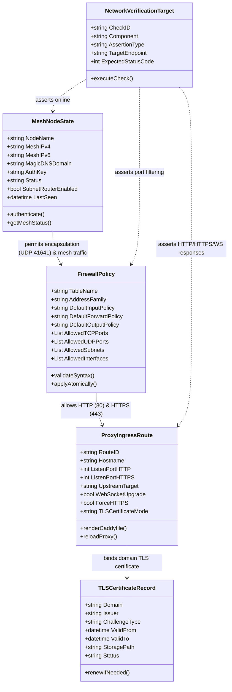
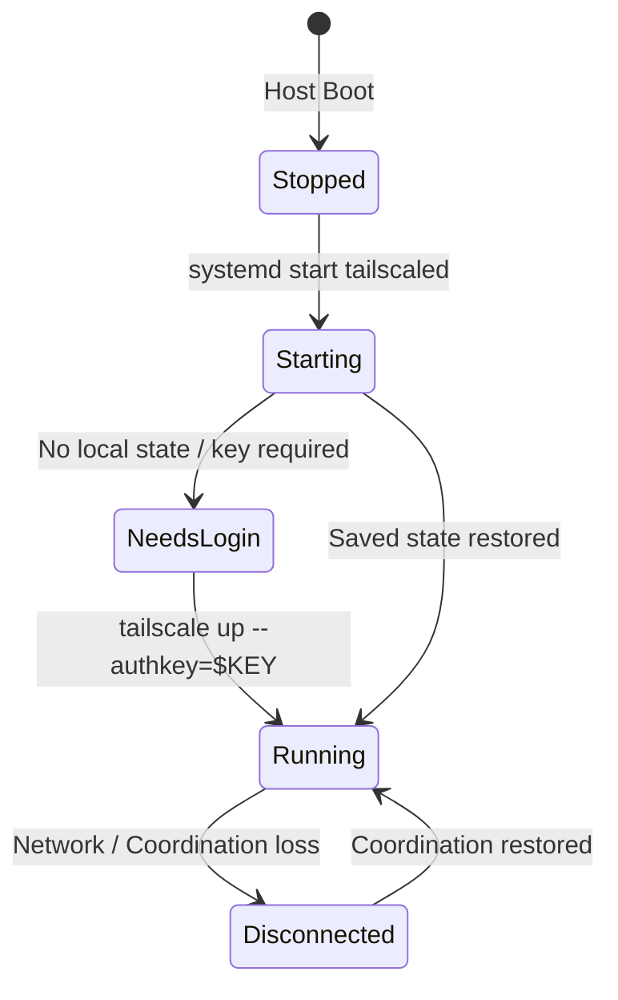

# Data Model: Network & Remote Access Overlay (Phase 3)

**Feature**: `003-network-remote-access`  
**Date**: 2026-11-01  
**Status**: Completed  

---

## 1. Overview

This document formalizes the entities, configuration schemas, state lifecycles, and validation rules governing the Phase 3 Network and Remote Access architecture, encompassing the Tailscale mesh node, nftables firewall policy, Caddy ingress reverse proxy, and automated verification targets.

---

## 2. Logical Data Model Diagram

---

## 3. Entity Definitions

### 3.1 MeshNodeState

Represents the host machine's identity and connection state within the encrypted Tailscale overlay network.

| Field | Type | Required | Description | Validation / Constraints |
|---|---|---|---|---|
| `NodeName` | String | Yes | Name of the node in the Tailnet | Alphanumeric, e.g. `homelab2` |
| `MeshIPv4` | IPv4Address | Yes | Carrier-grade NAT address in CGNAT range | `100.64.0.0/10` address allocated by Tailscale |
| `MeshIPv6` | IPv6Address | Yes | Unique Local Address allocated by Tailscale | `fd7a:115c:a1e0::/48` range |
| `MagicDNSDomain` | FQDN | Yes | Full domain within Tailnet | `*.ts.net` domain format |
| `AuthKey` | SecretString | Yes (initial) | Pre-authenticated or reusable registration key | Sourced from `vault.sops.yml` (`ts_auth_key`) |
| `Status` | Enum | Yes | Current daemon state | `NeedsLogin`, `LoggedOut`, `Running`, `Starting` |
| `SubnetRouterEnabled` | Boolean | No | Whether host advertises local LAN routes | Default: `false` |
| `LastSeen` | DateTime | Yes | Last heartbeat timestamp | ISO-8601 UTC |

#### State Lifecycle

---

### 3.2 FirewallPolicy

Defines the declarative packet filtering rules enforced by the Linux kernel via `nftables`.

| Field | Type | Required | Description | Validation / Constraints |
|---|---|---|---|---|
| `TableName` | String | Yes | Name of the nftables table | Default: `filter` |
| `AddressFamily` | Enum | Yes | Address family for unified filtering | Must be `inet` (dual-stack IPv4/IPv6) |
| `DefaultInputPolicy` | Enum | Yes | Policy for inbound packets | Must be `drop` |
| `DefaultForwardPolicy`| Enum | Yes | Policy for forwarded packets | Must be `drop` |
| `DefaultOutputPolicy` | Enum | Yes | Policy for outbound packets | Must be `accept` |
| `AllowedTCPPorts` | List[Integer] | Yes | Ports accepted on designated interfaces | `22` (SSH), `80` (HTTP), `443` (HTTPS) |
| `AllowedUDPPorts` | List[Integer] | Yes | Ports accepted on physical interfaces | `41641` (Tailscale encapsulation) |
| `AllowedSubnets` | List[CIDR] | Yes | Trusted subnets for administrative access | `192.168.4.0/24` (management LAN) |
| `AllowedInterfaces` | List[String] | Yes | Trusted network interfaces | `lo` (loopback), `tailscale0` (mesh interface) |

#### Validation Rules
1. `DefaultInputPolicy` MUST be `drop`.
2. Return traffic matching `ct state { established, related }` MUST be accepted before port evaluation.
3. Syntax check `nft -c -f <config>` MUST return exit code 0 before atomic reload.

---

### 3.3 ProxyIngressRoute

Defines an ingress routing stanza terminating TLS and proxying requests to local backend services.

| Field | Type | Required | Description | Validation / Constraints |
|---|---|---|---|---|
| `RouteID` | String | Yes | Unique identifier for the route drop-in | E.g. `00-health`, `01-placeholder` |
| `Hostname` | FQDN / String | Yes | Target domain or virtual host match | E.g. `homelab.internal`, `*.ts.net`, `:80` |
| `ListenPortHTTP` | Integer | Yes | Standard cleartext ingress port | Must be `80` |
| `ListenPortHTTPS` | Integer | Yes | Standard encrypted ingress port | Must be `443` |
| `UpstreamTarget` | URI / String | No | Target internal service or static responder | Socket, IP:port, or internal responder |
| `WebSocketUpgrade` | Boolean | Yes | Enable bidirectional WebSocket tunnel | Default: `true` |
| `ForceHTTPS` | Boolean | Yes | Enforce automatic HTTP -> HTTPS redirection | Default: `true` |
| `TLSCertificateMode` | Enum | Yes | TLS certificate generation mechanism | `internal`, `tailscale`, `acme_dns`, `acme_http` |

---

### 3.4 TLSCertificateRecord

Tracks certificate lifecycle, issuance authority, and automated renewal state managed by Caddy.

| Field | Type | Required | Description | Validation / Constraints |
|---|---|---|---|---|
| `Domain` | FQDN | Yes | Subject Alternative Name on certificate | Valid DNS FQDN |
| `Issuer` | String | Yes | ACME CA or local certificate generator | Let's Encrypt, ZeroSSL, or Tailscale CA |
| `ChallengeType` | Enum | Yes | Method used for ACME challenge | `dns-01`, `http-01`, `tailscale` |
| `ValidFrom` | DateTime | Yes | Start of certificate validity | ISO-8601 UTC |
| `ValidTo` | DateTime | Yes | Expiration timestamp | ISO-8601 UTC (typically 90 days) |
| `StoragePath` | FilePath | Yes | Local path to cached certificates & keys | `/var/lib/caddy/.local/share/caddy/` |
| `Status` | Enum | Yes | Current health of certificate | `Valid`, `Renewing`, `Expired`, `Revoked` |

---

### 3.5 NetworkVerificationTarget

Represents an individual acceptance assertion in the Phase 3 verification suite.

| Field | Type | Required | Description | Validation / Constraints |
|---|---|---|---|---|
| `CheckID` | String | Yes | Unique test identifier | E.g. `NET-01` to `NET-08` |
| `Component` | Enum | Yes | Target subsystem under test | `nftables`, `tailscale`, `caddy`, `tls` |
| `AssertionType` | Enum | Yes | Method of verification | `systemd_active`, `cli_status`, `http_probe`, `port_probe` |
| `TargetEndpoint` | String | Yes | Command, IP, port, or URI to probe | E.g. `http://127.0.0.1:80/health` |
| `ExpectedStatusCode` | Integer / String | Yes | Expected exit code, HTTP status, or string | E.g. `200`, `301`, `0`, `active` |
