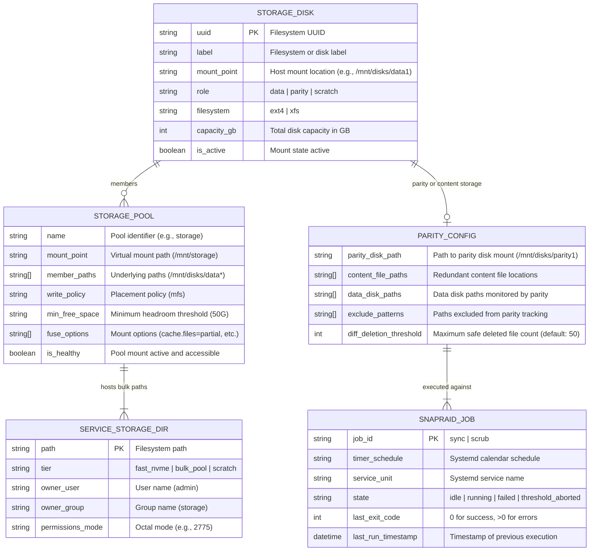

# Phase 1 Data Model: Storage Pooling & Data Resiliency Layer

**Feature**: `specs/004-storage-pooling-resiliency`  
**Date**: 2026-11-01  
**Status**: Draft  

---

## 1. Logical Entities & Schema



---

## 2. Entity Details & Validation Rules

### 2.1 StorageDisk
Represents an individual physical partition or disk attached to the host.
- **Fields**:
  - `uuid` (string, required): Stable UUID assigned by `mkfs`. Must be non-empty and formatted as standard 128-bit hex string.
  - `mount_point` (string, required): Canonical absolute mount path (e.g., `/mnt/disks/data1`, `/mnt/disks/parity1`).
  - `role` (enum, required): One of `data`, `parity`, `scratch`.
  - `filesystem` (string, required): Supported native Linux filesystem (`ext4` or `xfs`).
  - `is_active` (boolean): `true` when currently mounted in `/proc/mounts`.
- **Validation Rules**:
  - Parity disk capacity must be $\ge$ the capacity of the largest data disk.
  - Mount entries must specify `nofail` and `x-systemd.device-timeout=10s` to prevent headless boot stalls.

### 2.2 StoragePool
Represents the virtual aggregated filesystem created by MergerFS.
- **Fields**:
  - `name` (string): Identifies the pool (e.g., `storage_pool`).
  - `mount_point` (string): Standardized to `/mnt/storage`.
  - `member_paths` (list of strings): Globbed paths matching data disks (e.g., `/mnt/disks/data*`). Parity and scratch disks are strictly excluded.
  - `write_policy` (string): Defaults to `mfs` (most free space).
  - `min_free_space` (string): Minimum reserve (e.g., `50G`).
  - `fuse_options` (list of strings): Standard options including `cache.files=partial`, `dropcacheonclose=true`, `atomic_rename=true`.
- **Validation Rules**:
  - Pool mount must declare systemd dependency `x-systemd.requires-mounts-for` for all member paths.
  - FUSE device `/dev/fuse` must exist and be accessible.

### 2.3 ParityConfig
Defines the parameters written to `/etc/snapraid.conf`.
- **Fields**:
  - `parity_disk_path`: Absolute path to parity mount (e.g., `/mnt/disks/parity1/snapraid.parity`).
  - `content_file_paths`: Array of content file targets:
    - 1 on OS drive: `/var/snapraid.content`
    - 1 on each data drive: `/mnt/disks/data*/snapraid.content`
  - `exclude_patterns`: Array of patterns excluded from parity calculation:
    - `/mnt/scratch/**`
    - `*.tmp`, `*.part`, `*Thumbs.db`, `.DS_Store`, `.Trash-*`
  - `diff_deletion_threshold`: Integer threshold (default: `50`).
- **Validation Rules**:
  - Must have at least 2 distinct content files across separate physical disks.
  - No data disk path may overlap with the parity disk path or scratch path.

### 2.4 SnapRaidJob
Represents the lifecycle of automated parity sync and scrub tasks.
- **State Transitions**:
  ```mermaid
  stateDiagram-v2
      [*] --> Idle
      Idle --> Running : Systemd Timer Trigger
      Running --> ThresholdAborted : Deletions > Threshold
      Running --> Failed : SnapRAID Exit != 0
      Running --> Idle : SnapRAID Exit == 0
      ThresholdAborted --> Idle : Admin Inspects & Overrides
      Failed --> Idle : Admin Resolves Disk/File Issue
  ```
- **Validation Rules**:
  - `sync` timer runs daily at 03:00.
  - `scrub` timer runs weekly on Sunday at 04:00.
  - Any exit code other than 0 must produce an alert entry in `systemd-journald`.

### 2.5 ServiceStorageDirectory
Represents top-level storage directories consumed by applications.
- **Fields**:
  - `/opt/services`: Fast NVMe tier (`0755 admin:storage`).
  - `/mnt/storage`: Bulk pooled tier (`2775 admin:storage`).
  - `/mnt/scratch`: Transient scratch tier (`2775 admin:storage`).
- **Validation Rules**:
  - Setgid bit (`2xxx`) is mandatory on `/mnt/storage` and `/mnt/scratch` to enforce inheritance of the `storage` (GID 1001) group across all newly written subdirectories and files.
