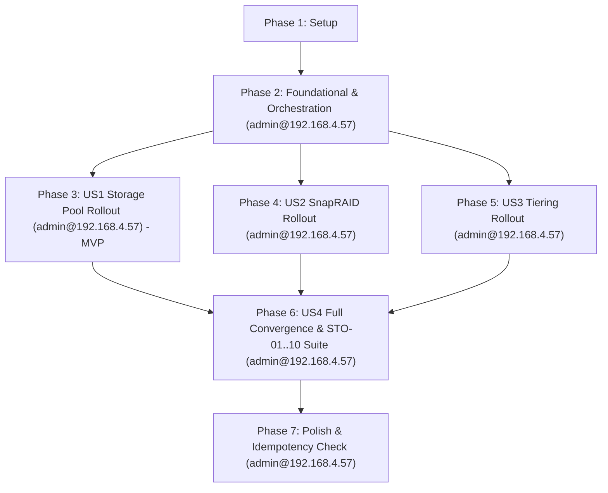

# Tasks: Storage Pooling & Data Resiliency Layer (Phase 4)

**Input**: Design documents from [`specs/004-storage-pooling-resiliency/`](file:///C:/Users/micro/projects/homelab2/specs/004-storage-pooling-resiliency/)
**Prerequisites**: [`plan.md`](file:///C:/Users/micro/projects/homelab2/specs/004-storage-pooling-resiliency/plan.md), [`spec.md`](file:///C:/Users/micro/projects/homelab2/specs/004-storage-pooling-resiliency/spec.md), [`data-model.md`](file:///C:/Users/micro/projects/homelab2/specs/004-storage-pooling-resiliency/data-model.md), [`contracts/`](file:///C:/Users/micro/projects/homelab2/specs/004-storage-pooling-resiliency/contracts/), [`.specify/memory/constitution.md`](file:///C:/Users/micro/projects/homelab2/.specify/memory/constitution.md)

**Rollout Target Host**: `admin@192.168.4.57` (homelab2 bare-metal Arch Linux host)

---

## Format: `[ID] [P?] [Story] Description`

- **[P]**: Can run in parallel (different files, no dependencies on incomplete tasks)
- **[Story]**: Which user story this task belongs to (e.g., [US1], [US2], [US3], [US4]). Omitted for Setup, Foundational, and Polish phases.
- Exact file paths are declared for all tasks.

---

## Phase 1: Setup (Shared Infrastructure)

**Purpose**: Project initialization, inventory definitions, and storage configuration defaults.

- [X] T001 [P] Configure storage group GID and global storage defaults in [ansible/inventory/group_vars/all/vars.yml](file:///C:/Users/micro/projects/homelab2/ansible/inventory/group_vars/all/vars.yml)
- [X] T002 [P] Create host storage disk UUID mapping and layout definitions in [ansible/inventory/host_vars/homelab2/storage.yml](file:///C:/Users/micro/projects/homelab2/ansible/inventory/host_vars/homelab2/storage.yml) quoting constraints: `uuid` must be "standard 128-bit hex string assigned by mkfs", `role` from enum `data`, `parity`, `scratch`, `filesystem` from `ext4`, `xfs`
- [X] T003 Create dedicated Phase 4 storage convergence playbook skeleton in [ansible/playbooks/storage.yml](file:///C:/Users/micro/projects/homelab2/ansible/playbooks/storage.yml)

---

## Phase 2: Foundational (Blocking Prerequisites & Orchestration)

**Purpose**: Core infrastructure, orchestration scripts, host connectivity, and base filesystem mounts that MUST be complete before ANY user story can be implemented.

**⚠️ CRITICAL**: No user story work can begin until this phase is complete.

- [X] T004 [P] Create role defaults and directory hierarchy variables in [ansible/roles/storage_layout/defaults/main.yml](file:///C:/Users/micro/projects/homelab2/ansible/roles/storage_layout/defaults/main.yml)
- [X] T005 Create system group `storage` with GID `1001` and assign `admin` user to `storage` group in [ansible/roles/storage_layout/tasks/main.yml](file:///C:/Users/micro/projects/homelab2/ansible/roles/storage_layout/tasks/main.yml)
- [X] T006 Create underlying physical disk and pool mount directories (`/mnt/disks/data1`, `/mnt/disks/data2`, `/mnt/disks/parity1`, `/mnt/storage`, `/mnt/scratch`, `/opt/services`) with raw mode `0755 root:root` in [ansible/roles/storage_layout/tasks/main.yml](file:///C:/Users/micro/projects/homelab2/ansible/roles/storage_layout/tasks/main.yml)
- [X] T007 Configure persistent `/etc/fstab` mount entries for physical data, parity, and scratch disks with verbatim options `defaults,noatime,nofail,x-systemd.device-timeout=10s` and `dump=0, passno=2` in [ansible/roles/storage_layout/tasks/main.yml](file:///C:/Users/micro/projects/homelab2/ansible/roles/storage_layout/tasks/main.yml)
- [X] T008 [P] Install foundational storage filesystem packages (`fuse3`, `e2fsprogs`, `xfsprogs`) via pacman in [ansible/roles/storage_layout/tasks/main.yml](file:///C:/Users/micro/projects/homelab2/ansible/roles/storage_layout/tasks/main.yml)
- [X] T009 [P] Implement cross-platform PowerShell runner for Windows workstation orchestration to push and execute storage playbooks against `admin@192.168.4.57` in [scripts/apply-phase4.ps1](file:///C:/Users/micro/projects/homelab2/scripts/apply-phase4.ps1)
- [X] T010 [P] Implement cross-platform POSIX runner for Linux/macOS orchestration to push and execute storage playbooks against `admin@192.168.4.57` in [scripts/apply-phase4.sh](file:///C:/Users/micro/projects/homelab2/scripts/apply-phase4.sh)
- [X] T011 Validate SSH connectivity and storage disk prerequisites on target host `admin@192.168.4.57` using [scripts/apply-phase4.ps1](file:///C:/Users/micro/projects/homelab2/scripts/apply-phase4.ps1) with `-Check`

**Checkpoint**: Foundation ready - inventory variables, orchestrator scripts established, target host connectivity verified, user stories can begin.

---

## Phase 3: User Story 1 - Unified Storage Pooling & Transparent File Access (Priority: P1) 🎯 MVP

**Goal**: Aggregate multiple physical data disks into a single unified virtual filesystem at `/mnt/storage` using MergerFS with balanced write policies, per-drive spin-down, and atomic renames, deployed live to `admin@192.168.4.57`.

**Independent Test**: Mount `/mnt/storage`, write a test file, confirm the file is placed on an underlying `/mnt/disks/data*` disk according to available space policy, confirm unified directory listing, and delete the file without orphaned blocks on `admin@192.168.4.57`.

- [X] T012 [P] [US1] Define MergerFS defaults and mount options in [ansible/roles/mergerfs/defaults/main.yml](file:///C:/Users/micro/projects/homelab2/ansible/roles/mergerfs/defaults/main.yml) specifying source branches `/mnt/disks/data*`, mount point `/mnt/storage`, `category.create=mfs`, `func.mkdir=pmfs`, `minfreespace=50G`, and options `cache.files=partial,dropcacheonclose=true,atomic_rename=true,fsname=storage_pool`
- [X] T013 [P] [US1] Define systemd daemon-reload and remount handlers for MergerFS in [ansible/roles/mergerfs/handlers/main.yml](file:///C:/Users/micro/projects/homelab2/ansible/roles/mergerfs/handlers/main.yml)
- [X] T014 [US1] Install `mergerfs` system package via pacman in [ansible/roles/mergerfs/tasks/main.yml](file:///C:/Users/micro/projects/homelab2/ansible/roles/mergerfs/tasks/main.yml)
- [X] T015 [US1] Configure persistent MergerFS pool mount in `/etc/fstab` with verbatim options `defaults,nonempty,allow_other,use_ino,cache.files=partial,dropcacheonclose=true,category.create=mfs,func.mkdir=pmfs,minfreespace=50G,atomic_rename=true,fsname=storage_pool,nofail,x-systemd.requires-mounts-for=/mnt/disks/data1` in [ansible/roles/mergerfs/tasks/main.yml](file:///C:/Users/micro/projects/homelab2/ansible/roles/mergerfs/tasks/main.yml)
- [X] T016 [US1] Assert `/mnt/storage` is mounted as `fuse.mergerfs` and enforce ownership `admin:storage` with setgid mode `2775` in [ansible/roles/mergerfs/tasks/main.yml](file:///C:/Users/micro/projects/homelab2/ansible/roles/mergerfs/tasks/main.yml)
- [X] T017 [US1] Wire role `mergerfs` and `storage_layout` into dedicated storage convergence playbook in [ansible/playbooks/storage.yml](file:///C:/Users/micro/projects/homelab2/ansible/playbooks/storage.yml)
- [X] T018 [US1] Deploy storage layout and MergerFS pool to production server `admin@192.168.4.57` using [scripts/apply-phase4.ps1](file:///C:/Users/micro/projects/homelab2/scripts/apply-phase4.ps1) with `-Tags "storage_layout,mergerfs"`
- [X] T019 [US1] Verify live `/mnt/storage` MergerFS mount and underlying member disk file distribution on production server `admin@192.168.4.57`

**Checkpoint**: At this point, User Story 1 is deployed live and delivers the functional MVP storage pool at `/mnt/storage` on the production server.

---

## Phase 4: User Story 2 - Snapshot-Based Parity Protection & Integrity Scrubbing (Priority: P1)

**Goal**: Configure SnapRAID snapshot parity across bulk data disks with daily sync, weekly scrubbing, and an automated pre-sync deletion threshold safety runner logging to `systemd-journald`, deployed live to `admin@192.168.4.57`.

**Independent Test**: Generate parity across data disks with `snapraid sync`, verify array status with `snapraid status`, test safety runner deletion threshold abort logic, and confirm timer units are active on `admin@192.168.4.57`.

- [X] T020 [P] [US2] Define SnapRAID defaults and array paths in [ansible/roles/snapraid/defaults/main.yml](file:///C:/Users/micro/projects/homelab2/ansible/roles/snapraid/defaults/main.yml) declaring parity file `/mnt/disks/parity1/snapraid.parity`, content files `/var/snapraid.content` and `/mnt/disks/data*/snapraid.content` (enforcing "at least 2 distinct content files across separate physical disks"), data disks `/mnt/disks/data1` and `/mnt/disks/data2`, excludes (`/mnt/scratch/**`, `*.bak`, `*.tmp`, `*.part`, `*Thumbs.db`, `.DS_Store`, `.Trash-*`, `*.unrecoverable`), and `diff_deletion_threshold: 50`
- [X] T021 [P] [US2] Create SnapRAID configuration template adhering to contracts/snapraid-contract.md in [ansible/roles/snapraid/templates/snapraid.conf.j2](file:///C:/Users/micro/projects/homelab2/ansible/roles/snapraid/templates/snapraid.conf.j2)
- [X] T022 [P] [US2] Create SnapRAID safety runner wrapper template with diff threshold check (`diff_deletion_threshold: 50`) and journald alert logging (`logger -p user.err -t snapraid`) in [ansible/roles/snapraid/templates/snapraid-runner.sh.j2](file:///C:/Users/micro/projects/homelab2/ansible/roles/snapraid/templates/snapraid-runner.sh.j2)
- [X] T023 [P] [US2] Create systemd daily sync service and timer templates scheduled for "daily at 03:00" with `ConditionACPower=true` in [ansible/roles/snapraid/templates/snapraid-sync.service.j2](file:///C:/Users/micro/projects/homelab2/ansible/roles/snapraid/templates/snapraid-sync.service.j2) and [ansible/roles/snapraid/templates/snapraid-sync.timer.j2](file:///C:/Users/micro/projects/homelab2/ansible/roles/snapraid/templates/snapraid-sync.timer.j2)
- [X] T024 [P] [US2] Create systemd weekly scrub service and timer templates scheduled for "weekly on Sunday at 04:00" executing `/usr/bin/snapraid scrub -p 8 -o 10` in [ansible/roles/snapraid/templates/snapraid-scrub.service.j2](file:///C:/Users/micro/projects/homelab2/ansible/roles/snapraid/templates/snapraid-scrub.service.j2) and [ansible/roles/snapraid/templates/snapraid-scrub.timer.j2](file:///C:/Users/micro/projects/homelab2/ansible/roles/snapraid/templates/snapraid-scrub.timer.j2)
- [X] T025 [P] [US2] Create systemd daemon-reload and timer reload handlers in [ansible/roles/snapraid/handlers/main.yml](file:///C:/Users/micro/projects/homelab2/ansible/roles/snapraid/handlers/main.yml)
- [X] T026 [US2] Implement SnapRAID tasks for package install, template deployment, runner script installation (`/usr/local/bin/snapraid-runner.sh`, mode `0755`), and systemd timer activation in [ansible/roles/snapraid/tasks/main.yml](file:///C:/Users/micro/projects/homelab2/ansible/roles/snapraid/tasks/main.yml)
- [X] T027 [US2] Wire role `snapraid` into dedicated storage convergence playbook in [ansible/playbooks/storage.yml](file:///C:/Users/micro/projects/homelab2/ansible/playbooks/storage.yml)
- [X] T028 [US2] Deploy SnapRAID configuration and timer units to production server `admin@192.168.4.57` using [scripts/apply-phase4.ps1](file:///C:/Users/micro/projects/homelab2/scripts/apply-phase4.ps1) with `-Tags snapraid`
- [X] T029 [US2] Verify live SnapRAID array status, test runner execution, and active systemd timers on production server `admin@192.168.4.57`

**Checkpoint**: At this point, User Stories 1 and 2 are active on the production server, providing pooled storage with automated parity and bit-rot scrubbing.

---

## Phase 5: User Story 3 - Storage Tiering & Scratch Space Isolation (Priority: P2)

**Goal**: Establish clear tiering boundaries separating fast NVMe app configs (`/opt/services`), pooled resilient storage (`/mnt/storage`), and high-wear transient data (`/mnt/scratch`) with strict parity and pooling isolation, deployed live to `admin@192.168.4.57`.

**Independent Test**: Write transient files to `/mnt/scratch`, confirm space is consumed only on `/mnt/scratch`, confirm zero change in `snapraid diff`, and verify setgid group inheritance on `admin@192.168.4.57`.

- [X] T030 [P] [US3] Configure Fast NVMe application tier directory `/opt/services` with ownership `admin:storage` and mode `0775` in [ansible/roles/storage_layout/tasks/main.yml](file:///C:/Users/micro/projects/homelab2/ansible/roles/storage_layout/tasks/main.yml)
- [X] T031 [P] [US3] Configure isolated scratch tier directory `/mnt/scratch` with ownership `admin:storage` and verbatim setgid mode `2775` enforcing storage group inheritance in [ansible/roles/storage_layout/tasks/main.yml](file:///C:/Users/micro/projects/homelab2/ansible/roles/storage_layout/tasks/main.yml)
- [X] T032 [US3] Verify explicit exclusion of `/mnt/scratch` from MergerFS member branch globs in [ansible/roles/mergerfs/defaults/main.yml](file:///C:/Users/micro/projects/homelab2/ansible/roles/mergerfs/defaults/main.yml) and SnapRAID config in [ansible/roles/snapraid/templates/snapraid.conf.j2](file:///C:/Users/micro/projects/homelab2/ansible/roles/snapraid/templates/snapraid.conf.j2)
- [X] T033 [US3] Deploy storage tiering updates to production server `admin@192.168.4.57` using [scripts/apply-phase4.ps1](file:///C:/Users/micro/projects/homelab2/scripts/apply-phase4.ps1) with `-Tags storage_layout`
- [X] T034 [US3] Verify live storage tier permissions and scratch isolation on production server `admin@192.168.4.57` ensuring `/mnt/scratch` writes do not alter `/mnt/storage` or trigger SnapRAID diff changes

**Checkpoint**: At this point, all three storage tiers are segregated on the production host, protecting the pool and parity array from CCTV and download churn.

---

## Phase 6: User Story 4 - Automated Verification, Telemetry & Mount Recovery (Priority: P2)

**Goal**: Deploy automated health assertions (STO-01 through STO-10), structured journal telemetry, cross-platform convergence runners, and unified playbook integration for disaster recovery, verified live on `admin@192.168.4.57`.

**Independent Test**: Execute `./scripts/verify-phase4.sh` or `ansible-playbook ansible/playbooks/verify-phase4.yml` against `admin@192.168.4.57` and assert that all 10 checks pass with exit code 0.

- [X] T035 [P] [US4] Implement automated host-side acceptance test script evaluating assertions STO-01 through STO-10 with structured stderr diagnostics and exit code semantics in [scripts/verify-phase4.sh](file:///C:/Users/micro/projects/homelab2/scripts/verify-phase4.sh)
- [X] T036 [P] [US4] Implement Windows PowerShell acceptance test runner executing `verify-phase4.sh` over SSH against `admin@192.168.4.57` in [scripts/verify-phase4.ps1](file:///C:/Users/micro/projects/homelab2/scripts/verify-phase4.ps1)
- [X] T037 [P] [US4] Implement Phase 4 dedicated Ansible verification playbook asserting checks STO-01 to STO-10 in [ansible/playbooks/verify-phase4.yml](file:///C:/Users/micro/projects/homelab2/ansible/playbooks/verify-phase4.yml)
- [X] T038 [US4] Integrate storage convergence playbook into unified site deployment in [ansible/playbooks/site.yml](file:///C:/Users/micro/projects/homelab2/ansible/playbooks/site.yml)
- [X] T039 [US4] Integrate Phase 4 verification assertions into unified verification playbook in [ansible/playbooks/verify.yml](file:///C:/Users/micro/projects/homelab2/ansible/playbooks/verify.yml)
- [X] T040 [US4] Execute full production convergence against production server `admin@192.168.4.57` using [scripts/apply-phase4.ps1](file:///C:/Users/micro/projects/homelab2/scripts/apply-phase4.ps1)
- [X] T041 [US4] Execute full automated verification suite [scripts/verify-phase4.ps1](file:///C:/Users/micro/projects/homelab2/scripts/verify-phase4.ps1) against production server `admin@192.168.4.57` confirming all checks STO-01 through STO-10 pass with exit code 0

**Checkpoint**: All user stories are implemented, rolled out to `admin@192.168.4.57`, verified, and integrated into platform-wide automation.

---

## Phase 7: Polish & Cross-Cutting Concerns

**Purpose**: Validation, linting, idempotency testing against production host, and roadmap tracking.

- [X] T042 [P] Execute `ansible-lint` against all storage roles and playbooks in [ansible/](file:///C:/Users/micro/projects/homelab2/ansible/)
- [X] T043 [P] Validate shell script syntax and execute `shellcheck` against [scripts/verify-phase4.sh](file:///C:/Users/micro/projects/homelab2/scripts/verify-phase4.sh), [scripts/apply-phase4.sh](file:///C:/Users/micro/projects/homelab2/scripts/apply-phase4.sh), and runner template in [ansible/roles/snapraid/templates/snapraid-runner.sh.j2](file:///C:/Users/micro/projects/homelab2/ansible/roles/snapraid/templates/snapraid-runner.sh.j2)
- [X] T044 Execute idempotency verification by running [scripts/apply-phase4.ps1](file:///C:/Users/micro/projects/homelab2/scripts/apply-phase4.ps1) against `admin@192.168.4.57` and confirming clean zero-change convergence
- [X] T045 [P] Update platform implementation roadmap tracking Phase 4 Storage Pooling & Data Resiliency completion in [ROADMAP.md](file:///C:/Users/micro/projects/homelab2/ROADMAP.md)

---

## Dependencies & Execution Order

### Phase Dependencies

- **Setup (Phase 1)**: No dependencies - can start immediately.
- **Foundational (Phase 2)**: Depends on Phase 1 completion - **BLOCKS** all user stories. Verifies SSH connectivity and establishes orchestrator scripts for `admin@192.168.4.57`.
- **User Story 1 (Phase 3)**: Depends on Foundational (Phase 2) completion. Rolls out MVP virtual storage pool to `admin@192.168.4.57`.
- **User Story 2 (Phase 4)**: Depends on Foundational (Phase 2) completion. Rolls out SnapRAID parity and systemd timers to `admin@192.168.4.57`.
- **User Story 3 (Phase 5)**: Depends on Foundational (Phase 2) completion and integrates with US1/US2 exclusion lists on `admin@192.168.4.57`.
- **User Story 4 (Phase 6)**: Depends on completion of US1, US2, and US3. Executes end-to-end convergence and asserts checks STO-01 to STO-10 on `admin@192.168.4.57`.
- **Polish (Phase 7)**: Depends on completion of all user story implementations. Asserts live idempotency on `admin@192.168.4.57`.

### User Story Dependencies



### Within Each User Story

- Default variable definitions before task implementation
- Templates and handlers before task execution
- Role task implementation before playbook inclusion
- Live deployment to `admin@192.168.4.57` using orchestrator script
- Target host verification on `admin@192.168.4.57` before declaring story complete

### Parallel Opportunities

- **Phase 1**: `T001` and `T002` can be implemented in parallel.
- **Phase 2**: `T004`, `T008`, `T009`, and `T010` can run in parallel.
- **Phase 3 (US1)**: `T012` and `T013` can be created in parallel.
- **Phase 4 (US2)**: `T020`, `T021`, `T022`, `T023`, `T024`, and `T025` can all be drafted in parallel.
- **Phase 5 (US3)**: `T030` and `T031` can be created in parallel.
- **Phase 6 (US4)**: `T035`, `T036`, and `T037` can be authored in parallel across test and verification playbooks.
- **Phase 7 (Polish)**: `T042`, `T043`, and `T045` can execute in parallel.

---

## Parallel Example: User Story 2 (SnapRAID)

```bash
# Launch templates and handlers for SnapRAID concurrently:
Task: "Create SnapRAID configuration template in ansible/roles/snapraid/templates/snapraid.conf.j2"
Task: "Create SnapRAID safety runner wrapper template in ansible/roles/snapraid/templates/snapraid-runner.sh.j2"
Task: "Create systemd daily sync templates in ansible/roles/snapraid/templates/snapraid-sync.*.j2"
Task: "Create systemd weekly scrub templates in ansible/roles/snapraid/templates/snapraid-scrub.*.j2"
Task: "Create systemd reload handlers in ansible/roles/snapraid/handlers/main.yml"
```

---

## Implementation Strategy

### MVP First (User Story 1 Deployed to Production)

1. Complete Phase 1: Setup (`T001`–`T003`)
2. Complete Phase 2: Foundational (`T004`–`T011`) — **CRITICAL**: Validates connectivity and foundation on `admin@192.168.4.57`
3. Complete Phase 3: User Story 1 (`T012`–`T019`)
4. **Deploy & Validate Live**: Execute `apply-phase4.ps1 -Tags "storage_layout,mergerfs"` and verify `/mnt/storage` on `admin@192.168.4.57`
5. Storage pool is immediately active and usable on the production server!

### Incremental Delivery to Production

1. **Increment 1**: Foundation, Orchestration & Connectivity (`T001`–`T011`)
2. **Increment 2 (MVP)**: Live MergerFS Storage Pool on `admin@192.168.4.57` (`T012`–`T019`)
3. **Increment 3**: Live SnapRAID Parity & Timers on `admin@192.168.4.57` (`T020`–`T029`)
4. **Increment 4**: Live Storage Tiering & Scratch Space on `admin@192.168.4.57` (`T030`–`T034`)
5. **Increment 5**: Full Live Convergence & 10-Point Verification Suite (`T035`–`T041`)
6. **Increment 6**: Idempotency Verification & Roadmap Sign-off (`T042`–`T045`)

---

## Notes

- All tasks use strict checklist format: `- [ ] [TaskID] [P?] [Story?] Description with file path`.
- Target production server `admin@192.168.4.57` is explicitly targeted for rollouts, checks, and idempotency assertions.
- Tasks avoid cross-file collisions during parallel execution.
- Verbatim constraints from `data-model.md` and contracts are embedded directly in task descriptions.
- Setgid bit (`2775`) on `/mnt/storage` and `/mnt/scratch` guarantees container permission compatibility.
- Safety runner guarantees parity data cannot be overwritten by accidental mass deletions (>50 files).
