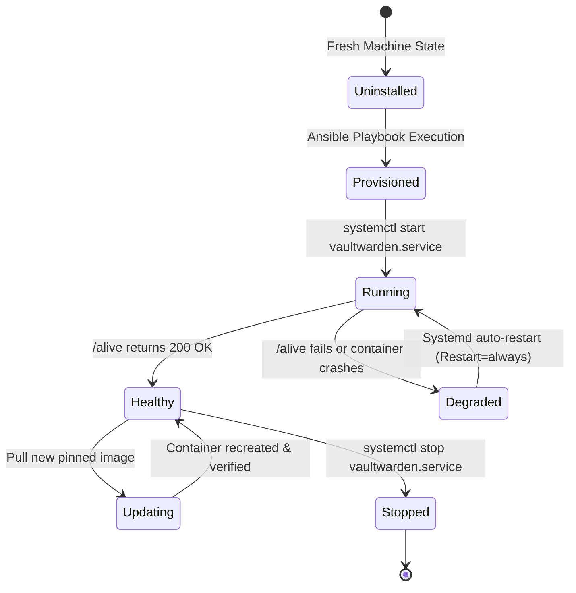
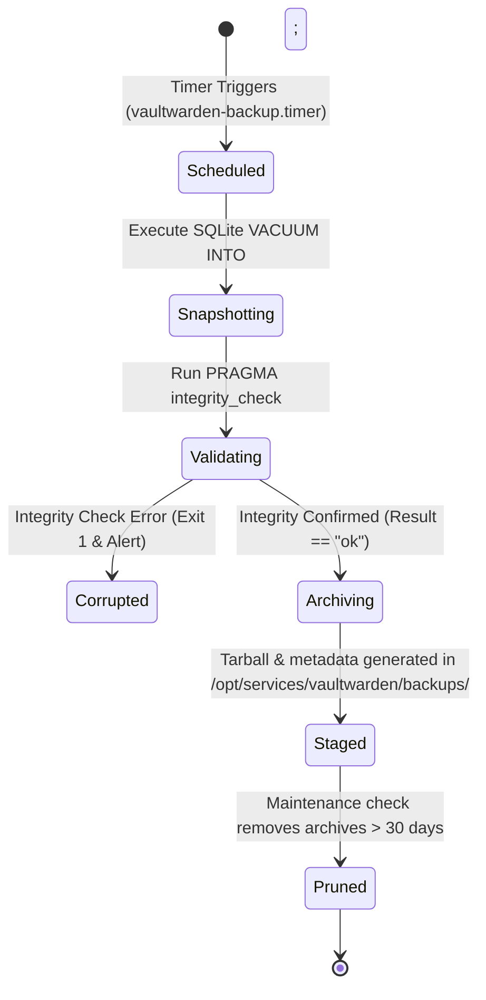
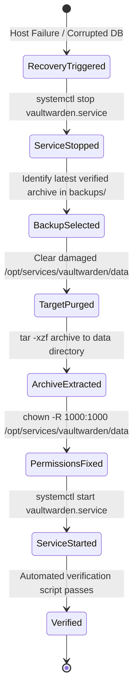

# Data Model: Vaultwarden Application Deployment & Resiliency

**Feature**: `005-vaultwarden-app` | **Date**: 2026-11-01

This document describes the entities, configurations, operational states, and lifecycle models for the Phase 5 Vaultwarden deployment.

---

## 1. Entities & Configuration Models

### 1.1 Vaultwarden Service Instance

Represents the containerized application daemon managed by systemd and Docker Compose.

| Field | Type | Required | Description | Constraints / Example |
|---|---|---|---|---|
| `service_name` | String | Yes | Name of the application service | Constant: `"vaultwarden"` |
| `service_dir` | Path | Yes | Host filesystem directory hosting configuration | `/opt/services/vaultwarden` |
| `data_dir` | Path | Yes | Host path for persistent application data | `/opt/services/vaultwarden/data` |
| `backups_dir` | Path | Yes | Host path for staged backup snapshots | `/opt/services/vaultwarden/backups` |
| `scripts_dir` | Path | Yes | Host path for operational and backup scripts | `/opt/services/vaultwarden/scripts` |
| `image_tag` | String | Yes | Container image and pinned version tag | `vaultwarden/server:1.32.7-alpine` |
| `container_puid` | Integer | Yes | User ID under which container process runs | `1000` (non-root operator) |
| `container_pgid` | Integer | Yes | Group ID under which container process runs | `1000` or `1001` (storage group) |
| `internal_port` | Integer | Yes | Container listening port mapped to loopback | `8088` (bound to `127.0.0.1:8088`) |
| `systemd_unit` | String | Yes | Host systemd service unit name | `vaultwarden.service` |

### 1.2 Service Environment & Secret Model (`.env`)

Represents the runtime configuration and sensitive secrets injected into the container environment.

| Variable Name | Type | Source | Security | Purpose |
|---|---|---|---|---|
| `DOMAIN` | String | `vars.yml` | Non-sensitive | Base URL for Vaultwarden web interface (e.g. `https://vaultwarden.lan` or `https://vaultwarden.<tailnet>`) |
| `SIGNUPS_ALLOWED` | Boolean | `vars.yml` | Non-sensitive | Restricts public registration (`false`) |
| `INVITATIONS_ALLOWED` | Boolean | `vars.yml` | Non-sensitive | Enables admin invitation workflow (`true`) |
| `ADMIN_TOKEN` | String | `vault.sops.yml` | Highly Sensitive | Argon2id PHC string hashed secret protecting `/admin` interface |
| `WEBSOCKET_ENABLED` | Boolean | `vars.yml` | Non-sensitive | Enables WebSocket listener on primary port (`true`) |
| `ENABLE_DB_WAL` | Boolean | `vars.yml` | Non-sensitive | Enforces SQLite Write-Ahead Logging (`true`) |
| `DATABASE_URL` | String | Default | Non-sensitive | Database location inside container (`/data/db.sqlite3`) |
| `ROCKET_PORT` | Integer | Default | Non-sensitive | Internal container listening port (`80`) |
| `LOG_LEVEL` | String | `vars.yml` | Non-sensitive | Logging verbosity (`"info"`) |

### 1.3 Persistent SQLite Database & State

The persistent relational store and encryption keys residing within `/opt/services/vaultwarden/data`.

| Artifact Name | Path | Durability / Mode | Purpose |
|---|---|---|---|
| `db.sqlite3` | `/opt/services/vaultwarden/data/db.sqlite3` | SQLite 3 WAL Mode | Relational database containing encrypted vaults, ciphers, folders, and users. |
| `db.sqlite3-wal` | `/opt/services/vaultwarden/data/db.sqlite3-wal` | Transient WAL | Write-Ahead Log capturing uncheckpointed transactions. |
| `db.sqlite3-shm` | `/opt/services/vaultwarden/data/db.sqlite3-shm` | Transient Shared Memory | Shared-memory index for concurrent WAL access. |
| `rsa_key.*` | `/opt/services/vaultwarden/data/rsa_key.*` | Mode `0600` | Host RSA cryptographic key pairs used for JWT signing and envelope encryption. |
| `attachments/` | `/opt/services/vaultwarden/data/attachments` | Directory (0700) | Encrypted binary files and document attachments uploaded by users. |
| `sends/` | `/opt/services/vaultwarden/data/sends` | Directory (0700) | Ephemeral encrypted file sends generated by users. |

### 1.4 Backup Archive Artifact

Represents a verified, atomic point-in-time backup bundle.

| Field | Type | Description | Example / Format |
|---|---|---|---|
| `backup_timestamp` | String | ISO-like timestamp string | `20261101-220000` |
| `db_snapshot` | Path | Atomic point-in-time SQLite snapshot | `vaultwarden-db-20261101-220000.sqlite3` |
| `tar_bundle` | Path | Consolidated, compressed archive | `vaultwarden-backup-20261101-220000.tar.gz` |
| `integrity_status` | Enum | Integrity check status (`PRAGMA integrity_check;`) | `PASSED` / `FAILED` |
| `archive_size` | Integer | Size in bytes of the backup tarball | Numeric byte count |
| `retention_days` | Integer | Retention policy lifespan before automatic pruning | `30` days |

### 1.5 Caddy Reverse Proxy Drop-In (`20-vaultwarden.caddy`)

Represents the modular ingress configuration snippet deployed into `/etc/caddy/conf.d/`.

| Parameter | Value / Directive | Purpose |
|---|---|---|
| `route_host` | `vaultwarden.lan`, `vaultwarden.<tailnet>` | Host header for Vaultwarden routing |
| `upstream_target` | `127.0.0.1:8088` | Local loopback address of the Vaultwarden container |
| `tls_configuration` | `tls internal` | Automatic local certificate management |
| `health_path` | `/alive` | Health probe passed directly to Vaultwarden |
| `websocket_path` | `/notifications/hub` | WebSocket path upgraded automatically by `reverse_proxy` |

---

## 2. State Transitions & Lifecycle

### 2.1 Service Lifecycle

### 2.2 Backup Lifecycle

### 2.3 Disaster Recovery / Restore Lifecycle

