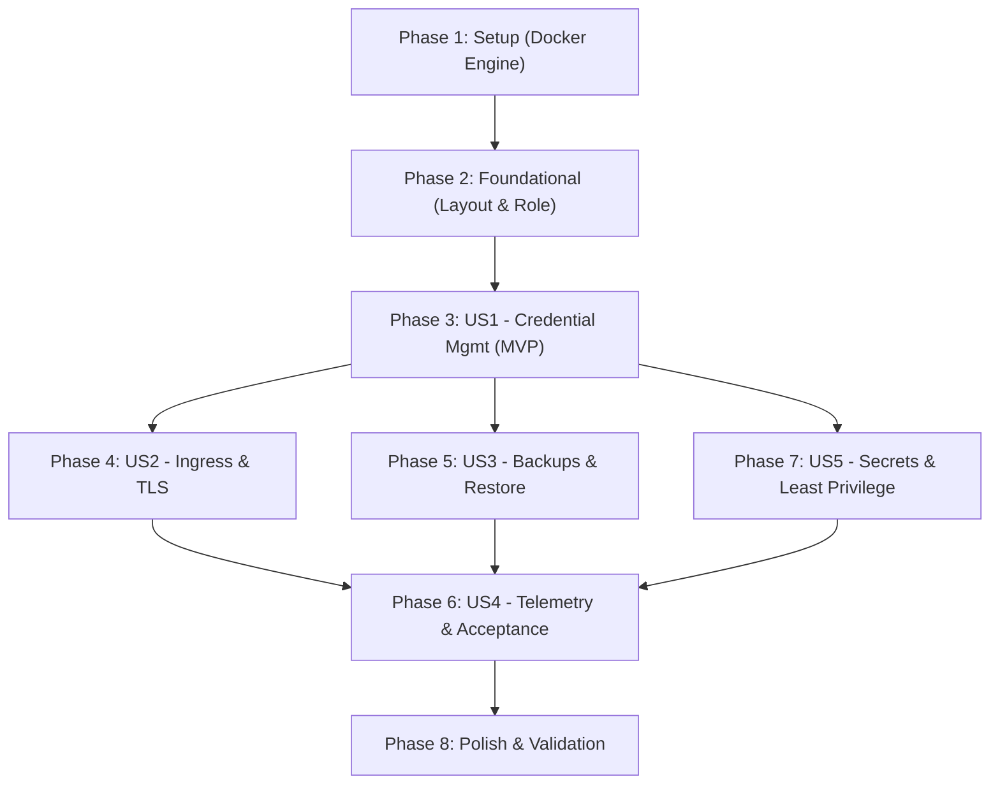

# Tasks: Vaultwarden Application Deployment & Resiliency

**Input**: Design documents from `specs/005-vaultwarden-app/` (`spec.md`, `plan.md`, `data-model.md`, `research.md`, `contracts/`, `quickstart.md`)

**Prerequisites**: [plan.md](file:///C:/Users/micro/projects/homelab2/specs/005-vaultwarden-app/plan.md), [spec.md](file:///C:/Users/micro/projects/homelab2/specs/005-vaultwarden-app/spec.md), [data-model.md](file:///C:/Users/micro/projects/homelab2/specs/005-vaultwarden-app/data-model.md), [contracts/](file:///C:/Users/micro/projects/homelab2/specs/005-vaultwarden-app/contracts/)

**Tests**: Automated verification tasks (VW-01 through VW-09) and acceptance test scripts are included in Phase 6 (User Story 4) in accordance with spec requirements FR-016, SC-006, and Constitution Principle III.

**Organization**: Tasks are grouped by user story to enable independent implementation and testing of each story.

## Format: `- [ ] [TaskID] [P?] [Story?] Description with file path`

- **[P]**: Can run in parallel (different files, no dependencies on incomplete tasks)
- **[Story]**: Which user story this task belongs to (`[US1]`, `[US2]`, `[US3]`, `[US4]`, `[US5]`)
- Every task includes an exact file path and quotes data model constraints verbatim where applicable

---

## Phase 1: Setup (Shared Infrastructure)

**Purpose**: Initialize container runtime infrastructure (Docker CE & Compose plugin) shared across all Phase 5 application workloads.

- [X] T001 Configure Docker CE package defaults in `ansible/roles/docker/defaults/main.yml`
- [X] T002 [P] Implement Docker daemon restart and reload handlers in `ansible/roles/docker/handlers/main.yml`
- [X] T003 Implement Docker CE and docker-compose plugin package installation and systemd service enablement tasks in `ansible/roles/docker/tasks/main.yml`
- [X] T004 [P] Add Docker global package list and daemon defaults to `ansible/inventory/group_vars/all/vars.yml`
- [X] T005 Integrate `docker` role into master convergence playbook in `ansible/playbooks/site.yml`

---

## Phase 2: Foundational (Blocking Prerequisites)

**Purpose**: Establish filesystem layout, permissions, and base Ansible role structure for Vaultwarden that MUST be complete before user stories can begin.

**⚠️ CRITICAL**: No user story implementation can begin until this phase is complete.

- [X] T006 [P] Define Vaultwarden role defaults (`service_name`: `"vaultwarden"`, `image_tag`: `vaultwarden/server:1.32.7-alpine`, `internal_port`: `8088` bound to `127.0.0.1:8088`, `service_dir`: `/opt/services/vaultwarden`, `retention_days`: `30`) in `ansible/roles/vaultwarden/defaults/main.yml`
- [X] T007 [P] Define systemd daemon reload and Vaultwarden service restart handlers in `ansible/roles/vaultwarden/handlers/main.yml`
- [X] T008 Implement directory creation tasks ensuring `/opt/services/vaultwarden` (`service_dir`), `/opt/services/vaultwarden/data` (`data_dir` mode `0750`, owner `1000:1000`), `/opt/services/vaultwarden/backups` (`backups_dir` mode `0750`), and `/opt/services/vaultwarden/scripts` (`scripts_dir` mode `0755`) in `ansible/roles/vaultwarden/tasks/layout.yml`
- [X] T009 Implement main task orchestrator including layout, config, service, and backup tasks in `ansible/roles/vaultwarden/tasks/main.yml`
- [X] T010 Create dedicated Phase 5 Vaultwarden playbook in `ansible/playbooks/vaultwarden.yml`
- [X] T011 Integrate `vaultwarden` role into master convergence playbook in `ansible/playbooks/site.yml`

**Checkpoint**: Foundation ready - Docker is operational and directory structure under `/opt/services/vaultwarden` is prepared.

---

## Phase 3: User Story 1 - Secure Credential Management & Cross-Device Synchronization (Priority: P1) 🎯 MVP

**Goal**: Deploy the core Vaultwarden application container with SQLite WAL persistence, WebSocket support, non-root execution (`1000:1000`), loopback binding `127.0.0.1:8088`, and systemd service supervision.

**Independent Test**: Deploy the container, verify that `http://127.0.0.1:8088/alive` returns HTTP 200 within 500ms, authenticate via the web vault, and create a credential item verifying persistence in `/opt/services/vaultwarden/data/db.sqlite3`.

- [X] T012 [P] [US1] Create Docker Compose manifest template with image `vaultwarden/server:1.32.7-alpine`, `user: "1000:1000"`, `ports: ["127.0.0.1:8088:80"]`, volume `/opt/services/vaultwarden/data:/data`, `security_opt: ["no-new-privileges:true"]`, and healthcheck `test: ["CMD", "curl", "-f", "http://localhost:80/alive"]` with `interval: 30s` in `ansible/roles/vaultwarden/templates/compose.yml.j2`
- [X] T013 [P] [US1] Create systemd service unit template (`vaultwarden.service`) with `Requires=docker.service`, `After=docker.service network-online.target`, `ExecStart=/usr/bin/docker compose up -d --remove-orphans`, and `ExecStop=/usr/bin/docker compose down` in `ansible/roles/vaultwarden/templates/vaultwarden.service.j2`
- [X] T014 [US1] Implement Compose manifest rendering task deploying `/opt/services/vaultwarden/compose.yml` (mode `0644`) in `ansible/roles/vaultwarden/tasks/config.yml`
- [X] T015 [US1] Implement systemd unit deployment, systemd reload, and service enablement/start tasks in `ansible/roles/vaultwarden/tasks/service.yml`

**Checkpoint**: Vaultwarden backend container is running, supervised by systemd, listening on `127.0.0.1:8088`, and responding HTTP 200 on `/alive`. (MVP Milestone!)

---

## Phase 4: User Story 2 - Reverse Proxy Ingress & End-to-End Encrypted Transport (Priority: P1)

**Goal**: Route ingress traffic through Caddy with automated internal TLS (`tls internal`), security headers (HSTS, `nosniff`, `SAMEORIGIN`), and transparent WebSocket upgrading on `/notifications/hub`.

**Independent Test**: Send HTTPS request to `https://127.0.0.1/alive` with `Host: vaultwarden.lan` returning HTTP 200 with valid TLS headers, and initiate a WebSocket handshake on `/notifications/hub` verifying `101 Switching Protocols`.

- [X] T016 [P] [US2] Create Caddy reverse proxy drop-in template routing `vaultwarden.lan` and `vaultwarden.{$HOMELAB_DOMAIN:local}` with `tls internal`, security headers (`Strict-Transport-Security "max-age=31536000; includeSubDomains;"`, `X-Content-Type-Options "nosniff"`, `X-Frame-Options "SAMEORIGIN"`), and upstream proxying `reverse_proxy 127.0.0.1:8088` in `ansible/roles/caddy/templates/20-vaultwarden.caddy.j2`
- [X] T017 [US2] Add Caddy drop-in deployment task with validation command `caddy validate` and reload handler notification in `ansible/roles/caddy/tasks/main.yml`
- [X] T018 [P] [US2] Configure Caddy domain variables and ingress routing defaults for Vaultwarden in `ansible/inventory/group_vars/all/vars.yml`

**Checkpoint**: Vaultwarden is securely accessible over HTTPS via Caddy reverse proxy with real-time WebSocket push notifications enabled.

---

## Phase 5: User Story 3 - Non-Disruptive Transactional Backups & Restoration Verification (Priority: P1)

**Goal**: Implement an automated, zero-downtime transactional database snapshot routine using SQLite `VACUUM INTO`, integrity verification via `PRAGMA integrity_check;`, dated tarball packaging with attachments and keys, 30-day retention pruning, daily systemd timer scheduling, and a verified disaster recovery script.

**Independent Test**: Execute `/opt/services/vaultwarden/scripts/backup.sh`, verify database snapshot integrity (`ok`) and archive creation in `/opt/services/vaultwarden/backups/`, and test `/opt/services/vaultwarden/scripts/restore.sh` with `--force` on an isolated test database.

- [X] T019 [P] [US3] Create transactional backup script template with `sqlite3 ... "VACUUM INTO .../snapshot.sqlite3"`, automated integrity check `PRAGMA integrity_check;` (failing with exit code 3 if non-ok), dated tarball packaging `snapshot.sqlite3`, `data/attachments`, `data/rsa_key.*`, and `mtime +30` retention pruning in `ansible/roles/vaultwarden/templates/backup.sh.j2`
- [X] T020 [P] [US3] Create disaster recovery restore script template with `--force` confirmation guard, `systemctl stop vaultwarden.service`, broken data evacuation to `data.broken.<timestamp>`, tarball extraction to `/opt/services/vaultwarden/data`, permissions enforcement (`chown -R 1000:1000`, mode `0750`), `systemctl start vaultwarden.service`, and `/alive` health polling in `ansible/roles/vaultwarden/templates/restore.sh.j2`
- [X] T021 [P] [US3] Create systemd backup service unit template (`vaultwarden-backup.service`) executing `/opt/services/vaultwarden/scripts/backup.sh` in `ansible/roles/vaultwarden/templates/vaultwarden-backup.service.j2`
- [X] T022 [P] [US3] Create systemd backup timer unit template (`vaultwarden-backup.timer`) scheduled daily at `03:30:00` with `Persistent=true` in `ansible/roles/vaultwarden/templates/vaultwarden-backup.timer.j2`
- [X] T023 [US3] Implement backup and restore script deployment tasks (mode `0755`), systemd timer deployment, and timer enablement/start in `ansible/roles/vaultwarden/tasks/backup.yml`

**Checkpoint**: Transactional backup automation is active and scheduled; disaster recovery restore tool is deployed and verified. (Constitutional Principle V satisfied!)

---

## Phase 6: User Story 4 - Observability, Telemetry & Acceptance Health Checks (Priority: P2)

**Goal**: Implement the complete automated acceptance test suite (checks VW-01 to VW-09), structured journald telemetry integration, and workstation convergence orchestrators.

**Independent Test**: Execute `scripts/verify-phase5-vaultwarden.sh` locally or `scripts/verify-phase5-vaultwarden.ps1` from workstation, validating that all 9 checks pass with exit code 0.

- [X] T024 [P] [US4] Implement target host acceptance verification suite covering checks VW-01 through VW-09 with `--json` and `--verbose` flags in `scripts/verify-phase5-vaultwarden.sh`
- [X] T025 [P] [US4] Implement workstation PowerShell acceptance test runner executing remote verification against `admin@192.168.4.57` in `scripts/verify-phase5-vaultwarden.ps1`
- [X] T026 [P] [US4] Implement Phase 5 Ansible verification playbook testing VW-01 to VW-09 assertions in `ansible/playbooks/verify-phase5.yml`
- [X] T027 [US4] Integrate Phase 5 acceptance assertions into unified platform verification playbook in `ansible/playbooks/verify.yml`
- [X] T028 [P] [US4] Implement Phase 5 PowerShell convergence orchestrator targeting `admin@192.168.4.57` in `scripts/apply-phase5.ps1`
- [X] T029 [P] [US4] Implement Phase 5 Bash convergence orchestrator in `scripts/apply-phase5.sh`

**Checkpoint**: Observability, health assertions, and automated verification gates are functional and report test results programmatically. (Constitutional Principle III satisfied!)

---

## Phase 7: User Story 5 - Least-Privilege Execution & Secret Isolation (Priority: P2)

**Goal**: Secure administrative secrets and environment configuration, ensuring Argon2id-hashed `ADMIN_TOKEN` is encrypted at rest in SOPS/age, `.env` is rendered with `0600` permissions, non-root execution (`1000:1000`) is enforced, public signups are disabled (`SIGNUPS_ALLOWED=false`), admin invitations are enabled (`INVITATIONS_ALLOWED=true`), and zero cleartext credentials exist in git.

**Independent Test**: Validate that `/opt/services/vaultwarden/.env` permissions are `0600`, verify no container processes run as `UID 0`, audit filesystem permissions on `/opt/services/vaultwarden/data` (`0750`), and run git grep verifying no cleartext secrets exist in the repository.

- [X] T030 [P] [US5] Create environment file template with `DOMAIN`, `SIGNUPS_ALLOWED=false`, `INVITATIONS_ALLOWED=true`, `ADMIN_TOKEN={{ vaultwarden_admin_token_hash }}`, `WEBSOCKET_ENABLED=true`, `ENABLE_DB_WAL=true`, `DATABASE_URL=/data/db.sqlite3`, `ROCKET_PORT=80`, and `LOG_LEVEL=info` in `ansible/roles/vaultwarden/templates/env.j2`
- [X] T031 [US5] Implement environment file deployment task rendering `/opt/services/vaultwarden/.env` with mode `0600` and owner `root` in `ansible/roles/vaultwarden/tasks/config.yml`
- [X] T032 [P] [US5] Add non-sensitive Vaultwarden configuration variables (`vaultwarden_domain`, `vaultwarden_signups_allowed: false`, `vaultwarden_invitations_allowed: true`) to `ansible/inventory/group_vars/all/vars.yml`
- [X] T033 [US5] Configure and document encrypted `vaultwarden_admin_token_hash` schema in `ansible/inventory/group_vars/all/vault.sops.yml`

**Checkpoint**: All secrets are encrypted via SOPS, `.env` is isolated with restricted permissions, and public registrations are blocked. (Constitutional Principle IV satisfied!)

---

## Phase 8: Polish & Cross-Cutting Concerns

**Purpose**: Validate documentation, execute end-to-end quickstart test scenarios, and finalize the feature requirements checklist.

- [X] T034 [P] Create Phase 5 feature verification checklist in `specs/005-vaultwarden-app/checklists/requirements.md`
- [X] T035 Execute end-to-end operational validation workflow documented in `specs/005-vaultwarden-app/quickstart.md`
- [X] T036 Update repository README and roadmap status for Phase 5 in `README.md`

---

## Dependencies & Execution Order

### Phase Dependencies

- **Setup (Phase 1)**: No dependencies - installs Docker CE and Compose plugin; can start immediately.
- **Foundational (Phase 2)**: Depends on Phase 1 completion - creates `/opt/services/vaultwarden` directories and role skeleton; BLOCKS all user stories.
- **User Story 1 (Phase 3 - P1)**: Depends on Phase 2 - deploys Compose manifest and systemd unit (MVP!).
- **User Story 2 (Phase 4 - P1)**: Depends on Phase 3 - integrates Caddy ingress routing and WebSocket support.
- **User Story 3 (Phase 5 - P1)**: Depends on Phase 3 - implements backup script, restore tool, and systemd timer.
- **User Story 4 (Phase 6 - P2)**: Depends on Phases 3, 4, and 5 - implements verification scripts and orchestrators.
- **User Story 5 (Phase 7 - P2)**: Can proceed alongside Phase 3/4 - configures SOPS secrets and `.env` isolation.
- **Polish (Phase 8)**: Depends on all user stories being complete.

### User Story Dependencies



---

## Parallel Opportunities

- **Phase 1 (Setup)**: T002 and T004 can run in parallel while T001 and T003 execute.
- **Phase 2 (Foundational)**: T006 and T007 can run in parallel with T008.
- **Phase 3 (User Story 1)**: Templates T012 (`compose.yml.j2`) and T013 (`vaultwarden.service.j2`) can be authored in parallel.
- **Phase 4 (User Story 2)**: T016 (`20-vaultwarden.caddy.j2`) and T018 (`vars.yml`) can run in parallel.
- **Phase 5 (User Story 3)**: Templates T019 (`backup.sh.j2`), T020 (`restore.sh.j2`), T021 (`vaultwarden-backup.service.j2`), and T022 (`vaultwarden-backup.timer.j2`) can all be authored in parallel.
- **Phase 6 (User Story 4)**: Test suites T024 (`verify-phase5-vaultwarden.sh`), T025 (`verify-phase5-vaultwarden.ps1`), T026 (`verify-phase5.yml`), T028 (`apply-phase5.ps1`), and T029 (`apply-phase5.sh`) can all be implemented in parallel.
- **Phase 7 (User Story 5)**: T030 (`env.j2`) and T032 (`vars.yml`) can run in parallel.

---

## Parallel Example: User Story 3 (Backups & Resiliency)

```bash
# Author all User Story 3 templates in parallel:
Task T019: "Create transactional backup script template in ansible/roles/vaultwarden/templates/backup.sh.j2"
Task T020: "Create disaster recovery restore script template in ansible/roles/vaultwarden/templates/restore.sh.j2"
Task T021: "Create systemd backup service unit template in ansible/roles/vaultwarden/templates/vaultwarden-backup.service.j2"
Task T022: "Create systemd backup timer unit template in ansible/roles/vaultwarden/templates/vaultwarden-backup.timer.j2"
```

---

## Implementation Strategy

### MVP First (User Story 1 Only)

1. Complete Phase 1: Setup (Docker CE & Compose plugin).
2. Complete Phase 2: Foundational (Directory layout & role structure).
3. Complete Phase 3: User Story 1 (Compose stack & systemd service).
4. **STOP and VALIDATE**: Verify backend health probe `http://127.0.0.1:8088/alive` returns HTTP 200 within 500ms.

### Incremental Delivery

1. **Step 1 (MVP)**: Setup + Foundational + User Story 1 -> Core password vault container operational on loopback.
2. **Step 2 (Ingress)**: User Story 2 -> Caddy HTTPS reverse proxy and WebSocket upgrade operational.
3. **Step 3 (Resiliency)**: User Story 3 -> Online transactional backups with SQLite integrity checks and retention pruning active.
4. **Step 4 (Hardening & Isolation)**: User Story 5 -> SOPS secrets decoupling, Argon2id token, non-root permissions, signups restricted.
5. **Step 5 (Acceptance & Observability)**: User Story 4 -> Automated verification suites (VW-01 through VW-09) and workstation runners.
6. **Step 6 (Polish)**: Requirements checklist and quickstart runbook validation.
