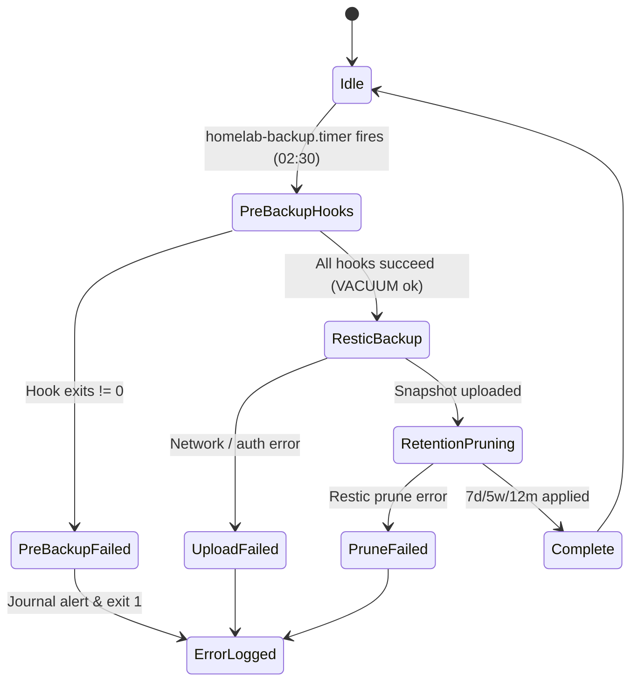
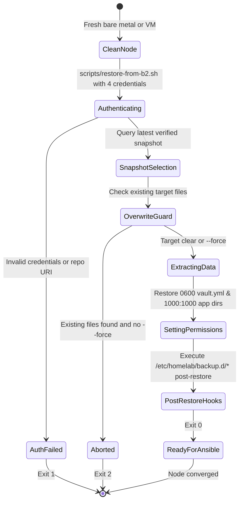

# Data Model: Centralized Backblaze B2 Backup & Automated Disaster Recovery

**Feature**: `006-backblaze-backup-restore`  
**Status**: Completed  
**Author**: Antigravity Assistant  

---

## 1. Entity Overview

The backup and disaster recovery subsystem models entities across the host configuration tier, secret management tier, application snapshot tier, and remote Backblaze B2 object store.

```mermaid
erDiagram
    BACKUP_CONFIG ||--o{ BACKUP_HOOK : executes
    BACKUP_CONFIG ||--|| BACKUP_CREDENTIALS : loads
    BACKUP_CONFIG ||--o{ BACKUP_SNAPSHOT : creates
    BACKUP_SNAPSHOT ||--o{ BACKUP_ITEM : contains
    BACKUP_HOOK ||--o{ APP_SNAPSHOT : generates
    APP_SNAPSHOT ||--|| BACKUP_ITEM : packaged_as
    HOST_SECRETS ||--|| BACKUP_ITEM : packaged_as

    BACKUP_CONFIG {
        string runner_path "/usr/local/bin/homelab-backup"
        string config_dir "/etc/homelab"
        string include_file "/etc/homelab/backup-include.txt"
        string exclude_file "/etc/homelab/backup-excludes.txt"
        string retention_policy "7d, 5w, 12m"
    }

    BACKUP_CREDENTIALS {
        string b2_account_id "Key ID"
        string b2_account_key "App Key"
        string restic_repository "b2:bucket:path"
        string restic_password "Passphrase"
    }

    BACKUP_HOOK {
        string hook_id "e.g. 10-vaultwarden"
        string executable_path "/etc/homelab/backup.d/10-vaultwarden.sh"
        string action "pre-backup | post-restore"
        int timeout_seconds 60
    }

    HOST_SECRETS {
        string vault_file "/etc/homelab/vault.yml"
        string app_env_dir "/etc/homelab/apps"
        string file_mode "0600"
        string owner "root:root"
    }

    APP_SNAPSHOT {
        string service_name "vaultwarden"
        string source_db "/opt/services/vaultwarden/data/db.sqlite3"
        string snapshot_path "/opt/services/vaultwarden/backups/snapshot.sqlite3"
        string integrity_status "ok"
    }

    BACKUP_SNAPSHOT {
        string snapshot_id "8-character hex / full hex"
        timestamp created_at "ISO-8601"
        string repository "Backblaze B2"
        string encryption "AES-256 Poly1305"
        string tags "homelab2, scheduled | manual"
    }

    BACKUP_ITEM {
        string relative_path "e.g. opt/services/vaultwarden/data/attachments"
        int size_bytes
        string file_type "file | directory"
        int mode_octal
        int uid
        int gid
    }
```

---

## 2. Entity Specifications

### 2.1 Backup Credentials (`BACKUP_CREDENTIALS`)
Defines the 4 master bootstrap credentials required to authenticate to Backblaze B2 and decrypt the client-side encrypted Restic repository.

| Field | Type | Storage Location | Sensitivity | Description |
|---|---|---|---|---|
| `b2_account_id` | string | `vault_b2_account_id` / `/etc/homelab/backup.env` | Secret | Backblaze B2 Application Key ID. |
| `b2_account_key` | string | `vault_b2_account_key` / `/etc/homelab/backup.env` | Secret | Backblaze B2 Application Key secret. |
| `restic_repository` | string | `vault_restic_repository` / `/etc/homelab/backup.env` | Config | Restic repository target (e.g. `b2:homelab2-backup:homelab2`). |
| `restic_password` | string | `vault_restic_password` / `/etc/homelab/backup.env` | Secret | Encryption passphrase for Restic AES-256 client-side encryption. |

**Validation Rules**:
- `b2_account_id`: Non-empty alphanumeric string (25+ characters).
- `b2_account_key`: Non-empty alphanumeric string (31+ characters).
- `restic_repository`: Valid URI prefix starting with `b2:`.
- `restic_password`: Minimum 16 characters, high entropy.

---

### 2.2 Host Secrets (`HOST_SECRETS`)
Files containing active local machine credentials and tokens that are gitignored in version control but mandatory for automated disaster recovery.

| Field | Type | Path | Perms | Description |
|---|---|---|---|---|
| `vault_file` | file | `/etc/homelab/vault.yml` | `0600 root:root` | Master host secret file populated from workstation `vault.yml`. |
| `apps_env_dir` | directory | `/etc/homelab/apps/` | `0700 root:root` | Directory containing individual app environment secret files (`*.env`). |

**Validation Rules**:
- Permissions on `/etc/homelab/vault.yml` MUST be `0600` owned by `root:root`.
- File MUST be captured in every Restic snapshot.

---

### 2.3 Application Snapshot (`APP_SNAPSHOT`)
Point-in-time consistent database and state snapshots produced by pre-backup hooks prior to Restic execution.

| Field | Type | Path | Description |
|---|---|---|---|
| `service_name` | string | Identifier | Unique service name (e.g. `vaultwarden`). |
| `source_db` | string | Path | Live active database path (e.g., `/opt/services/vaultwarden/data/db.sqlite3`). |
| `snapshot_path` | string | Path | Destination of atomic transactional snapshot (`/opt/services/<app>/backups/snapshot.sqlite3`). |
| `integrity_status`| string | "ok" | Result of `PRAGMA integrity_check;`. |

**Validation Rules**:
- `snapshot_path` MUST pass `sqlite3 "$snapshot_path" "PRAGMA integrity_check;" == "ok"` before Restic starts.
- Live `db.sqlite3` MUST be excluded from Restic backup archives.

---

### 2.4 Backup Hook (`BACKUP_HOOK`)
Modular hook script registered by applications to handle quiescence/dumping before backup and restoration after disaster recovery.

| Field | Type | Path | Description |
|---|---|---|---|
| `hook_id` | string | File basename | Ordering prefix and service name (e.g., `10-vaultwarden.sh`). |
| `executable_path` | string | `/etc/homelab/backup.d/<hook_id>` | Mode `0750 root:root`. |
| `subcommand` | enum | `pre-backup` \| `post-restore` | Action invoked by runner. |

**Validation Rules**:
- Must be executable (`test -x`).
- Must accept `pre-backup` and `post-restore` arguments.
- Must return exit code `0` on success; non-zero fails the backup routine.

---

### 2.5 Restic Snapshot (`BACKUP_SNAPSHOT`)
Immutable offsite cryptographic snapshot residing in Backblaze B2.

| Field | Type | Description |
|---|---|---|
| `snapshot_id` | string (hex) | Unique 8-char or 64-char hash generated by Restic. |
| `timestamp` | ISO-8601 string | Creation timestamp. |
| `hostname` | string | Host originating the backup (`homelab2`). |
| `paths` | array of strings | Top-level included roots (`/etc/homelab/vault.yml`, `/etc/homelab/apps`, `/opt/services`). |
| `tags` | array of strings | Classification tags (`homelab2`, `daily`). |

---

## 3. Lifecycle & State Transitions

### 3.1 Daily Backup Lifecycle



### 3.2 Disaster Recovery State Machine


