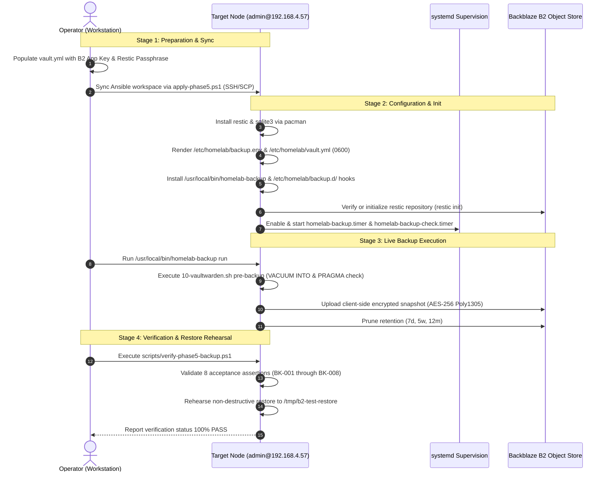

# Implementation Plan: Centralized Backblaze B2 Backup & Automated Disaster Recovery

**Branch**: `006-backblaze-backup-restore` | **Date**: 2026-11-02 | **Spec**: [spec.md](file:///C:/Users/micro/projects/homelab2/specs/006-backblaze-backup-restore/spec.md)

**Input**: Feature specification from `/specs/006-backblaze-backup-restore/spec.md`

---

## Summary

Feature 006 establishes the centralized, client-side encrypted backup and automated disaster recovery pipeline for `homelab2`, fulfilling Constitution Principle V (Disaster Recovery & Backup by Design) and Principle IV (Zero Secrets in Version Control & Isolated Configuration). The technical approach deploys `restic` using native Backblaze B2 object storage integration (`b2:<bucket>:<path>`), authenticates with 4 bootstrap credentials (`B2_ACCOUNT_ID`, `B2_ACCOUNT_KEY`, `RESTIC_REPOSITORY`, `RESTIC_PASSWORD`) stored locally in gitignored files, captures host secret configurations (`/etc/homelab/vault.yml`, `/etc/homelab/apps/*.env`) alongside stateful application data, coordinates atomic pre-backup SQLite database dumps (`VACUUM INTO` + `PRAGMA integrity_check;`) while strictly excluding live database files, prunes historical snapshots to a 7d/5w/12m retention policy, runs weekly 5% repository data integrity checks, and provides a standalone disaster recovery script (`scripts/restore-from-b2.sh`) capable of rebuilding node states from fresh bare metal with no prior state.

---

## Technical Context

**Language/Version**:
- Backup Engine: Go (upstream `restic` 0.16+)
- Automation & Scripting: Bash 5.2+, PowerShell 7+, Ansible 2.16+
- Database Tooling: SQLite 3.45+ (`sqlite3` CLI)

**Primary Dependencies**:
- Backup CLI: `restic` (client-side encrypted backup utility with native Backblaze B2 backend)
- Database Utility: `sqlite3` (for atomic transactional `VACUUM INTO` snapshots and `PRAGMA integrity_check;`)
- Init & Process Supervision: systemd (`homelab-backup.service`, `homelab-backup.timer`, `homelab-backup-check.service`, `homelab-backup-check.timer`)
- Remote Target: Backblaze B2 Cloud Storage (private bucket, application key authentication)

**Storage**:
- Host Secrets: `/etc/homelab/vault.yml` (`0600 root:root`), `/etc/homelab/apps/*.env` (`0700 root:root`)
- App Data & Snapshots: `/opt/services/*/data/`, `/opt/services/*/backups/snapshot.sqlite3`
- Backup Environment & Configs: `/etc/homelab/backup.env` (`0600 root:root`), `/etc/homelab/backup-include.txt`, `/etc/homelab/backup-excludes.txt`, `/etc/homelab/backup.d/`
- Cloud Target: Backblaze B2 repository (AES-256 / Poly1305 encrypted)

**Testing**:
- Local Acceptance Runner: `scripts/verify-phase5-backup.sh` (8 automated assertions in [`backup-verification-contract.md`](file:///C:/Users/micro/projects/homelab2/specs/006-backblaze-backup-restore/contracts/backup-verification-contract.md))
- Workstation Orchestration: `scripts/verify-phase5-backup.ps1`
- Ansible Verification Playbook: `ansible/playbooks/verify-phase5-backup.yml` integrated into unified `verify.yml`
- Non-Destructive Restore Test: Automated recovery of `vault.yml` to `/tmp/b2-test-restore` with SHA-256 checksum matching

**Target Platform & Deployment Target**:
- Target Host: `admin@192.168.4.57` (`homelab2`), Arch Linux bare-metal x86_64
- Deployment Mechanism: Ansible playbook push targeting `admin@192.168.4.57` via workstation orchestrator `scripts/apply-phase5.ps1 -HostAddress 192.168.4.57 -User admin` (and server-side `scripts/apply-phase5.sh`)
- Verification Mechanism: Remote acceptance verification suite executed via `scripts/verify-phase5-backup.ps1 -TargetHost 192.168.4.57 -User admin`

**Project Type**:
- Infrastructure automation, disaster recovery CLI tooling, and systemd backup supervision

**Performance Goals**:
- Daily automated backup completes in under 3 minutes for base state + Vaultwarden (SC-001)
- Live database files are never backed up directly; 100% of backed up database artifacts pass SQLite integrity validation (SC-002)
- Disaster recovery restore script reconstructs `vault.yml` and application data in under 2 minutes (SC-003)
- Verification test suite executes all 8 assertions in under 15 seconds
- Weekly 5% repository data integrity check completes without errors

**Constraints**:
- Zero secrets in version control (Principle IV): Real secrets exist exclusively in gitignored files (`ansible/inventory/group_vars/all/vault.yml`, `/etc/homelab/vault.yml`, `/etc/homelab/backup.env`), never in git.
- Client-side encryption: All data sent to Backblaze B2 is encrypted client-side by Restic using AES-256 / Poly1305 before leaving the host.
- Torn file prevention: Live `*.sqlite3` and `*.db` files are strictly excluded from Restic backup archives.
- Safe convergence & overwrite guards: Restoration script refuses to overwrite existing directories without explicit `--force` flag.

**Scale/Scope**:
- Unified backup and disaster recovery architecture for the homelab host, protecting all host secret configurations and current/future Phase 5 containerized workloads (Vaultwarden, Home Assistant, Immich, Mealie).

---

## Constitution Check

*GATE: Evaluated prior to Phase 0 research and re-evaluated post-design.*

| Principle / Gate | Compliance Analysis | Status |
|---|---|---|
| **I. Pragmatic Declarative-First Automation** | Restic installation, environment credentials file, include/exclude manifests, systemd service units, and timer units are declared declaratively via Ansible role `ansible/roles/backup`. Transactional database dumping, retention pruning, and standalone disaster recovery restoration use modular, self-contained shell scripts (`homelab-backup`, `restore-from-b2.sh`, `backup.d/*.sh`) with explicit CLI contracts. | **PASS** |
| **II. Strict Idempotency & Safe Convergence** | Rerunning Ansible playbooks or `homelab-backup run` converges without unintended drift or duplicate snapshots. Destructive restore operations in `restore-from-b2.sh` enforce strict non-empty directory overwrite guards requiring `--force`. | **PASS** |
| **III. Automated Verification & Acceptance Gates** | 8 automated assertions defined in [`backup-verification-contract.md`](file:///C:/Users/micro/projects/homelab2/specs/006-backblaze-backup-restore/contracts/backup-verification-contract.md). Checks verify package installation, secret permissions (`0600`), B2 cloud repository connectivity, snapshot inclusion of `vault.yml`, exclusion of live `db.sqlite3`, timer active status, and non-destructive restore checksum matching. | **PASS** |
| **IV. Zero Secrets in Version Control & Isolated Configuration** | Real Backblaze B2 credentials and Restic passwords reside exclusively in uncommitted, gitignored files (`ansible/inventory/group_vars/all/vault.yml`, `/etc/homelab/backup.env`, `/etc/homelab/vault.yml`). Only `vault.yml.example` is committed to git. Disaster recovery restores gitignored secrets directly from the encrypted B2 repository using 4 bootstrap keys. | **PASS** |
| **V. Disaster Recovery & Backup by Design** | Directly fulfills the core mandate of Principle V: automated daily backups to Backblaze B2 with client-side Restic encryption, tested restoration procedure from 4 bootstrap credentials, atomic transactional pre-backup snapshots, 7d/5w/12m retention pruning, and weekly 5% data subset integrity checks. | **PASS** |
| **VI. Modular & Decoupled Architecture** | Applications decouple their backup logic using the per-app hook directory `/etc/homelab/backup.d/`. The backup orchestrator (`/usr/local/bin/homelab-backup`) operates independently of application code, invoking standardized `pre-backup` and `post-restore` hooks. | **PASS** |
| **VII. Stability-First & Annual Maintenance Cadence** | Uses stable `restic` binary from Arch Linux repositories. Relies on standard systemd timers rather than continuous third-party container daemons. Requires zero daily operational intervention. | **PASS** |

**Constitution Gate Outcome**: **PASS**. 100% compliant with Constitution v1.3.0; zero principle violations; no exemptions required.

---

## Project Structure

### Documentation (this feature)

```text
specs/006-backblaze-backup-restore/
├── contracts/
│   ├── app-backup-contract.md             # Specification for /etc/homelab/backup.d/ hooks
│   ├── backup-runner-contract.md          # Specification for /usr/local/bin/homelab-backup CLI & systemd units
│   ├── backup-verification-contract.md    # 8 automated acceptance test assertions (BK-001 through BK-008)
│   └── disaster-recovery-contract.md      # Standalone recovery CLI specification (restore-from-b2.sh/.ps1)
├── data-model.md                          # Entity relationship model, state transitions, validation rules
├── plan.md                                # This implementation plan (/speckit-plan output)
├── quickstart.md                          # Operational validation scenarios and disaster recovery runbook
├── research.md                            # Phase 0 architectural decisions, rationale, alternatives
└── spec.md                                # Feature specification
```

### Source Code (repository root)

```text
ansible/
├── inventory/
│   └── group_vars/
│       └── all/
│           ├── vault.yml.example          # Committed secrets template with B2 & Restic variables
│           └── vault.yml                  # Gitignored real secrets
├── playbooks/
│   ├── backup.yml                         # Standalone backup deployment playbook
│   ├── site.yml                           # Full convergence playbook (includes backup.yml)
│   ├── verify-phase5-backup.yml           # Automated backup verification playbook
│   └── verify.yml                         # Unified verification playbook
└── roles/
    ├── backup/                            # Backup & Disaster Recovery Ansible role
    │   ├── defaults/
    │   │   └── main.yml                   # Backup defaults, paths, retention policies
    │   ├── handlers/
    │   │   └── main.yml                   # systemd daemon-reload & timer handlers
    │   ├── tasks/
    │   │   ├── main.yml                   # Task inclusion orchestrator
    │   │   ├── packages.yml               # Restic installation & prerequisites
    │   │   ├── config.yml                 # /etc/homelab/ backup.env, include, exclude manifests
    │   │   ├── runner.yml                 # /usr/local/bin/homelab-backup installation
    │   │   ├── hooks.yml                  # /etc/homelab/backup.d/ app hook installation
    │   │   └── service.yml                # systemd units & timers configuration
    │   └── templates/
    │       ├── backup-excludes.txt.j2     # Global backup exclusion patterns
    │       ├── backup-include.txt.j2      # Backup inclusion paths
    │       ├── backup.env.j2              # B2 credentials and Restic environment variables
    │       ├── homelab-backup.j2          # Backup runner script (/usr/local/bin/homelab-backup)
    │       ├── homelab-backup.service.j2  # Daily backup oneshot systemd service
    │       ├── homelab-backup.timer.j2    # Daily backup systemd timer (02:30)
    │       ├── homelab-backup-check.service.j2 # Weekly integrity check systemd service
    │       ├── homelab-backup-check.timer.j2   # Weekly integrity check systemd timer (Sunday 04:00)
    │       └── 10-vaultwarden.sh.j2       # Vaultwarden pre-backup and post-restore hook
    └── vaultwarden/
        └── tasks/
            └── backup.yml                 # Updated to register with centralized /etc/homelab/backup.d/

scripts/
├── apply-phase5.ps1                       # Updated to execute backup configuration
├── apply-phase5.sh                        # Server-side Phase 5 deployment runner
├── restore-from-b2.ps1                    # Workstation disaster recovery orchestrator
├── restore-from-b2.sh                     # Server-side standalone disaster recovery script
├── verify-phase5-backup.ps1               # Workstation backup verification runner
└── verify-phase5-backup.sh                # Server-side 8-assertion test runner
```

**Structure Decision**:
Infrastructure and disaster recovery tooling follows the established repository patterns: Ansible automation lives under `ansible/roles/backup/` and `ansible/playbooks/backup.yml`, operator-facing shell/PowerShell scripts reside under `scripts/`, and hook templates decouple application-specific snapshots into `/etc/homelab/backup.d/`.

---

## Rollout & Deployment Workflow: Machine `admin@192.168.4.57`

To satisfy user requirements for deploying directly to the production node `admin@192.168.4.57`, the implementation tasks must encompass both local code development and end-to-end rollout execution.



### Rollout Stages for `admin@192.168.4.57`

1. **Pre-flight & Credential Provisioning**:
   - Verify SSH connectivity and sudo access to `admin@192.168.4.57`.
   - Verify `ansible/inventory/group_vars/all/vault.yml` contains valid B2 credentials (`vault_b2_account_id`, `vault_b2_account_key`, `vault_restic_repository`, `vault_restic_password`).

2. **Ansible Convergence on Target Host**:
   - Execute workstation orchestrator:
     ```powershell
     ./scripts/apply-phase5.ps1 -HostAddress 192.168.4.57 -User admin -Playbook playbooks/backup.yml
     ```
   - Verifies package installation (`restic`, `sqlite3`), writes `/etc/homelab/backup.env` (`0600 root:root`), provisions `/etc/homelab/vault.yml` (`0600 root:root`), deploys the backup runner `/usr/local/bin/homelab-backup`, installs `/etc/homelab/backup.d/10-vaultwarden.sh`, and enables `homelab-backup.timer` and `homelab-backup-check.timer`.

3. **Repository Initialization**:
   - On `admin@192.168.4.57`, check if repository is already initialized; if not, execute `restic init` using the credentials in `/etc/homelab/backup.env`.

4. **Live First Backup Run**:
   - Trigger initial backup run on `admin@192.168.4.57`:
     ```bash
     ssh admin@192.168.4.57 "sudo /usr/local/bin/homelab-backup run"
     ```
   - Confirms pre-backup hook quiesces SQLite, integrity check passes, snapshot is uploaded to Backblaze B2, and retention pruning completes.

5. **Live Verification Suite Execution**:
   - Run remote acceptance verification suite from workstation:
     ```powershell
     ./scripts/verify-phase5-backup.ps1 -TargetHost 192.168.4.57 -User admin
     ```
   - Verifies all 8 assertions (`BK-001` through `BK-008`) against `admin@192.168.4.57`.

6. **Non-Destructive Disaster Recovery Rehearsal on `admin@192.168.4.57`**:
   - Execute non-destructive restore rehearsal:
     ```bash
     ssh admin@192.168.4.57 "sudo /usr/local/bin/homelab-backup restore --target-dir /tmp/b2-test-restore --include-path etc/homelab/vault.yml --force"
     ```
   - Verify SHA-256 checksum of `/etc/homelab/vault.yml` matches `/tmp/b2-test-restore/etc/homelab/vault.yml`.
   - Remove temporary test directory `/tmp/b2-test-restore`.

---

## Complexity Tracking

> **Fill ONLY if Constitution Check has violations that must be justified**

*No violations identified. Complete adherence to Constitution v1.3.0.*
