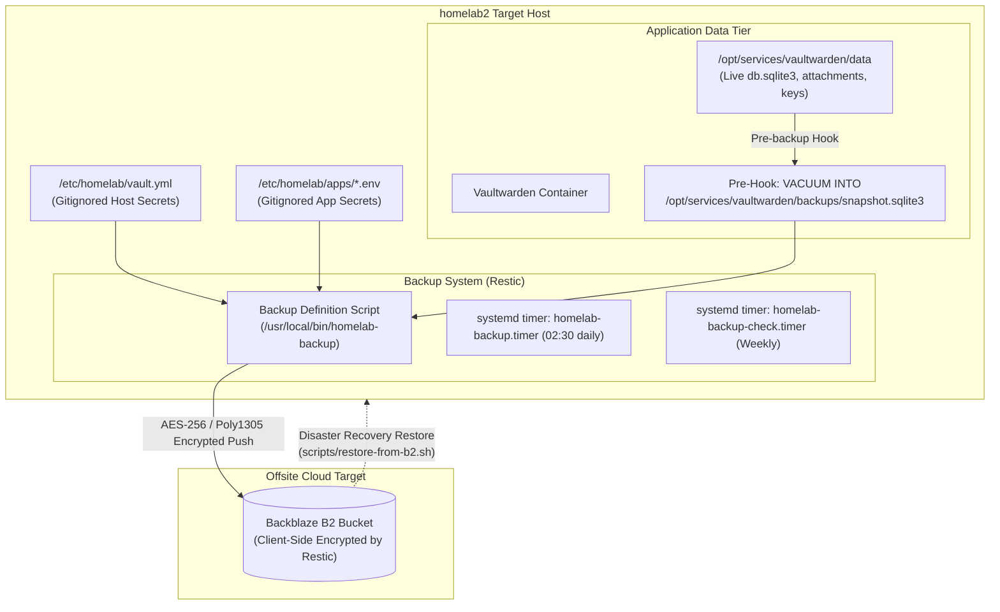

# Feature Specification: Centralized Backblaze B2 Backup & Automated Disaster Recovery

**Feature Branch**: `006-backblaze-backup-restore`

**Created**: 2026-11-02

**Status**: Draft

**Input**: User description: "Going forward I want everything getting backed up and restored from backblaze. Phase 7 should be migrating that to a local backup server. If it makes the most sense let's add that as a new spec. We need to make sure gitignored secret files are included in backups and restored automatically."

---

## User Scenarios & Testing *(mandatory)*

### User Story 1 - Continuous Automated Offsite Backups to Backblaze B2 (Priority: P1)

As a homelab operator, I want automated, daily, client-side encrypted backups of all stateful application data and gitignored secrets directly to Backblaze B2 via Restic, so that hardware failure, fire, or catastrophic physical loss does not destroy irreplaceable personal data or credentials.

**Why this priority**: In accordance with Constitution Principle V (Disaster Recovery & Backup by Design) and Principle IV (Zero Secrets in Version Control), backups cannot be deferred to the end of the project. Secrets are gitignored and never committed, so encrypted offsite backup of those secret files alongside stateful application data is mandatory for disaster recovery.

**Independent Test**: Can be tested independently by running the automated backup routine on the server, verifying that a client-side encrypted snapshot is created in Backblaze B2 containing the active host secrets (`/etc/homelab/vault.yml`) and verified transactional application snapshots (Vaultwarden DB dump, RSA keys, attachments), without capturing live/in-flight database files.

**Acceptance Scenarios**:
1. **Given** a live running server with Vaultwarden and active secrets in `/etc/homelab/vault.yml`, **When** the scheduled or on-demand Restic backup executes, **Then** an offsite snapshot is created in the Backblaze B2 repository with exit code `0`.
2. **Given** a live SQLite database, **When** the backup routine runs, **Then** it triggers an atomic transactional snapshot (`VACUUM INTO`) and integrity check before backing up the snapshot file, explicitly excluding the live `db.sqlite3` file to prevent torn images.
3. **Given** gitignored host identity files (`/etc/homelab/vault.yml`, app `.env` files), **When** Restic executes, **Then** these files are included in the encrypted snapshot with permissions intact.
4. **Given** zero network connectivity during a backup run, **When** Restic fails to reach Backblaze B2, **Then** an actionable failure log is written to journald, local application operation remains uninterrupted, and the failure alert is recorded.

---

### User Story 2 - One-Command Automated Disaster Recovery & Secret Restoration (Priority: P1) 🎯 MVP

As a homelab administrator recovering a destroyed node or setting up on fresh bare metal, I want an automated restore script that connects to Backblaze B2 using only 4 bootstrap credentials, so that all gitignored secret files and application datasets are restored into their exact filesystem paths without manual retyping or manual reconfiguration.

**Why this priority**: A backup that cannot be restored in an automated fashion is useless in a disaster. The core value of gitignoring secrets is realized only when the restore script can autonomously recover `vault.yml` and app databases from the B2 snapshot.

**Independent Test**: Can be tested independently by running `scripts/restore-from-b2.sh` against an isolated staging directory or clean test system, providing the 4 bootstrap credentials (`B2_ACCOUNT_ID`, `B2_ACCOUNT_KEY`, `RESTIC_REPOSITORY`, `RESTIC_PASSWORD`), and confirming that `vault.yml` and the complete Vaultwarden dataset are restored with correct ownership (`1000:1000`) and mode permissions.

**Acceptance Scenarios**:
1. **Given** a fresh system with only the cloned repository and 4 bootstrap credentials, **When** the operator runs `restore-from-b2.sh`, **Then** the script authenticates to Backblaze B2 and identifies the latest verified snapshot.
2. **Given** existing live directories on an active server, **When** the restore script runs without `--force`, **Then** it refuses to overwrite existing files and requires explicit confirmation.
3. **Given** a successful restore run, **When** checking the filesystem, **Then** `/etc/homelab/vault.yml` and `/opt/services/vaultwarden/data/` exist with identical checksums to the backup source.
4. **Given** the restored host secrets and application data, **When** Ansible (`apply-phase5.ps1`) or `docker compose` is executed, **Then** the service starts immediately and passes all `/alive` health assertions.

---

### User Story 3 - Retention Rotation, Pruning & Snapshot Health Telemetry (Priority: P2)

As a systems operator, I want automated retention pruning and periodic repository integrity checks, so that storage costs on Backblaze B2 remain controlled and repository corruption is detected before data loss occurs.

**Why this priority**: Without automated pruning and data subset verification, backup storage grows unbounded and silent repository corruption goes undetected until an emergency restore fails.

**Independent Test**: Can be tested independently by running the pruning routine (`restic forget --prune`) and the repository integrity check (`restic check --read-data-subset=5%`), confirming aged snapshots are cleanly expunged and pack integrity is verified.

**Acceptance Scenarios**:
1. **Given** a collection of historical snapshots, **When** the nightly retention job runs, **Then** snapshots adhering to the retention policy (7 daily, 5 weekly, 12 monthly) are kept and expired snapshots are pruned.
2. **Given** the weekly integrity timer, **When** the verification job fires, **Then** `restic check --read-data-subset=5%` runs and reports complete repository consistency to systemd journald.

---

### User Story 4 - Standardized Per-App Backup Onboarding Contract (Priority: P2)

As a developer adding future Phase 5 applications (Home Assistant, Immich, Mealie, etc.), I want a standardized backup inventory contract so that each newly deployed application automatically integrates into the Backblaze B2 backup and restore pipeline.

**Why this priority**: Standardizing the app backup interface ensures that future application deployments do not require re-engineering the backup system or forgetting to back up new data tiers.

**Independent Test**: Can be tested independently by adding a mock service definition adhering to the contract and verifying that the centralized backup runner picks up its pre-dump hook and data paths.

**Acceptance Scenarios**:
1. **Given** a new application deployed under `/opt/services/<app>`, **When** defining its backup hook, **Then** it registers a pre-backup script (e.g., database dump) and an inclusion path.
2. **Given** an application uninstall or teardown, **When** removed, **Then** historical B2 snapshots remain intact in retention while future runs omit the removed path.

---

## Architecture & System Design

---

## Requirements *(mandatory)*

### Functional Requirements

- **FR-001**: System MUST install and configure `restic` as the core client-side encrypted backup utility.
- **FR-002**: System MUST store Backblaze B2 credentials (`vault_b2_account_id`, `vault_b2_account_key`, `vault_restic_repository`, `vault_restic_password`) in the uncommitted, gitignored file `ansible/inventory/group_vars/all/vault.yml`.
- **FR-003**: System MUST provide an uncommitted secrets template `ansible/inventory/group_vars/all/vault.yml.example` committed to version control.
- **FR-004**: System MUST maintain active host secrets at `/etc/homelab/vault.yml` with strict permissions (`0600`, `root:root`).
- **FR-005**: System MUST execute a pre-backup hook for SQLite applications that runs `sqlite3 VACUUM INTO` and asserts `PRAGMA integrity_check; == "ok"` before archiving.
- **FR-006**: System MUST explicitly exclude live `*.sqlite3` and `*.db` files from the Restic backup paths to prevent torn database images.
- **FR-007**: System MUST back up `/etc/homelab/vault.yml`, `/etc/homelab/apps/*.env`, and all verified application data directories (`/opt/services/*/data`, attachments, crypto keys) to Backblaze B2.
- **FR-008**: System MUST schedule automated backups via systemd timer `homelab-backup.timer` firing daily at 02:30 with `Persistent=true`.
- **FR-009**: System MUST enforce a snapshot retention policy of 7 daily, 5 weekly, and 12 monthly snapshots, pruning expired snapshots automatically.
- **FR-010**: System MUST schedule a weekly repository data integrity check (`restic check --read-data-subset=5%`) via `homelab-backup-check.timer`.
- **FR-011**: System MUST provide a standalone disaster recovery restore script `scripts/restore-from-b2.sh` capable of restoring `vault.yml` and all application states on clean hardware given only the 4 bootstrap credentials.
- **FR-012**: System MUST provide a remote verification script `scripts/verify-phase5-backup.ps1` and `.sh` to validate B2 connectivity, snapshot creation, and restore viability.

### Non-Functional Requirements & Security Invariants

- **NFR-001 (Zero Secrets in Git)**: `vault.yml`, `.env`, and private keys MUST NEVER be committed to Git. The `.gitignore` file MUST reject `vault.yml`.
- **NFR-002 (Client-Side Encryption)**: All data transmitted to and stored at Backblaze B2 MUST be encrypted client-side by Restic before traversing the network.
- **NFR-003 (Least-Privilege Restoration)**: The restoration script MUST confirm before overwriting any existing non-empty directory unless explicitly invoked with `--force`.

---

## Success Criteria *(mandatory)*

- **SC-001**: Automated daily backup completes in under 3 minutes for base state + Vaultwarden and exits with return code `0`.
- **SC-002**: Live database files are never backed up directly; 100% of backed up database artifacts pass SQLite integrity validation.
- **SC-003**: Disaster recovery script `restore-from-b2.sh` can successfully restore `vault.yml` and all Vaultwarden data to a clean directory in under 2 minutes.
- **SC-004**: Git repository history contains 0 secrets (neither plaintext nor SOPS encrypted ciphertext).
- **SC-005**: Weekly check timer successfully verifies 5% of repository chunks without error.
