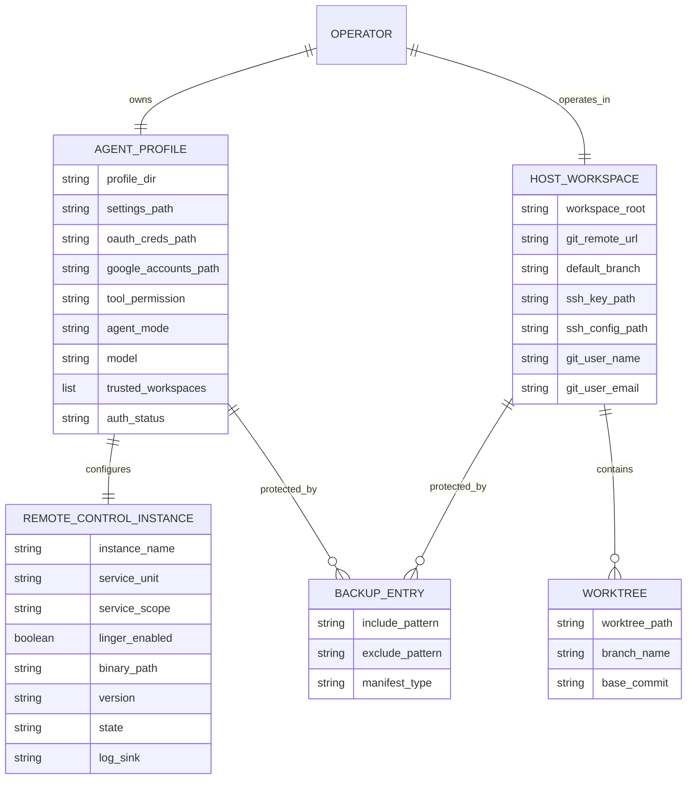
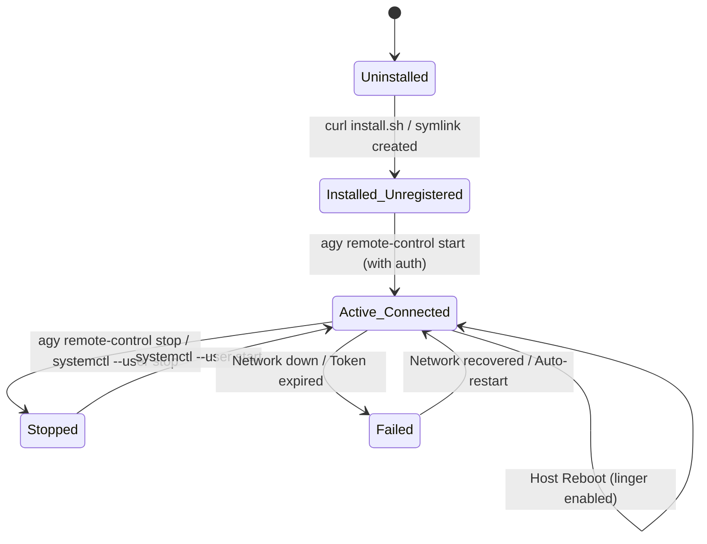

# Data Model: Target Host Antigravity Installation & Remote Control

**Feature**: `007-antigravity-remote-control`  
**Status**: Draft  
**Spec Reference**: [`spec.md`](spec.md)  

---

## 1. Entity Model

---

## 2. Entity Specifications

### 2.1 Remote Control Instance (`RemoteControlInstance`)

Represents the persistent Antigravity background daemon running on the target machine.

| Field | Type | Description | Validation / Constraints |
|---|---|---|---|
| `instance_name` | String | Identifier displayed in Remote Control dashboard | Default: `homelab2-target`; alphanumeric and hyphens |
| `service_unit` | String | Systemd user service unit name | Fixed: `agy-remote-control.service` |
| `service_scope` | String | Systemd supervision scope | Fixed: `user` (systemd user manager) |
| `linger_enabled` | Boolean | Whether user lingering is enabled for `admin` | MUST be `true` (`/var/lib/systemd/linger/admin` exists) |
| `binary_path` | String | Path to `agy` binary | `/home/admin/.local/bin/agy` and symlinked to `/usr/local/bin/agy` |
| `version` | String | Output of `agy --version` | Non-empty version string |
| `state` | Enum | Lifecycle state | `uninstalled`, `installed_unregistered`, `active_connected`, `stopped`, `failed` |
| `log_sink` | String | Log destination | Systemd journal (`journalctl --user -u agy-remote-control.service`) |

#### Lifecycle State Transitions

---

### 2.2 Agent Profile & Auth State (`AgentProfile`)

Represents local configuration settings, authorization grants, and OAuth session tokens.

| Field | Type | Description | Validation / Constraints |
|---|---|---|---|
| `profile_dir` | String | Base directory for Gemini/Antigravity | `/home/admin/.gemini` (perms `0700 admin:admin`) |
| `config_dir` | String | CLI configuration directory | `/home/admin/.gemini/antigravity-cli` (perms `0700 admin:admin`) |
| `settings_path` | String | CLI configuration JSON file | `/home/admin/.gemini/antigravity-cli/settings.json` (perms `0600 admin:admin`) |
| `oauth_creds_path` | String | OAuth credential token storage | `/home/admin/.gemini/oauth_creds.json` (perms `0600 admin:admin`) |
| `google_accounts_path` | String | Authenticated account details | `/home/admin/.gemini/google_accounts.json` (perms `0600 admin:admin`) |
| `tool_permission` | String | Baseline tool permission policy | MUST be `"always-proceed"` (autonomous mode) |
| `agent_mode` | String | Agent default execution mode | MUST be `"auto"` |
| `trusted_workspaces` | List[String] | Directories allowed for agent execution | MUST contain `"/home/admin/homelab2"` |
| `model` | String | Default model for CLI sessions | Default: `"Gemini 3.8 Flash (Medium)"` |
| `auth_status` | Enum | Current authentication status | `unauthenticated`, `authenticated`, `token_expired` |

#### Validation Rules
1. `oauth_creds_path` and `google_accounts_path` MUST have file mode `0600` and ownership `admin:admin`.
2. Zero secret tokens or credential files may be committed or tracked in git (`git check-ignore` must return 0).
3. `settings.json` must be strictly valid JSON.

---

### 2.3 Target Host Workspace (`HostWorkspace`)

Represents the `homelab2` git repository checkout and execution environment on the target host.

| Field | Type | Description | Validation / Constraints |
|---|---|---|---|
| `workspace_root` | String | Git checkout root directory | `/home/admin/homelab2` (owned by `admin:admin`) |
| `git_remote_url` | String | Remote origin URL | Valid GitHub SSH URL (e.g. `git@github.com:...`) |
| `default_branch` | String | Default checked-out branch | `master` or feature branch |
| `worktrees_dir` | String | Directory for isolated worktrees | `/home/admin/homelab2/.worktrees` |
| `ssh_key_path` | String | Dedicated Git SSH private key | `/home/admin/.ssh/id_ed25519_github` (perms `0600 admin:admin`) |
| `ssh_pub_path` | String | Dedicated Git SSH public key | `/home/admin/.ssh/id_ed25519_github.pub` (perms `0644 admin:admin`) |
| `ssh_config_path` | String | SSH client configuration | `/home/admin/.ssh/config` containing `Host github.com` stanza |
| `git_user_name` | String | Git commit author name | Configured non-empty string in `~/.gitconfig` |
| `git_user_email` | String | Git commit author email | Configured valid email in `~/.gitconfig` |

#### Validation Rules
1. Workspace root must be a valid git repository (`git rev-parse --is-inside-work-tree` returns `true`).
2. SSH deploy key must authenticate successfully to GitHub (`ssh -T git@github.com` confirms access).
3. Sudo permissions for `admin` must allow passwordless execution of homelab automation playbooks.

---

### 2.4 Backup Manifest Entries (`BackupManifestEntries`)

Defines entries in the centralized Restic backup and exclusion files managed under `/etc/homelab/`.

| File Path | Entry | Type | Rationale |
|---|---|---|---|
| `/etc/homelab/backup-include.txt` | `/home/admin/.gemini/oauth_creds.json` | Include | Persistent Google OAuth session |
| `/etc/homelab/backup-include.txt` | `/home/admin/.gemini/google_accounts.json` | Include | Account identity metadata |
| `/etc/homelab/backup-include.txt` | `/home/admin/.gemini/antigravity-cli/settings.json` | Include | Autonomous tool permissions & workspaces |
| `/etc/homelab/backup-include.txt` | `/home/admin/.ssh/id_ed25519_github` | Include | Dedicated git push/pull private key |
| `/etc/homelab/backup-include.txt` | `/home/admin/.ssh/id_ed25519_github.pub` | Include | Dedicated git public key |
| `/etc/homelab/backup-excludes.txt` | `/home/admin/.gemini/antigravity-cli/cache/**` | Exclude | Transient model and API caches |
| `/etc/homelab/backup-excludes.txt` | `/home/admin/.gemini/antigravity-cli/crashes/**` | Exclude | Crash telemetry dumps |
| `/etc/homelab/backup-excludes.txt` | `/home/admin/.gemini/antigravity-cli/log/**` | Exclude | Transient session logs |
| `/etc/homelab/backup-excludes.txt` | `/home/admin/.gemini/antigravity-cli/updater/**` | Exclude | Update scratch files |
| `/etc/homelab/backup-excludes.txt` | `/home/admin/.gemini/antigravity-cli/brain/**` | Exclude | Local scratch buffers & task state |
| `/etc/homelab/backup-excludes.txt` | `/home/admin/.gemini/tmp/**` | Exclude | Temporary scratch files |
| `/etc/homelab/backup-excludes.txt` | `/home/admin/homelab2/.git/**` | Exclude | Git object database (authoritative in GitHub) |
