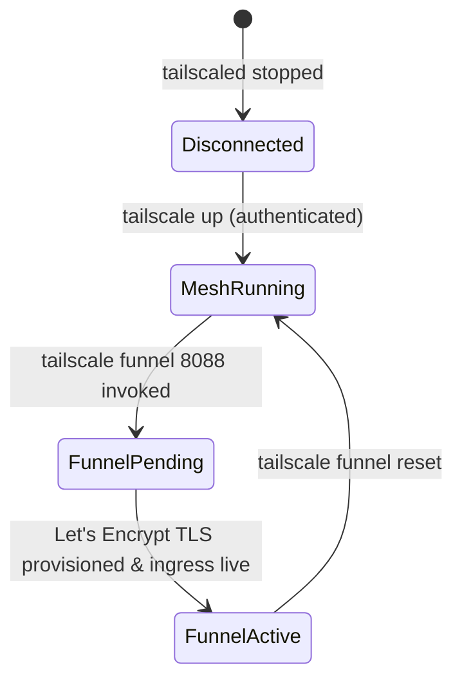

# Data Model: Vaultwarden Public Access via Tailscale Funnel

**Feature Branch**: `008-vaultwarden-tailscale-funnel`  
**Date**: 2026-11-03  
**Status**: Completed  

## 1. Entities & Configuration Schema

### Entity: `TailscaleNodeIngress` (Runtime State)
Represents the local Tailscale node's edge ingress configuration and networking status.

| Field | Type | Required | Description | Example / Allowed Values |
|---|---|---|---|---|
| `NodeFQDN` | string | Yes | Authoritative DNS domain managed by Tailscale | `<node-name>.<tailnet>.ts.net` |
| `CertDomains` | list[string] | Yes | Domains covered by automated TLS certificate | `["<node-name>.<tailnet>.ts.net"]` |
| `BackendState` | string | Yes | Tailscale daemon operational state | `"Running"`, `"NeedsLogin"`, `"Stopped"` |
| `FunnelActive` | boolean | Yes | Whether Funnel is active on the node | `true`, `false` |
| `FunnelPort` | integer | Yes | Public ingress port | `443` |
| `TargetPort` | integer | Yes | Local backend container target port | `8088` |
| `AllowFunnel` | boolean | Yes | Whether tailnet ACL grants funnel capability | `true`, `false` |

**State Transitions**:

---

### Entity: `VaultwardenEnvironment` (File Configuration)
Represents the service environment variables defined in `/opt/services/vaultwarden/.env`.

| Parameter | Type | Default | Description | Validation Rule |
|---|---|---|---|---|
| `DOMAIN` | string | `https://<node-name>.<tailnet>.ts.net` | Public canonical URL used for origins and links | Must start with `https://`, no trailing slash |
| `ROCKET_PORT` | integer | `80` | Internal container listening port | `80` (mapped to host `8088`) |
| `SIGNUPS_ALLOWED` | boolean | `false` | Whether unauthenticated public signups are enabled | MUST be `false` (FR-005) |
| `INVITATIONS_ALLOWED`| boolean | `true` | Whether administrative invitations are allowed | `true` or `false` |
| `WEBSOCKET_ENABLED` | boolean | `true` | Enables WebSocket notification hub | MUST be `true` for real-time sync |
| `ENABLE_DB_WAL` | boolean | `true` | SQLite Write-Ahead Logging mode | MUST be `true` for transactional integrity |
| `DATABASE_URL` | string | `/data/db.sqlite3` | SQLite database file location | Absolute path in container mount |
| `ADMIN_TOKEN` | string | (Optional Hash) | Argon2 PHC string for admin portal | Argon2id hash or absent |
| `LOG_LEVEL` | string | `info` | Logging verbosity | `trace`, `debug`, `info`, `warn`, `error` |

---

### Entity: `CaddyIngressState` (Host Configuration)
Represents the local reverse proxy's drop-in route configurations in `/etc/caddy/conf.d/`.

| File Path | Status | Action | Rationale |
|---|---|---|---|
| `/etc/caddy/conf.d/00-health.caddy` | Present | Modified / Retained | Retains internal health endpoints, eliminates conflicting wildcard `:443` binding |
| `/etc/caddy/conf.d/20-vaultwarden.caddy` | Absent | Decommissioned | Removed to bypass Caddy, eliminate dual-proxying, and prevent domain binding conflicts |

---

## 2. Validation & Invariants

1. **Secure Origin Invariant**: `DOMAIN` MUST match `https://{{ tailscale_discovered_fqdn }}` exactly. Mismatches will trigger client-side WebCrypto failures and cross-origin security warnings.
2. **Access Control Invariant**: `SIGNUPS_ALLOWED` MUST strictly equal `false`. Any configuration where `SIGNUPS_ALLOWED=true` fails pre-flight verification.
3. **Port Invariant**: Vaultwarden container continues binding exclusively to `127.0.0.1:8088`. It MUST NOT bind to `0.0.0.0:8088`.
4. **Zero-Secret Invariant**: Neither `NodeFQDN`, Tailscale auth keys, nor admin tokens may appear in version control (`ansible/roles/vaultwarden/defaults/main.yml` must use placeholders or dynamic evaluation).
