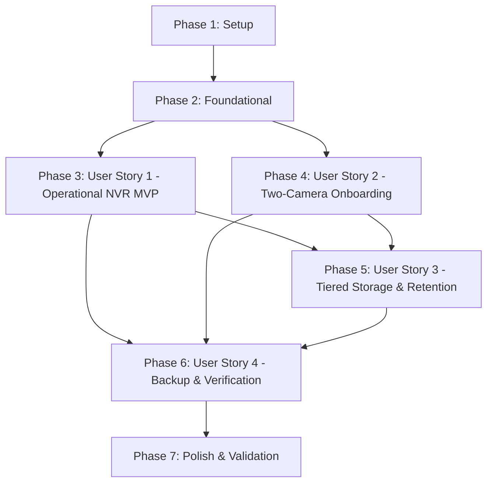

# Tasks: Frigate NVR Pre-Arrival Setup for Two Cameras

**Input**: Design documents from `/specs/009-frigate-nvr-setup/`  
**Prerequisites**: [plan.md](./plan.md) (required), [spec.md](./spec.md) (required), [research.md](./research.md), [data-model.md](./data-model.md), [contracts/](./contracts/), [quickstart.md](./quickstart.md)  
**Tests**: Automated acceptance verification suite (`FRG-01` to `FRG-09`) specified in [contracts/verification-contract.md](./contracts/verification-contract.md) and governed by Homelab Constitution Principle III.  
**Organization**: Tasks are grouped by user story to enable independent implementation, testing, and progressive validation of each story.

## Format: `[ID] [P?] [Story] Description`

- **[P]**: Can run in parallel (different files, no dependencies on incomplete tasks)
- **[Story]**: Which user story this task belongs to (`[US1]`, `[US2]`, `[US3]`, `[US4]`)
- Every task includes exact file paths and verbatim configuration constraints

---

## Phase 1: Setup (Shared Infrastructure)

**Purpose**: Project initialization, inventory variables, sanitized secret templates, and Ansible role scaffolding.

- [X] T001 Define Frigate non-sensitive variables in `ansible/inventory/group_vars/all/vars.yml` (HTTP port `5000`, auth port `8971`, RTSP port `8554`, WebRTC port `8555`, retention defaults `7`d motion / `14`d events, and camera enabled flags `frigate_camera_1_enabled: false` and `frigate_camera_2_enabled: false`)
- [X] T002 [P] Add sanitized camera RTSP placeholder secret variables to `ansible/inventory/group_vars/all/vault.yml.example` (`vault_frigate_camera_1_rtsp_main_url`, `vault_frigate_camera_1_rtsp_sub_url`, `vault_frigate_camera_2_rtsp_main_url`, `vault_frigate_camera_2_rtsp_sub_url`)
- [X] T003 [P] Create Ansible role directory structure for Frigate in `ansible/roles/frigate/{defaults,files,handlers,tasks,templates}`
- [X] T004 [P] Define role default variables in `ansible/roles/frigate/defaults/main.yml` with verbatim constraints: pinned image `frigate_image_tag: "ghcr.io/blakeblackshear/frigate:0.14.1"`, iGPU paths `frigate_igpu_render_device: "/dev/dri/by-path/pci-0000:00:02.0-render"`, `frigate_igpu_card_device: "/dev/dri/by-path/pci-0000:00:02.0-card"`, memory buffers `frigate_shm_size: "256mb"`, `frigate_tmpfs_cache_size: "512m"` (`536870912`), ports `5000`, `8971`, `8554`, `8555`, and app/media storage paths
- [X] T005 [P] Create committed sanitized environment variable template in `ansible/roles/frigate/files/env.example` defining placeholder RTSP URLs for Camera 1 and Camera 2
- [X] T006 [P] Create systemd daemon-reload and Frigate restart handlers in `ansible/roles/frigate/handlers/main.yml`

---

## Phase 2: Foundational (Blocking Prerequisites)

**Purpose**: Host preflight validations, firewall rules, and base storage directory layout that all Frigate user stories depend on.

**⚠️ CRITICAL**: No user story work can begin until this foundational phase is complete.

- [X] T007 Implement hardware device and mount preflight assertions in `ansible/roles/frigate/tasks/preflight.yml` (asserting Intel UHD Graphics 770 render device `/dev/dri/by-path/pci-0000:00:02.0-render` exists as a character device symlink, discrete AMD GPU `03:00.0` is omitted, and `/mnt/scratch` is an active mount point)
- [X] T008 [P] Configure firewall port declarations for Frigate in `ansible/roles/firewall/defaults/main.yml` adding TCP ports `[5000, 8971, 8554, 8555]` and UDP port `[8555]` to LAN-accessible services
- [X] T009 [P] Update firewall ruleset template in `ansible/roles/firewall/templates/nftables.conf.j2` to permit trusted local LAN (`192.168.4.0/24`) and Tailscale overlay (`tailscale0`) access to Frigate ports while dropping untrusted traffic
- [X] T010 Create base directory layout tasks in `ansible/roles/frigate/tasks/layout.yml` with verbatim ownership and mode constraints: Tier 0 NVMe directories `/opt/services/frigate` (`0755` `root:root`), `/opt/services/frigate/config` (`0755` `root:root`), `/opt/services/frigate/backups` (`0750` `root:root`), and Tier 2 scratch directories `/mnt/scratch/frigate` (`2775` `root:storage`), `/mnt/scratch/frigate/media` (`2775` `root:storage`)
- [X] T011 Create role task orchestrator in `ansible/roles/frigate/tasks/main.yml` sequencing `preflight.yml`, `layout.yml`, `config.yml`, and `service.yml` with task tags

**Checkpoint**: Foundation ready - host preflight assertions, firewall policies, and storage directories verified. User story implementation can now proceed.

---

## Phase 3: User Story 1 - Operational Pre-Arrival NVR Service & Dashboard Access (Priority: P1) 🎯 MVP

**Goal**: Deploy the containerized Frigate NVR stack on `homelab2` so it runs cleanly, restarts on host boot, utilizes the Intel UHD 770 iGPU, and serves its web UI and health API immediately with zero connected physical cameras.

**Independent Test**: Execute `scripts/apply-phase5-frigate.sh`, confirm `systemctl is-active frigate.service` is `active`, verify container `frigate` is running and healthy with 0 restarts, and verify `curl -fsS http://127.0.0.1:5000/api/version` returns `0.14.1` and dashboard loads on `http://192.168.4.57:5000`.

- [X] T012 [P] [US1] Create Docker Compose Jinja2 template in `ansible/roles/frigate/templates/compose.yml.j2` with image `ghcr.io/blakeblackshear/frigate:0.14.1`, container name `frigate`, `restart: unless-stopped`, `stop_grace_period: 30s`, `shm_size: "256mb"`, Intel iGPU pass-through `/dev/dri/by-path/pci-0000:00:02.0-render:/dev/dri/renderD128` and `/dev/dri/by-path/pci-0000:00:02.0-card:/dev/dri/card0`, AMD GPU excluded, volume mounts for `/config`, `/media/frigate`, tmpfs `512m` `/tmp/cache`, `env_file: .env`, `LIBVA_DRIVER_NAME=iHD`, port bindings (`5000`, `8971`, `8554`, `8555`), and healthcheck curling `/api/version`
- [X] T013 [P] [US1] Create systemd service unit template in `ansible/roles/frigate/templates/frigate.service.j2` supervising Docker Compose stack with `Type=oneshot`, `RemainAfterExit=yes`, `WorkingDirectory=/opt/services/frigate`, `ExecStart=/usr/bin/docker compose up -d --remove-orphans`, `ExecStop=/usr/bin/docker compose down`, `TimeoutStartSec=180`, and `RequiresMountsFor=/opt/services /mnt/scratch`
- [X] T014 [US1] Implement service installation and daemon tasks in `ansible/roles/frigate/tasks/service.yml` to deploy `/etc/systemd/system/frigate.service` (`0644` `root:root`), trigger daemon-reload, enable, and start `frigate.service`
- [X] T015 [US1] Create dedicated Frigate deployment playbook in `ansible/playbooks/frigate.yml` targeting `homelab_nodes` with pre-task assertions verifying `vault.yml` exists, role execution, and post-task health check assertions
- [X] T016 [US1] Integrate `frigate` role into master convergence playbook in `ansible/playbooks/site.yml` with tags `frigate` and `app`
- [X] T017 [P] [US1] Create POSIX bash operator convergence runner in `scripts/apply-phase5-frigate.sh` supporting `--host`, `--user`, `--identity`, `--check`, and tags
- [X] T018 [P] [US1] Create PowerShell operator convergence runner in `scripts/apply-phase5-frigate.ps1` supporting `-TargetHost`, `-User`, `-IdentityFile`, and `-Check` parameters

**Checkpoint**: At this point, User Story 1 is fully functional as the MVP increment. Frigate is deployed, supervised by systemd, hardware-accelerated via Intel iGPU, and serving HTTP 200 on port 5000 with 0 cameras connected.

---

## Phase 4: User Story 2 - Plug-and-Play Two-Camera Onboarding Upon Delivery (Priority: P1)

**Goal**: Provide pre-staged dual-stream (`detect` + `record`) configuration blocks and isolated secret environment templates for `camera_1` and `camera_2` so the homeowner can enter camera credentials upon delivery and start recording in < 5 minutes without altering service layouts.

**Independent Test**: Verify `/opt/services/frigate/.env` contains placeholder RTSP variables with mode `0600`, verify `/opt/services/frigate/config/config.yml` defines `camera_1` and `camera_2` with `enabled: false`, dual-stream roles (sub-stream `roles: [detect]` at 720p @ 5 FPS, main stream `roles: [record]`), and tracked objects `["person", "car"]`. Then test toggling `frigate_camera_1_enabled: true` in `vars.yml` and verify Frigate updates and reloads without errors.

- [X] T019 [P] [US2] Create isolated camera secrets environment Jinja2 template in `ansible/roles/frigate/templates/env.j2` populating `FRIGATE_CAMERA_1_RTSP_MAIN_URL`, `FRIGATE_CAMERA_1_RTSP_SUB_URL`, `FRIGATE_CAMERA_2_RTSP_MAIN_URL`, and `FRIGATE_CAMERA_2_RTSP_SUB_URL` from Ansible vault variables
- [X] T020 [P] [US2] Create Frigate configuration Jinja2 template in `ansible/roles/frigate/templates/config.yml.j2` with OpenVINO GPU detector on `/openvino-model/ssdlite_mobilenet_v2.xml` (`width: 300`, `height: 300`, `input_tensor: nhwc`, `input_pixel_format: bgr`, `labelmap_path: /openvino-model/coco_91cl_bkgr.txt`), VAAPI ffmpeg hwaccel (`preset-vaapi`), global detect (`width: 1280`, `height: 720`, `fps: 5`), tracked objects `["person", "car"]`, and pre-staged `camera_1` and `camera_2` slots with `enabled: {{ frigate_camera_1_enabled }}` and `inputs` mapped to environment placeholders `{FRIGATE_CAMERA_*_RTSP_*}`
- [X] T021 [US2] Implement configuration rendering tasks in `ansible/roles/frigate/tasks/config.yml` deploying `/opt/services/frigate/.env` with strict mode `0600` (`root:root`), `/opt/services/frigate/.env.example` (`0644` `root:root`), `/opt/services/frigate/config/config.yml` (`0644` `root:root`), and `/opt/services/frigate/compose.yml` (`0644` `root:root`), notifying Frigate restart handler upon change

**Checkpoint**: At this point, User Stories 1 AND 2 are complete. The two cameras are pre-staged, disabled by default to keep logs clean, and ready for instant < 5-minute activation on delivery day.

---

## Phase 5: User Story 3 - Tiered Storage Separation & Automated Retention Management (Priority: P2)

**Goal**: Guarantee physical and logical isolation between fast application metadata (Tier 0 NVMe `/opt/services/frigate/config`) and continuous CCTV footage (Tier 2 scratch `/mnt/scratch/frigate/media`), while enforcing automated 7-day motion and 14-day detection event retention policies.

**Independent Test**: Verify container mount inspection confirms `/config` maps to `/opt/services/frigate/config` (containing `frigate.db`) and `/media/frigate` maps to `/mnt/scratch/frigate/media` (on `/dev/sdb`), verify `/mnt/scratch` is absent from `/etc/fstab` MergerFS pool branches, and query `/api/config` to verify retention constraints `record.retain.days: 7`, `record.retain.mode: "motion"`, `record.events.retain.default: 14`, and `record.events.retain.mode: "active_objects"`.

- [X] T022 [US3] Configure storage tier mount assertions and directory permissions in `ansible/roles/frigate/tasks/layout.yml` asserting `/mnt/scratch` is not inside MergerFS `/mnt/storage` pool branches and ensuring `/mnt/scratch/frigate/media` has GID `1001` (`storage`) and setgid mode `2775`
- [X] T023 [US3] Enforce retention parameters in `ansible/roles/frigate/templates/config.yml.j2` setting verbatim constraints: 7-day general motion retention (`record.retain.days: 7`, `record.retain.mode: "motion"`), 14-day tracked event retention (`record.events.retain.default: 14`, `record.events.retain.mode: "active_objects"`), and 14-day snapshot retention (`snapshots.retain.default: 14`)

**Checkpoint**: Storage tier separation is enforced. 100% of CCTV video segments write to scratch storage with automated pruning, and zero video bytes hit parity disks.

---

## Phase 6: User Story 4 - Backup Protection, Secret Isolation & Health Verification (Priority: P2)

**Goal**: Protect Frigate configuration and SQLite database with verified transactional Restic Backblaze B2 snapshots (while strictly excluding bulk CCTV video), ensure zero secrets in version control, and automate end-to-end acceptance verification (`FRG-01` through `FRG-09`).

**Independent Test**: Execute `/etc/homelab/backup.d/20-frigate.sh pre-backup`, verify `/opt/services/frigate/backups/snapshot.sqlite3` is created and passes `PRAGMA integrity_check;`, confirm `/mnt/scratch` is in `/etc/homelab/backup-excludes.txt`, and execute `scripts/verify-phase5-frigate.sh` verifying all 9 assertions pass.

- [X] T024 [P] [US4] Create transactional SQLite backup hook script template in `ansible/roles/backup/templates/20-frigate.sh.j2` implementing `pre-backup` (executing `sqlite3 ... "VACUUM INTO '/opt/services/frigate/backups/snapshot.sqlite3'"` and asserting `PRAGMA integrity_check;` returns `"ok"` with `0640` mode) and `post-restore` (restoring snapshot if `frigate.db` absent)
- [X] T025 [US4] Deploy backup hook in `ansible/roles/backup/tasks/hooks.yml` installing `/etc/homelab/backup.d/20-frigate.sh` with mode `0750` (`root:root`)
- [X] T026 [P] [US4] Update Restic backup exclusions in `ansible/roles/backup/defaults/main.yml` adding `/opt/services/*/config/*.db`, `*.db-wal`, `*.db-shm`, `/opt/services/frigate/config/model_cache`, and `/mnt/scratch/**` to `/etc/homelab/backup-excludes.txt`
- [X] T027 [P] [US4] Create automated acceptance test script in `scripts/verify-phase5-frigate.sh` implementing assertions `FRG-01` through `FRG-09` with `--local`, `--json`, and colored terminal reporting
- [X] T028 [P] [US4] Create PowerShell workstation verification wrapper in `scripts/verify-phase5-frigate.ps1` executing `scripts/verify-phase5-frigate.sh` over SSH or locally
- [X] T029 [US4] Create dedicated Ansible verification playbook in `ansible/playbooks/verify-phase5-frigate.yml` implementing `FRG-01` through `FRG-09` assertions (service active, API response `< 2`s, Intel iGPU binding, pre-staged camera slots, secret permissions `0600`, storage mount separation, firewall rules, backup snapshot check, and journald logs)
- [X] T030 [US4] Import `verify-phase5-frigate.yml` into master platform verification playbook in `ansible/playbooks/verify.yml` and add Frigate status assertions to summary debug report

**Checkpoint**: All 4 user stories are fully implemented. Secret isolation, transactional backup snapshots, and the complete 9-assertion automated verification suite are operational.

---

## Phase 7: Polish & Cross-Cutting Concerns

**Purpose**: Syntax linting, static analysis, and end-to-end documentation validation.

- [X] T031 [P] Run static syntax analysis and linting (`ansible-lint`, `shellcheck`) across all newly created playbooks, roles, and shell scripts (`ansible/roles/frigate`, `scripts/*frigate*`, `20-frigate.sh`)
- [X] T032 Validate complete pre-arrival deployment and camera onboarding workflow by running quickstart validation steps from `specs/009-frigate-nvr-setup/quickstart.md`

---

## Dependencies & Execution Order

### Phase Dependencies

- **Setup (Phase 1)**: No dependencies - can start immediately.
- **Foundational (Phase 2)**: Depends on Setup (Phase 1) completion - BLOCKS all user stories.
- **User Story 1 (Phase 3 - P1)**: Depends on Foundational (Phase 2) completion. Delivers the operational MVP.
- **User Story 2 (Phase 4 - P1)**: Depends on Foundational (Phase 2) and User Story 1 template structures. Can be implemented in parallel with US1 templates or immediately after.
- **User Story 3 (Phase 5 - P2)**: Depends on User Story 1 (service compose mounts) and User Story 2 (config.yml retention blocks).
- **User Story 4 (Phase 6 - P2)**: Depends on User Story 1 and User Story 2 (requires running service, database, and `.env` to verify).
- **Polish (Phase 7)**: Depends on all user stories being complete.



### User Story Dependencies

- **User Story 1 (P1)**: Foundational prerequisites only. No dependencies on other user stories. Delivers the running Frigate service on Intel iGPU with zero connected cameras.
- **User Story 2 (P1)**: Depends on US1 Compose stack and configuration structure to inject dual-stream `camera_1` and `camera_2` definitions and `.env` variables.
- **User Story 3 (P2)**: Extends US1 layout and US2 configuration with explicit retention parameters (`7`d motion, `14`d events) and scratch tier isolation.
- **User Story 4 (P2)**: Verifies all aspects of US1, US2, and US3 via backup hook `20-frigate.sh` and verification scripts (`FRG-01` to `FRG-09`).

### Within Each User Story

- Prerequisites and defaults before templates.
- Jinja2 templates before role tasks.
- Role tasks before playbooks.
- Playbooks before convergence scripts.
- Story complete and validated before advancing to dependent stories.

### Parallel Opportunities

- **Phase 1 (Setup)**: T002, T003, T004, T005, and T006 can all run in parallel after T001.
- **Phase 2 (Foundational)**: T008 (firewall defaults) and T009 (nftables template) can run in parallel with T007 (preflight) and T010 (layout).
- **Phase 3 (User Story 1)**: T012 (`compose.yml.j2`) and T013 (`frigate.service.j2`) can run in parallel. T017 (`apply-phase5-frigate.sh`) and T018 (`apply-phase5-frigate.ps1`) can run in parallel.
- **Phase 4 (User Story 2)**: T019 (`env.j2`) and T020 (`config.yml.j2`) can run in parallel.
- **Phase 6 (User Story 4)**: T024 (`20-frigate.sh.j2`), T026 (`backup/defaults/main.yml`), T027 (`verify-phase5-frigate.sh`), and T028 (`verify-phase5-frigate.ps1`) can all be drafted in parallel.

---

## Parallel Execution Examples

### Parallel Example: User Story 1 (MVP Deployment)

```bash
# Launch templates for User Story 1 in parallel:
Task: "T012 [P] [US1] Create Docker Compose Jinja2 template in ansible/roles/frigate/templates/compose.yml.j2"
Task: "T013 [P] [US1] Create systemd service unit template in ansible/roles/frigate/templates/frigate.service.j2"

# Launch operator convergence runners in parallel:
Task: "T017 [P] [US1] Create POSIX bash operator convergence runner in scripts/apply-phase5-frigate.sh"
Task: "T018 [P] [US1] Create PowerShell operator convergence runner in scripts/apply-phase5-frigate.ps1"
```

### Parallel Example: User Story 2 (Camera Onboarding Staging)

```bash
# Launch configuration templates for User Story 2 in parallel:
Task: "T019 [P] [US2] Create isolated camera secrets environment Jinja2 template in ansible/roles/frigate/templates/env.j2"
Task: "T020 [P] [US2] Create Frigate configuration Jinja2 template in ansible/roles/frigate/templates/config.yml.j2"
```

### Parallel Example: User Story 4 (Backup & Acceptance Verification)

```bash
# Launch backup hook, Restic exclusions, and verification scripts in parallel:
Task: "T024 [P] [US4] Create transactional SQLite backup hook script template in ansible/roles/backup/templates/20-frigate.sh.j2"
Task: "T026 [P] [US4] Update Restic backup exclusions in ansible/roles/backup/defaults/main.yml"
Task: "T027 [P] [US4] Create automated acceptance test script in scripts/verify-phase5-frigate.sh"
Task: "T028 [P] [US4] Create PowerShell workstation verification wrapper in scripts/verify-phase5-frigate.ps1"
```

---

## Implementation Strategy

### MVP First (User Story 1 Only)

1. Complete **Phase 1: Setup** (inventory variables, role scaffolding, defaults).
2. Complete **Phase 2: Foundational** (preflight checks, firewall rules, storage directories).
3. Complete **Phase 3: User Story 1** (compose template, systemd unit, service task, deployment playbook).
4. **STOP and VALIDATE**:
   - Run `./scripts/apply-phase5-frigate.sh` (or `ansible-playbook ansible/playbooks/frigate.yml`).
   - Query `curl -fsS http://127.0.0.1:5000/api/version` -> should return `0.14.1`.
   - Verify dashboard loads on `http://192.168.4.57:5000` with 0 camera connection error loops.
   - MVP is fully usable and verified ahead of camera delivery!

### Incremental Delivery

1. **Increment 1 (MVP)**: Phase 1 + Phase 2 + Phase 3 -> Frigate is deployed, running, and accessible on LAN/Tailscale.
2. **Increment 2**: Phase 4 (User Story 2) -> Camera slots `camera_1` and `camera_2` pre-staged in `config.yml` with isolated `.env` placeholders ready for delivery day.
3. **Increment 3**: Phase 5 (User Story 3) -> Retention rules (`7`d motion, `14`d events) and Tier 2 scratch isolation verified.
4. **Increment 4**: Phase 6 (User Story 4) -> Backup hook `/etc/homelab/backup.d/20-frigate.sh` deployed, Restic exclusions configured, and `scripts/verify-phase5-frigate.sh` executing all 9 assertions (`FRG-01` to `FRG-09`).
5. **Increment 5**: Phase 7 (Polish) -> `ansible-lint`, `shellcheck`, and quickstart runbook validation.

---

## Notes

- Every task follows the strict format: `- [ ] [TaskID] [P?] [Story?] Description with file path`.
- Setup and Foundational tasks have no story label. User story tasks have `[US1]`, `[US2]`, `[US3]`, or `[US4]`. Polish tasks have no story label.
- Specific constraints from `data-model.md` and contracts (e.g. modes `0600`, `0750`, `2775`, image tag `ghcr.io/blakeblackshear/frigate:0.14.1`, iGPU device path `/dev/dri/by-path/pci-0000:00:02.0-render`) are quoted verbatim in task descriptions.
- Zero Coral TPU hardware present or configured; discrete AMD GPU (`03:00.0`) remains untouched by Frigate.
- No real credentials appear in version control; real secrets live in gitignored files and are recovered via encrypted offsite Restic backups to Backblaze B2.
