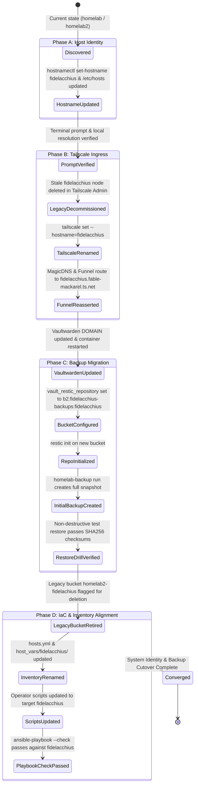

# Data Model & Entity Specifications: System Identity & Backup Bucket Naming (Fidelacchius)

**Feature**: `010-fidelacchius-system-rename`  
**Date**: 2026-11-04  
**Status**: Completed  

---

## 1. Entities & Schemas

### 1.1 HostIdentity

Represents the physical server's operating system identity and local hostname resolution.

| Field | Type | Description | Constraints & Validation |
|-------|------|-------------|--------------------------|
| `static_hostname` | string | System hostname stored in `/etc/hostname` | Must be `fidelacchius` (RFC 1123 compliant: lowercase alphanumeric and hyphens, 1-63 chars) |
| `transient_hostname` | string | Kernel in-memory hostname (`uname -n`) | Must match `static_hostname` |
| `pretty_hostname` | string | Human-readable system name in systemd | "Fidelacchius (the sword of faith)" (optional display label) |
| `loopback_mappings` | array of strings | Local mappings in `/etc/hosts` | Must map `127.0.0.1` and `127.0.1.1` to `fidelacchius` / `fidelacchius.localdomain` |
| `primary_ip` | string | Primary IPv4 address on LAN subnet | `192.168.4.57` |

### 1.2 TailscaleNodeIdentity

Represents the machine's identity on the Tailscale mesh overlay and public ingress routing.

| Field | Type | Description | Constraints & Validation |
|-------|------|-------------|--------------------------|
| `node_name` | string | Advertised Tailscale machine name | Must be `fidelacchius` (no numeric suffix like `-1`) |
| `tailscale_ip` | string | CGNAT IPv4 address assigned to node | `100.120.174.15` (existing stable IP) |
| `magicdns_fqdn` | string | Fully qualified MagicDNS domain | `fidelacchius.fable-mackarel.ts.net` |
| `funnel_domain` | string | Public Tailscale Funnel ingress URL | `https://fidelacchius.fable-mackarel.ts.net` |
| `funnel_target_port` | integer | Local service port bound to Funnel | `8088` (Vaultwarden) |

### 1.3 BackupRepositoryTarget

Represents the cloud backup target in Backblaze B2 and client-side Restic encryption metadata.

| Field | Type | Description | Constraints & Validation |
|-------|------|-------------|--------------------------|
| `b2_bucket_name` | string | Official Backblaze B2 bucket name | `fidelacchius-backups` (S3/B2 DNS naming rules: lowercase, numbers, hyphens) |
| `restic_repository_uri` | string | Full URI target for Restic CLI | `b2:fidelacchius-backups:fidelacchius` |
| `b2_account_id` | string (secret) | B2 Application Key ID | Valid B2 Key ID with read/write/list permissions |
| `b2_account_key` | string (secret) | B2 Application Key secret | Valid B2 Key Secret (MUST NOT be committed to git) |
| `restic_password` | string (secret) | Client-side encryption passphrase | Strong passphrase (MUST NOT be committed to git) |
| `environment_file` | string (path) | File holding runtime backup env | `/etc/homelab/backup.env` (permissions `0600 root:root`) |
| `legacy_bucket_name`| string | Old test bucket slated for retirement | `homelab2-fidelachius` |

### 1.4 AnsibleInventoryTarget

Represents the declarative IaC node definition and associated configuration hierarchy.

| Field | Type | Description | Constraints & Validation |
|-------|------|-------------|--------------------------|
| `inventory_hostname`| string | Canonical inventory name in `hosts.yml` | `fidelacchius` |
| `ansible_host` | string | Network address for Ansible connectivity | `192.168.4.57` |
| `ansible_user` | string | Remote SSH username | `admin` |
| `ansible_python` | string (path) | Python interpreter path | `/usr/local/bin/python3` |
| `host_vars_dir` | string (path) | Directory containing host-specific vars | `ansible/inventory/host_vars/fidelacchius/` |
| `host_groups` | list of strings | Groups the node belongs to | `[homelab_nodes, arch_linux]` |

---

## 2. State Transitions & Lifecycle

---

## 3. Validation Rules

1. **RFC 1123 Hostname Rule**:
   - Hostname MUST contain only lowercase ASCII letters (`a-z`), numbers (`0-9`), and hyphens (`-`).
   - Hostname MUST NOT begin or end with a hyphen.
   - Hostname length MUST NOT exceed 63 characters.

2. **Tailscale MagicDNS No-Collision Rule**:
   - Node name in `tailscale status` MUST NOT end with `-<number>` (e.g., `-1`).
   - Node DNSName MUST resolve to `fidelacchius.fable-mackarel.ts.net.`.

3. **Disaster Recovery Repository Rule**:
   - `RESTIC_REPOSITORY` MUST match pattern `^b2:fidelacchius-backups:fidelacchius$`.
   - `/etc/homelab/backup.env` MUST have permissions `0600` owned by `root:root`.
   - Before retiring the legacy bucket, at least one verified snapshot MUST exist in `b2:fidelacchius-backups:fidelacchius` containing `/etc/homelab/vault.yml`.

4. **Zero-Secret Commit Rule (Constitution Principle IV)**:
   - Git status MUST NOT show modifications adding plaintext or encrypted secrets to versioned files.
   - Any updates to `vault.yml.example` MUST only contain placeholder tokens (`00xxxxxxxxxxxxxxx`, `b2:your-b2-bucket-name:homelab2`, etc.).
