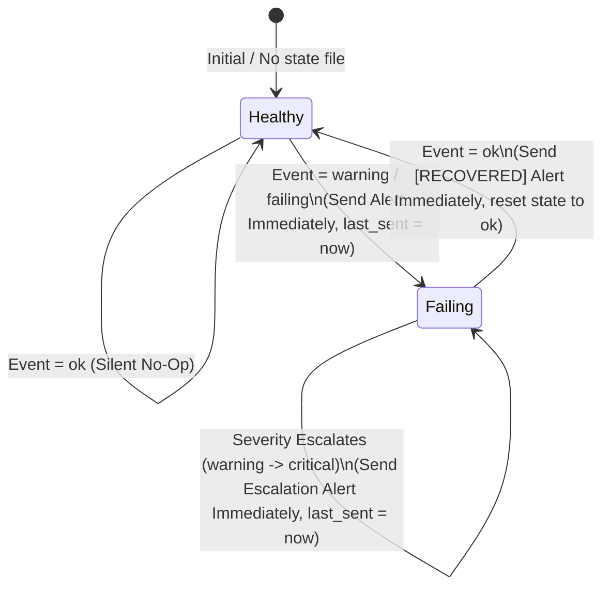

# Phase 1 Data Model: Automated Platform Monitoring & Alerting (`ntfy` & `Healthchecks`)

**Feature**: `011-monitoring-ntfy-healthchecks`  
**Date**: 2026-11-05  
**Spec**: [spec.md](./spec.md) | **Research**: [research.md](./research.md)

---

## 1. Entity & Architecture Overview

```text
+-------------------------------------------------------------------------+
|                    Monitoring Bootstrap Profile                         |
|  - Source: ansible/inventory/group_vars/all/vault.yml (gitignored)      |
|  - Runtime: /etc/homelab/monitoring.env (0600 root:root)                |
|  - Template: /etc/homelab/monitoring.env.example (0644)                 |
|  - Keys: NTFY_SERVER_URL, NTFY_TOPIC, NTFY_TOKEN,                       |
|          HEALTHCHECKS_API_KEY, HEALTHCHECKS_PING_KEY                    |
+-------------------------------------------------------------------------+
              |                                           |
              | authenticates API v3 / pings              | publishes alerts
              v                                           v
+-----------------------------------+       +-----------------------------+
|  Healthchecks.io Check Registry   |       |  ntfy.sh Push Notification  |
|  (/var/lib/homelab/monitoring/    |       |  Dispatcher (homelab-ntfy)  |
|   checks.json, mode 0600)         |       |  - Deduplication & Cooldown |
|  - 6 canonical platform checks    |       |    State (/var/lib/homelab/ |
|  - Auto-upserted future checks    |       |    monitoring/state/*.json) |
|  - Bound to channels: "*" (ntfy)  |       |  - Silent when healthy      |
+-----------------------------------+       +-----------------------------+
              ^                                           ^
              |                                           |
              +---------------------+---------------------+
                                    |
        +---------------------------+---------------------------+
        |                           |                           |
+-------+---------------+   +-------+---------------+   +-------+---------------+
| Scheduled Job Hooks   |   | Global Systemd Unit   |   | Composite Health      |
| (10-healthchecks.conf |   | Failure Hook          |   | Sweep & Disk Monitor  |
|  & homelab-hc-run)    |   | (service.d/99-homelab |   | (homelab-health-sweep |
| - Restic backup       |   |  -failure-alert.conf) |   |  + smartd -M exec)    |
| - Restic check        |   | - System & User units |   | - Daemons & Endpoints |
| - Vaultwarden backup  |   | - Journal excerpt     |   | - Docker discovery    |
| - SnapRAID sync/scrub |   | - Recursion-safe      |   | - Mounts & Capacity   |
+-----------------------+   +-----------------------+   +-----------------------+
```

---

## 2. Entities & Schema Definitions

### 2.1 Monitoring Bootstrap Profile

Represents the minimal operator-supplied credentials in `vault.yml` rendered to `/etc/homelab/monitoring.env`.

| Variable Name | Source in `vault.yml` | Runtime Env Variable (`/etc/homelab/monitoring.env`) | Required | Default / Placeholder (`.example`) | Validation Rule |
|---|---|---|---|---|---|
| `monitoring_ntfy_server_url` | `vault_ntfy_server_url` | `NTFY_SERVER_URL` | Yes | `"https://ntfy.sh"` | Must be a valid `https://` base URL without trailing slash |
| `monitoring_ntfy_topic` | `vault_ntfy_topic` | `NTFY_TOPIC` | **Yes** | `"fidelacchius-alerts-CHANGE_ME"` | Non-empty string; must not contain `"CHANGE_ME"` or whitespace during live runs |
| `monitoring_ntfy_token` | `vault_ntfy_token` | `NTFY_TOKEN` | No | `""` | Optional `ntfy.sh` access token (`tk_...`); passed as `Authorization: Bearer <token>` when non-empty |
| `monitoring_healthchecks_api_url` | `vault_healthchecks_api_url` | `HEALTHCHECKS_API_URL` | Yes | `"https://healthchecks.io/api/v3"` | Must point to `healthchecks.io` Management API v3 endpoint |
| `monitoring_healthchecks_ping_url` | `vault_healthchecks_ping_url` | `HEALTHCHECKS_PING_BASE_URL` | Yes | `"https://hc-ping.com"` | Base URL for `healthchecks.io` ping endpoints |
| `monitoring_healthchecks_api_key` | `vault_healthchecks_api_key` | `HEALTHCHECKS_API_KEY` | **Yes** | `"hc_rw_CHANGE_ME_PROJECT_API_KEY"` | Non-empty Read/Write Project API key; must not contain `"CHANGE_ME"` during live runs |
| `monitoring_healthchecks_ping_key` | `vault_healthchecks_ping_key` | `HEALTHCHECKS_PING_KEY` | No | `""` | Optional project Slug Ping Key; if empty, checks are pinged via cached `ping_url` from `/var/lib/homelab/monitoring/checks.json` |
| `monitoring_cooldown_sec` | `monitoring_cooldown_sec` (`vars.yml`) | `MONITORING_COOLDOWN_SEC` | Yes | `900` (15 minutes) | Integer $\ge 60$; suppresses duplicate alerts for the same `component_key` within the window |
| `monitoring_disk_warn_pct` | `monitoring_disk_warn_pct` (`vars.yml`) | `MONITORING_DISK_WARN_PCT` | Yes | `85` | Integer $1\text{--}99$; triggers warning alert when filesystem usage $\ge$ threshold |
| `monitoring_disk_crit_pct` | `monitoring_disk_crit_pct` (`vars.yml`) | `MONITORING_DISK_CRIT_PCT` | Yes | `95` | Integer $>$ `monitoring_disk_warn_pct`; triggers critical alert when usage $\ge$ threshold |

*Security & Permission Rules*:
- `/etc/homelab/monitoring.env` MUST be owned by `root:root` with mode `0600`.
- `/etc/homelab/monitoring.env.example` MUST be owned by `root:root` with mode `0644` and contain only sanitized placeholders.

---

### 2.2 Heartbeat Check (`Healthchecks.io` Check Definition & Local Registry)

Represents a dead-man's-switch monitor reconciled via `POST https://healthchecks.io/api/v3/checks/` with `"unique": ["name", "slug"]` and cached locally in `/var/lib/homelab/monitoring/checks.json` (`0600 root:root`).

#### Schema Fields (API Payload & Cache Record)

| Field | Type | Description | Validation Rule |
|---|---|---|---|
| `name` | `string` | Human-readable check name in `healthchecks.io` | Non-empty, prefixed with `fidelacchius:` |
| `slug` | `string` | Deterministic identifier (`[a-z0-9-]+`) | Unique per check; matches systemd unit or workload role |
| `tags` | `string` | Space-separated tags | Includes `"fidelacchius homelab"` plus subsystem tag (`backup`, `storage`, `liveness`, etc.) |
| `desc` | `string` | Description of monitored systemd unit/timer and recovery command | Managed by Ansible / `homelab-hc-reconcile` |
| `timeout` | `integer` (optional) | Expected period in seconds (for interval checks) | Mutually exclusive with `schedule`; used by `fidelacchius-host-heartbeat` (`300`s) |
| `schedule` | `string` (optional) | 5-field cron expression (for calendar-scheduled checks) | Mutually exclusive with `timeout`; matches systemd timer `OnCalendar` |
| `tz` | `string` (optional) | IANA timezone for `schedule` evaluation | Defaults to `"America/New_York"` (host timezone) |
| `grace` | `integer` | Grace period in seconds before `healthchecks.io` fires a missed-heartbeat alert | Integer $\ge 60$ |
| `channels` | `string` | Notification integration binding | Always `"*"` so all checks automatically bind to the project's `ntfy.sh` channel (FR-002, FR-004) |
| `unique` | `array<string>` | Upsert deduplication keys | Always `["name", "slug"]` |
| `ping_url` | `string` (response) | Assigned `https://hc-ping.com/<uuid>` URL returned by API v3 | Cached in `/var/lib/homelab/monitoring/checks.json` under `.checks[<slug>].ping_url` |

#### Canonical Pre-Provisioned Check Catalog (`monitoring_healthchecks_catalog`)

| Slug | Name | Monitored Unit / Timer | Schedule / Timeout | Grace Period | Tags |
|---|---|---|---|---|---|
| `fidelacchius-host-heartbeat` | `fidelacchius: Host & Platform Composite Heartbeat` | `homelab-heartbeat.service` (`homelab-heartbeat.timer`) | `timeout: 300` (every 5m) | `600` (10m) | `fidelacchius homelab liveness composite` |
| `fidelacchius-backup-daily` | `fidelacchius: Restic Offsite Daily Backup` | `homelab-backup.service` (`homelab-backup.timer`) | `schedule: "30 2 * * *"` | `3600` (60m) | `fidelacchius homelab backup restic b2` |
| `fidelacchius-backup-check` | `fidelacchius: Restic Weekly Repository Integrity Check` | `homelab-backup-check.service` (`homelab-backup-check.timer`) | `schedule: "0 4 * * 0"` | `7200` (120m) | `fidelacchius homelab backup restic integrity` |
| `fidelacchius-vaultwarden-backup` | `fidelacchius: Vaultwarden Daily SQLite Backup` | `vaultwarden-backup.service` (`vaultwarden-backup.timer`) | `schedule: "30 3 * * *"` | `1800` (30m) | `fidelacchius homelab backup vaultwarden` |
| `fidelacchius-snapraid-sync` | `fidelacchius: SnapRAID Daily Parity Sync` | `snapraid-sync.service` (`snapraid-sync.timer`) | `schedule: "0 3 * * *"` | `7200` (120m) | `fidelacchius homelab storage snapraid sync` |
| `fidelacchius-snapraid-scrub` | `fidelacchius: SnapRAID Weekly Parity Scrub` | `snapraid-scrub.service` (`snapraid-scrub.timer`) | `schedule: "0 4 * * 0"` | `14400` (240m) | `fidelacchius homelab storage snapraid scrub` |

---

### 2.3 Alert Event & Deduplication State Record

Represents the local per-component state persisted at `/var/lib/homelab/monitoring/state/<component_key>.json` to enforce silent-when-healthy behavior, cooldown suppression during crash loops, and automatic recovery alerts.

| Field | Type | Example | Validation / Lifecycle Rule |
|---|---|---|---|
| `component_key` | `string` | `"unit-system-vaultwarden.service"` | Sanitized key (`[a-zA-Z0-9._-]+`) uniquely identifying the monitored unit, container, mount, disk, or endpoint |
| `status` | `enum` | `"ok"` \| `"warning"` \| `"failing"` | Current health state of the component |
| `severity` | `enum` | `"default"` \| `"high"` \| `"urgent"` | Maps to `ntfy.sh` priority (`3` = default/recovery, `4` = high/warning/failure, `5` = urgent/critical) |
| `first_failure_epoch` | `integer` | `1793894400` | Unix timestamp when current failure episode began (`0` when `status == "ok"`) |
| `last_sent_epoch` | `integer` | `1793894400` | Unix timestamp when an `ntfy.sh` notification was last transmitted for this component |
| `suppressed_count` | `integer` | `4` | Number of duplicate failure alerts suppressed during the active cooldown window; included in recovery summary |
| `last_title` | `string` | `"[FAILURE] fidelacchius: vaultwarden.service"` | Last notification title |
| `last_message` | `string` | `"Unit vaultwarden.service entered failed state..."` | Last diagnostic payload |

#### Alert State Machine Transitions



---

### 2.4 Monitored Target Inventory (`homelab-health-sweep`)

Defines the complete set of continuous infrastructure services, endpoints, storage tiers, and dynamic container rules evaluated every 5 minutes by `homelab-health-sweep`:

1. **Systemd System Services (`monitoring_required_system_services`)**:
   - `sshd.service`, `chronyd.service`, `smartd.service`, `systemd-oomd.service`, `nftables.service`, `tailscaled.service`, `caddy.service`, `docker.service`, `vaultwarden.service`, `frigate.service`
2. **Systemd User Services (`monitoring_required_user_services`)**:
   - `agy-remote-control.service` (evaluated for `admin` user when `/home/admin/.gemini/oauth_creds.json` exists)
3. **Application HTTP & Overlay Readiness Probes (`monitoring_http_probes`)**:
   - Caddy Ingress: `http://127.0.0.1:80/health` → HTTP `200`
   - Vaultwarden API: `http://127.0.0.1:8088/alive` → HTTP `200`
   - Frigate API: `http://127.0.0.1:5000/api/version` → HTTP `200`
   - Tailscale Overlay: `tailscale status --json` → `.BackendState == "Running"`
4. **Dynamic Docker Container Discovery**:
   - Enumerates all existing and future containers via `docker ps -a`: alerts on any container where `.State.Health.Status == "unhealthy"`, `.State.Status == "restarting"`, `.State.Status == "dead"`, or `.State.Status == "exited"` with `.State.ExitCode != 0`.
5. **Storage Mounts & Capacity Thresholds (`monitoring_monitored_mounts`)**:
   - `/` (root NVMe), `/opt/services` (Tier 0 app NVMe), `/mnt/storage` (Tier 1 MergerFS pool), `/mnt/disks/data1`, `/mnt/disks/data2`, `/mnt/disks/parity1`, `/mnt/scratch` (Tier 2 NVR scratch disk)
   - Alerts on missing mountpoint or disk capacity $\ge 85\%$ (warning) / $\ge 95\%$ (critical).
