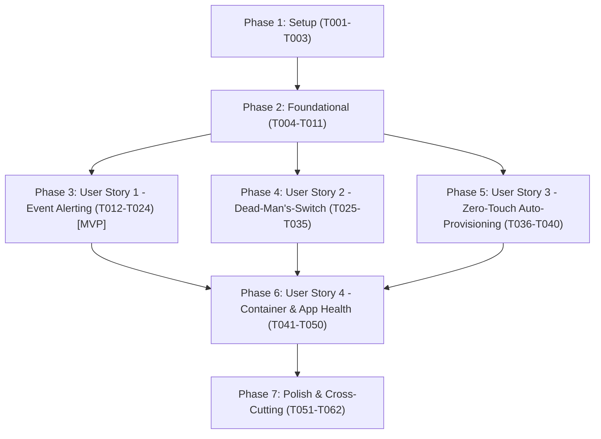

# Tasks: Automated Platform Monitoring & Alerting (`ntfy` & `Healthchecks`)

**Input**: Design documents from `specs/011-monitoring-ntfy-healthchecks/`  
**Prerequisites**: [plan.md](plan.md) (required), [spec.md](spec.md) (required), [research.md](research.md), [data-model.md](data-model.md), [contracts/](contracts/), [quickstart.md](quickstart.md), [.specify/memory/constitution.md](../../.specify/memory/constitution.md)

**Tests**: Includes automated system verification suites (`scripts/verify-phase8-monitoring.sh`, `scripts/verify-phase8-monitoring.ps1`, `ansible/playbooks/verify-phase8-monitoring.yml`) enforcing assertions `MON-01` through `MON-10` mandated by the feature specification and Constitution Principles III, IV, & V.

**Organization**: Tasks are grouped by user story to enable independent implementation and testing of each story.

## Format: `[ID] [P?] [Story] Description`

- **[P]**: Can run in parallel (different files, no dependencies on incomplete tasks)
- **[Story]**: Which user story this task belongs to (`[US1]`, `[US2]`, `[US3]`, `[US4]`)
- Include exact file paths in descriptions
- Quoted constraints from data-model.md included verbatim

---

## Phase 1: Setup (Shared Infrastructure)

**Purpose**: Pre-flight environment preparation, directory scaffolding, and toolchain readiness

- [X] T001 Verify pre-flight environment on host `fidelacchius`, confirming active git branch `011-monitoring-ntfy-healthchecks` and availability of required host utilities (`curl`, `jq`, `flock`, `smartctl`, `systemd`, `docker`)
- [X] T002 [P] Create monitoring configuration directory at `/etc/homelab/monitoring` with mode `0755` (`root:root`)
- [X] T003 [P] Create runtime state and cache directories at `/var/lib/homelab/monitoring` and `/var/lib/homelab/monitoring/state` with mode `0700` (`root:root`)

---

## Phase 2: Foundational (Blocking Prerequisites)

**Purpose**: Core configuration schemas, secret isolation, and role skeleton that MUST be complete before ANY user story can execute

**⚠️ CRITICAL**: All user stories depend on valid configuration variables, secret templates, and base Ansible role structure

- [X] T004 [P] Configure non-sensitive monitoring defaults in `ansible/inventory/group_vars/all/vars.yml` with `monitoring_cooldown_sec: 900` ("Integer $\ge 60$; suppresses duplicate alerts for the same `component_key` within the window"), `monitoring_disk_warn_pct: 85` ("Integer $1\text{--}99$; triggers warning alert when filesystem usage $\ge$ threshold"), and `monitoring_disk_crit_pct: 95` ("Integer $>$ `monitoring_disk_warn_pct`; triggers critical alert when usage $\ge$ threshold")
- [X] T005 [P] Document sanitized monitoring secret placeholders in committed template `ansible/inventory/group_vars/all/vault.yml.example` covering `vault_ntfy_server_url: "https://ntfy.sh"`, `vault_ntfy_topic: "fidelacchius-alerts-CHANGE_ME"`, `vault_ntfy_token: ""`, `vault_healthchecks_api_url: "https://healthchecks.io/api/v3"`, `vault_healthchecks_ping_url: "https://hc-ping.com"`, `vault_healthchecks_api_key: "hc_rw_CHANGE_ME_PROJECT_API_KEY"`, and `vault_healthchecks_ping_key: ""`
- [X] T006 [P] Create committed runtime template in `ansible/roles/monitoring/files/monitoring.env.example` owned by `root:root` with mode `0644` containing sanitized placeholders adhering to constraint "`/etc/homelab/monitoring.env.example` MUST be owned by `root:root` with mode `0644` and contain only sanitized placeholders"
- [X] T007 Initialize Ansible monitoring role defaults and dictionary definitions in `ansible/roles/monitoring/defaults/main.yml` defining canonical endpoints, thresholds, monitored units, probe targets, and storage mount lists
- [X] T008 Implement pre-flight secret validation tasks in `ansible/roles/monitoring/tasks/preflight.yml` asserting `vault_ntfy_topic` satisfies "Non-empty string; must not contain `\"CHANGE_ME\"` or whitespace during live runs" and `vault_healthchecks_api_key` satisfies "Non-empty Read/Write Project API key; must not contain `\"CHANGE_ME\"` during live runs"
- [X] T009 Implement configuration deployment tasks in `ansible/roles/monitoring/tasks/config.yml` rendering `/etc/homelab/monitoring.env` from `ansible/roles/monitoring/templates/monitoring.env.j2` verifying constraint "`/etc/homelab/monitoring.env` MUST be owned by `root:root` with mode `0600`" and deploying `/etc/homelab/monitoring.env.example` with mode `0644`
- [X] T010 Implement systemd daemon-reload and service handler definitions in `ansible/roles/monitoring/handlers/main.yml` supporting both system and user manager reloads
- [X] T011 Create main role orchestrator in `ansible/roles/monitoring/tasks/main.yml` sequencing `preflight.yml`, `config.yml`, `scripts.yml`, `systemd_hooks.yml`, `reconcile.yml`, and `heartbeat.yml`

**Checkpoint**: Foundation ready - monitoring secret store and role skeleton in place. User story implementation can now proceed.

---

## Phase 3: User Story 1 - Immediate Event Alerting Across All Existing & Future Services (Priority: P1) 🎯 MVP

**Goal**: Global systemd service crash detection across system and user units, sending actionable diagnostic push notifications via `ntfy.sh` with deduplication and recovery handling.

**Independent Test**: Trigger a synthetic service failure via `systemd-run --unit=homelab-synthetic-fail-test.service /bin/sh -c "echo 'Synthetic failure' >&2; exit 42"` and confirm a structured notification arrives on `ntfy.sh` within 30 seconds containing exit status 42 and the stderr line, verify cooldown suppression on repeated failures, and confirm recovery notification when cleared.

### Tests & Verification Suites for User Story 1

- [X] T012 [P] [US1] Implement automated secret isolation and Git leak check `MON-01` in `scripts/verify-phase8-monitoring.sh` asserting `stat -c '%a:%u:%g' /etc/homelab/monitoring.env` is `600:0:0`, `/etc/homelab/monitoring.env.example` exists (`0644`), and `git grep` finds zero real tokens in version control
- [X] T013 [P] [US1] Implement automated systemd failure hook assertions `MON-02` in `scripts/verify-phase8-monitoring.sh` asserting `systemctl show sshd.service -p OnFailure` contains `homelab-alert@sshd.service` while recursion guard `systemctl show homelab-alert@sshd.service -p OnFailure` is empty
- [X] T014 [P] [US1] Implement automated alert deduplication and recovery state machine test `MON-07` in `scripts/verify-phase8-monitoring.sh` verifying that 5 rapid simulated failures increment `suppressed_count: 4` in `/var/lib/homelab/monitoring/state/verify-flapping-test.json` before `--status ok` dispatches 1 recovery alert and clears failure state
- [X] T015 [P] [US1] Implement live outbound `ntfy.sh` connectivity test `MON-08` in `scripts/verify-phase8-monitoring.sh` validating test notification dispatch and receipt within 30 seconds

### Implementation for User Story 1

- [X] T016 [US1] Implement the core push notification dispatcher `/usr/local/bin/homelab-ntfy` in `ansible/roles/monitoring/files/homelab-ntfy` implementing `flock -w 10` locking, sourcing `/etc/homelab/monitoring.env`, mapping priorities (`3=default/recovery`, `4=high/warning`, `5=urgent/critical`), enforcing silent-when-healthy on `--status ok` with no prior failure, suppressing duplicates within `MONITORING_COOLDOWN_SEC: 900`, and dispatching `[RECOVERED]` notifications with suppressed counts
- [X] T017 [US1] Implement unit failure diagnostic collector `/usr/local/bin/homelab-unit-alert` in `ansible/roles/monitoring/files/homelab-unit-alert` capturing `ActiveState`, `SubState`, `Result`, `ExecMainStatus`, and the last 20 journal lines (`journalctl -u <unit> -n 20 --no-pager`), with explicit bypass for `homelab-alert@*` units
- [X] T018 [US1] Create systemd system alert template unit in `ansible/roles/monitoring/templates/homelab-alert-system.service.j2` deployed to `/etc/systemd/system/homelab-alert@.service` (`Type=oneshot`, `User=root`, `ExecStart=-/usr/local/bin/homelab-unit-alert --scope system --unit %i`, `TimeoutSec=30`)
- [X] T019 [US1] Create systemd user alert template unit in `ansible/roles/monitoring/templates/homelab-alert-user.service.j2` deployed to `/etc/systemd/user/homelab-alert@.service` (`Type=oneshot`, `ExecStart=-/usr/bin/sudo -n /usr/local/bin/homelab-unit-alert --scope user --user %u --unit %i`, `TimeoutSec=30`)
- [X] T020 [US1] Create global failure drop-in template `ansible/roles/monitoring/templates/99-homelab-failure-alert.conf.j2` deployed to both `/etc/systemd/system/service.d/99-homelab-failure-alert.conf` and `/etc/systemd/user/service.d/99-homelab-failure-alert.conf` setting `[Unit] OnFailure=homelab-alert@%n.service`
- [X] T021 [US1] Create recursion guard drop-in template `ansible/roles/monitoring/templates/99-zz-no-recursion.conf.j2` deployed to `/etc/systemd/system/homelab-alert@.service.d/99-zz-no-recursion.conf` and `/etc/systemd/user/homelab-alert@.service.d/99-zz-no-recursion.conf` clearing `[Unit] OnFailure=`
- [X] T022 [US1] Implement script installation tasks in `ansible/roles/monitoring/tasks/scripts.yml` deploying `/usr/local/bin/homelab-ntfy` and `/usr/local/bin/homelab-unit-alert` with mode `0755 root:root`
- [X] T023 [US1] Implement systemd hook deployment tasks in `ansible/roles/monitoring/tasks/systemd_hooks.yml` deploying global drop-ins, recursion guards, and alert services, triggering daemon-reload
- [X] T024 [US1] Execute validation scenario B from `quickstart.md`: run transient synthetic failure `systemd-run --unit=homelab-synthetic-fail-test.service ...` and assert journal log and `ntfy.sh` alert delivery

**Checkpoint**: User Story 1 (MVP) complete and testable independently. All existing and future systemd services now automatically alert on failure.

---

## Phase 4: User Story 2 - Dead-Man's-Switch Heartbeats for Scheduled Jobs & Host Liveness (Priority: P1)

**Goal**: Integrate all 5 scheduled maintenance jobs and host liveness into `healthchecks.io` dead-man's-switch monitoring using modular drop-ins and reusable wrappers.

**Independent Test**: Execute a scheduled job wrapper or trigger a maintenance timer, verifying start and completion signals in `healthchecks.io`, and verify that stopping heartbeat signals triggers a missed-check alert.

### Tests & Verification Suites for User Story 2

- [X] T025 [P] [US2] Implement automated scheduled maintenance job drop-in assertion `MON-04` in `scripts/verify-phase8-monitoring.sh` asserting `/usr/local/bin/homelab-hc-run` and `/usr/local/bin/homelab-hc-ping` are executable (`0755`) and that `10-healthchecks.conf` drop-ins are active on all 5 platform services (`systemctl show <unit> -p ExecStartPre -p ExecStopPost` references `homelab-hc-ping`)
- [X] T026 [P] [US2] Implement live heartbeat ping assertion `MON-08` addition in `scripts/verify-phase8-monitoring.sh` asserting ping signals to `https://hc-ping.com` return HTTP 200

### Implementation for User Story 2

- [X] T027 [US2] Implement heartbeat signal helper `/usr/local/bin/homelab-hc-ping` in `ansible/roles/monitoring/files/homelab-hc-ping` supporting `--slug`, `--event start|success|fail|stop`, resolving cached `ping_url` from `/var/lib/homelab/monitoring/checks.json`, handling systemd `$SERVICE_RESULT` / `$EXIT_STATUS` in `stop` mode, and notifying `homelab-ntfy` on failure
- [X] T028 [US2] Implement reusable job wrapper CLI `/usr/local/bin/homelab-hc-run` in `ansible/roles/monitoring/files/homelab-hc-run` supporting `--slug`, `--schedule`, `--timeout`, `--grace`, signaling `/start`, teeing the last 50 lines of execution output, and signaling success or failure exit codes
- [X] T029 [US2] Create scheduled maintenance drop-in template `ansible/roles/monitoring/templates/10-healthchecks.conf.j2` configuring `ExecStartPre=-/usr/local/bin/homelab-hc-ping --slug {{ check_slug }} --event start --unit %n` and `ExecStopPost=-/usr/local/bin/homelab-hc-ping --slug {{ check_slug }} --event stop --unit %n`
- [X] T030 [US2] Deploy drop-in `/etc/systemd/system/homelab-backup.service.d/10-healthchecks.conf` for slug `fidelacchius-backup-daily` via `ansible/roles/monitoring/tasks/systemd_hooks.yml`
- [X] T031 [US2] Deploy drop-in `/etc/systemd/system/homelab-backup-check.service.d/10-healthchecks.conf` for slug `fidelacchius-backup-check` via `ansible/roles/monitoring/tasks/systemd_hooks.yml`
- [X] T032 [US2] Deploy drop-in `/etc/systemd/system/vaultwarden-backup.service.d/10-healthchecks.conf` for slug `fidelacchius-vaultwarden-backup` via `ansible/roles/monitoring/tasks/systemd_hooks.yml`
- [X] T033 [US2] Deploy drop-in `/etc/systemd/system/snapraid-sync.service.d/10-healthchecks.conf` for slug `fidelacchius-snapraid-sync` via `ansible/roles/monitoring/tasks/systemd_hooks.yml`
- [X] T034 [US2] Deploy drop-in `/etc/systemd/system/snapraid-scrub.service.d/10-healthchecks.conf` for slug `fidelacchius-snapraid-scrub` via `ansible/roles/monitoring/tasks/systemd_hooks.yml`
- [X] T035 [US2] Test `/usr/local/bin/homelab-hc-run` with a synthetic command (`homelab-hc-run --slug test-job-run -- true`) confirming start/success signal cycle

**Checkpoint**: User Stories 1 and 2 are functional. Scheduled jobs report execution status and dead-man's-switch coverage.

---

## Phase 5: User Story 3 - Zero-Touch Auto-Provisioning & Minimal Manual Setup (Priority: P1)

**Goal**: Automatically reconcile all canonical checks with `healthchecks.io` API v3 using `"unique": ["name", "slug"]` and `"channels": "*"`, caching ping URLs in `/var/lib/homelab/monitoring/checks.json` (`0600 root:root`) with zero manual UI configuration.

**Independent Test**: Reconcile checks against a project using `homelab-hc-reconcile`, verify all 6 checks are created/updated with `channels: "*"`, and confirm `checks.json` contains valid ping URLs for each slug.

### Tests & Verification Suites for User Story 3

- [X] T036 [P] [US3] Implement automated `healthchecks.io` reconciliation assertion `MON-03` in `scripts/verify-phase8-monitoring.sh` asserting `/usr/local/bin/homelab-hc-reconcile` is executable (`0755`), `/etc/homelab/monitoring/checks-catalog.json` defines all 6 canonical slugs with `channels: "*"` and `unique: ["name", "slug"]`, and `/var/lib/homelab/monitoring/checks.json` (`0600`) contains resolved `ping_url` entries for all 6 checks

### Implementation for User Story 3

- [X] T037 [US3] Create canonical checks catalog template in `ansible/roles/monitoring/templates/checks-catalog.json.j2` defining all 6 canonical checks: `fidelacchius-host-heartbeat` (`timeout: 300`, `grace: 600`), `fidelacchius-backup-daily` (`schedule: "30 2 * * *"`, `grace: 3600`), `fidelacchius-backup-check` (`schedule: "0 4 * * 0"`, `grace: 7200`), `fidelacchius-vaultwarden-backup` (`schedule: "30 3 * * *"`, `grace: 1800`), `fidelacchius-snapraid-sync` (`schedule: "0 3 * * *"`, `grace: 7200`), and `fidelacchius-snapraid-scrub` (`schedule: "0 4 * * 0"`, `grace: 14400`), all with `"channels": "*"` and `"unique": ["name", "slug"]`
- [X] T038 [US3] Implement zero-touch reconciler `/usr/local/bin/homelab-hc-reconcile` in `ansible/roles/monitoring/files/homelab-hc-reconcile` sending API v3 `POST ${HEALTHCHECKS_API_URL}/checks/` with `X-Api-Key`, `"channels": "*"`, `"unique": ["name", "slug"]`, caching `.ping_url` to `/var/lib/homelab/monitoring/checks.json` (`0600 root:root`), and supporting `--ensure-slug` for dynamic on-demand check creation
- [X] T039 [US3] Implement reconciliation execution tasks in `ansible/roles/monitoring/tasks/reconcile.yml` deploying `/etc/homelab/monitoring/checks-catalog.json` and running `homelab-hc-reconcile` to synchronize all checks
- [X] T040 [US3] Verify reconciliation idempotency by executing `sudo /usr/local/bin/homelab-hc-reconcile` twice, asserting HTTP 200 on the second run with 0 duplicate checks created

**Checkpoint**: User Stories 1, 2, and 3 are functional. Check provisioning is 100% automated via API v3.

---

## Phase 6: User Story 4 - Application & Container Health Verification (Priority: P2)

**Goal**: Continuous health verification for all running system services, dynamic Docker container discovery, application readiness probes (Caddy, Vaultwarden, Frigate, Tailscale), storage capacity thresholds, SMART disk alerts, and composite host heartbeat.

**Independent Test**: Simulate an unhealthy container or threshold breach, confirm targeted alert dispatch and suppression of spam, and confirm composite heartbeat signals `/0` when healthy or `/fail` when degraded.

### Tests & Verification Suites for User Story 4

- [X] T041 [P] [US4] Implement composite health sweep and timer assertion `MON-05` in `scripts/verify-phase8-monitoring.sh` asserting `systemctl is-active homelab-heartbeat.timer` and `systemctl is-enabled homelab-heartbeat.timer` report `active`/`enabled` and `/usr/local/bin/homelab-health-sweep` exits `0`
- [X] T042 [P] [US4] Implement physical disk SMART alert hook assertion `MON-06` in `scripts/verify-phase8-monitoring.sh` asserting `/etc/smartd.conf` includes `-M exec /usr/local/bin/homelab-smartd-alert`, script is executable (`0755`), and `smartd.service` is `active`
- [X] T043 [P] [US4] Implement container and journal cleanliness assertion `MON-10` in `scripts/verify-phase8-monitoring.sh` asserting zero self-hosted monitoring containers in `docker ps -a` and clean execution logs in `journalctl -u homelab-heartbeat.service`

### Implementation for User Story 4

- [X] T044 [US4] Implement physical disk SMART alert handler `/usr/local/bin/homelab-smartd-alert` in `ansible/roles/monitoring/files/homelab-smartd-alert` parsing `SMARTD_DEVICE`, `SMARTD_FAILTYPE`, `SMARTD_MESSAGE`, and `SMARTD_FULLMESSAGE` and forwarding to `/usr/local/bin/homelab-ntfy` (`Priority: urgent`, tags `rotating_light,cd`)
- [X] T045 [US4] Update `ansible/roles/disk_health/defaults/main.yml` and `ansible/roles/disk_health/templates/smartd.conf.j2` configuring `smartd_scan_options` with `-m <nomailer> -M exec /usr/local/bin/homelab-smartd-alert`
- [X] T046 [US4] Implement composite health sweep script template `ansible/roles/monitoring/templates/homelab-health-sweep.j2` deployed to `/usr/local/bin/homelab-health-sweep` (`0755 root:root`) checking:
  - System daemons (`sshd`, `chronyd`, `smartd`, `systemd-oomd`, `nftables`, `tailscaled`, `caddy`, `docker`, `vaultwarden`, `frigate`) and user daemon `agy-remote-control.service`
  - Dynamic Docker container discovery (`docker ps -a`) evaluating `.State.Status` and `.State.Health.Status`
  - HTTP & overlay probes: Caddy `http://127.0.0.1:80/health`, Vaultwarden `http://127.0.0.1:8088/alive`, Frigate `http://127.0.0.1:5000/api/version`, Tailscale `BackendState == "Running"`
  - Storage mounts (`/`, `/opt/services`, `/mnt/storage`, `/mnt/disks/data1`, `/mnt/disks/data2`, `/mnt/disks/parity1`, `/mnt/scratch`) against `MONITORING_DISK_WARN_PCT: 85` and `MONITORING_DISK_CRIT_PCT: 95`
  - Signals `fidelacchius-host-heartbeat` success (`/0`) if 0 critical failures, or `/fail` with summary if $\ge 1$ failures
- [X] T047 [US4] Create composite heartbeat service unit in `ansible/roles/monitoring/templates/homelab-heartbeat.service.j2` deployed to `/etc/systemd/system/homelab-heartbeat.service` (`Type=oneshot`, `EnvironmentFile=/etc/homelab/monitoring.env`, `ExecStart=/usr/local/bin/homelab-health-sweep`)
- [X] T048 [US4] Create composite heartbeat timer unit in `ansible/roles/monitoring/templates/homelab-heartbeat.timer.j2` deployed to `/etc/systemd/system/homelab-heartbeat.timer` (`OnBootSec=2min`, `OnUnitActiveSec=5min`, `Persistent=true`, `WantedBy=timers.target`)
- [X] T049 [US4] Implement heartbeat and sweep enablement tasks in `ansible/roles/monitoring/tasks/heartbeat.yml` enabling and starting `homelab-heartbeat.timer` and running an initial health sweep
- [X] T050 [US4] Verify composite health sweep execution: run `sudo systemctl start homelab-heartbeat.service` and verify journal logs confirm clean zero-failure sweep and silent heartbeat ping

**Checkpoint**: All 4 User Stories are implemented and functional.

---

## Phase 7: Polish & Cross-Cutting Concerns

**Purpose**: Disaster recovery backup integration, master playbook orchestration, complete acceptance test suite, and end-to-end validation.

- [X] T051 [P] Implement automated backup manifest assertion `MON-09` in `scripts/verify-phase8-monitoring.sh` asserting `/etc/homelab/backup-include.txt` contains `/etc/homelab` and `/var/lib/homelab/monitoring/checks.json`
- [X] T052 [P] Update offsite backup manifest in `ansible/roles/backup/defaults/main.yml` ensuring `/etc/homelab/monitoring.env`, `/etc/homelab/monitoring/checks-catalog.json`, and `/var/lib/homelab/monitoring/checks.json` are included in `backup_include_paths`
- [X] T053 [P] Create dedicated Phase 8 deployment playbook in `ansible/playbooks/monitoring.yml` targeting `fidelacchius` and executing role `monitoring`
- [X] T054 [P] Update master platform convergence playbook `ansible/playbooks/site.yml` including `roles/monitoring` in the platform deployment sequence
- [X] T055 [P] Implement dedicated Phase 8 verification playbook in `ansible/playbooks/verify-phase8-monitoring.yml` validating checks `MON-01` through `MON-10`
- [X] T056 [P] Update master verification playbook `ansible/playbooks/verify.yml` importing `verify-phase8-monitoring.yml`
- [X] T057 [P] Create Bash deployment wrapper script at `scripts/apply-phase8-monitoring.sh` (`0755`) executing `ansible-playbook playbooks/monitoring.yml`
- [X] T058 [P] Create PowerShell deployment wrapper script at `scripts/apply-phase8-monitoring.ps1`
- [X] T059 [P] Create PowerShell workstation verification wrapper at `scripts/verify-phase8-monitoring.ps1`
- [X] T060 Complete target host verification suite `scripts/verify-phase8-monitoring.sh` (`0755`) implementing full test runner for `MON-01` through `MON-10` with `--json` output support
- [X] T061 Execute full automated verification suite `sudo ./scripts/verify-phase8-monitoring.sh --json` and confirm all 10 checks (`MON-01` to `MON-10`) pass with 0 errors
- [X] T062 Validate quickstart.md end-to-end scenarios A, B, C, and D against live system

---

## Dependencies & Execution Order

### Phase Dependencies



- **Setup (Phase 1)**: Can start immediately (preflight checks, directory creation).
- **Foundational (Phase 2)**: Depends on Phase 1. BLOCKS all user stories (defines variables, secret templates, and role skeleton).
- **User Story 1 (Phase 3 - MVP)**: Can start after Phase 2. Delivers immediate event alerting for all service crashes.
- **User Story 2 (Phase 4)**: Can start after Phase 2. Implements ping helper and scheduled maintenance drop-ins.
- **User Story 3 (Phase 5)**: Can start after Phase 2. Implements API v3 reconciliation and check registry.
- **User Story 4 (Phase 6)**: Depends on US1, US2, and US3 (uses `homelab-ntfy`, `homelab-hc-ping`, and `checks.json`).
- **Polish (Phase 7)**: Depends on all user stories being complete. Adds backup integration, master playbooks, wrappers, and end-to-end verification.

### User Story Dependencies

- **US1 (P1)**: Independent of other stories once Foundation is complete.
- **US2 (P1)**: Independent of other stories; connects maintenance jobs to `healthchecks.io`.
- **US3 (P1)**: Independent of other stories; reconciles check catalog via API v3.
- **US4 (P2)**: Integrates US1 dispatcher (`homelab-ntfy`) and US2/US3 heartbeat slug (`fidelacchius-host-heartbeat`).

### Parallel Opportunities

- **Setup & Foundational**:
  - `T002` and `T003` can run in parallel.
  - `T004`, `T005`, and `T006` can run in parallel.
- **User Story 1**:
  - Verification test tasks `T012`, `T013`, `T014`, and `T015` can be developed in parallel with script implementation.
- **User Story 2**:
  - `T025` and `T026` can run in parallel.
  - Service drop-in definitions `T030` through `T034` can be authored in parallel.
- **User Story 3**:
  - `T036` and `T037` can run in parallel.
- **User Story 4**:
  - Verification assertions `T041`, `T042`, and `T043` can run in parallel.
  - SMART alert handler (`T044`, `T045`) and composite sweep (`T046`, `T047`) can be developed in parallel.
- **Polish**:
  - Tasks `T051` through `T060` can all run in parallel across different files.

---

## Parallel Execution Examples

### User Story 1

```bash
# Launch test suite tasks in parallel:
Task: "T012 [P] [US1] Implement automated secret isolation and Git leak check MON-01 in scripts/verify-phase8-monitoring.sh"
Task: "T013 [P] [US1] Implement automated systemd failure hook assertions MON-02 in scripts/verify-phase8-monitoring.sh"
Task: "T014 [P] [US1] Implement automated alert deduplication and recovery state machine test MON-07 in scripts/verify-phase8-monitoring.sh"
Task: "T015 [P] [US1] Implement live outbound ntfy.sh connectivity test MON-08 in scripts/verify-phase8-monitoring.sh"
```

### User Story 2 & 3

```bash
# Author maintenance service drop-ins in parallel:
Task: "T030 [US2] Deploy drop-in /etc/systemd/system/homelab-backup.service.d/10-healthchecks.conf"
Task: "T031 [US2] Deploy drop-in /etc/systemd/system/homelab-backup-check.service.d/10-healthchecks.conf"
Task: "T032 [US2] Deploy drop-in /etc/systemd/system/vaultwarden-backup.service.d/10-healthchecks.conf"
Task: "T033 [US2] Deploy drop-in /etc/systemd/system/snapraid-sync.service.d/10-healthchecks.conf"
Task: "T034 [US2] Deploy drop-in /etc/systemd/system/snapraid-scrub.service.d/10-healthchecks.conf"
```

---

## Implementation Strategy

### MVP First (User Story 1 Only)

1. Complete Phase 1: Setup (`T001`–`T003`)
2. Complete Phase 2: Foundational (`T004`–`T011`)
3. Complete Phase 3: User Story 1 (`T012`–`T024`)
4. **STOP and VALIDATE**: Trigger synthetic service failure, verify `ntfy.sh` push notification arrives within 30 seconds, confirm deduplication suppresses repeat spam, and verify recovery notification.
5. Deploy MVP: All current and future systemd services now have automatic failure alerts.

### Incremental Delivery

1. **Increment 1 (MVP)**: Setup + Foundation + User Story 1 → Real-time failure alerting across all services.
2. **Increment 2**: User Story 2 → Dead-man's-switch coverage for all 5 scheduled maintenance jobs.
3. **Increment 3**: User Story 3 → Zero-touch automated check provisioning via API v3.
4. **Increment 4**: User Story 4 → 5-minute composite health sweep, dynamic Docker container discovery, SMART disk alerts, and capacity warnings.
5. **Increment 5**: Polish → Offsite backup coverage (`MON-09`), master playbooks, wrapper scripts, and full acceptance suite (`MON-01` to `MON-10`).
