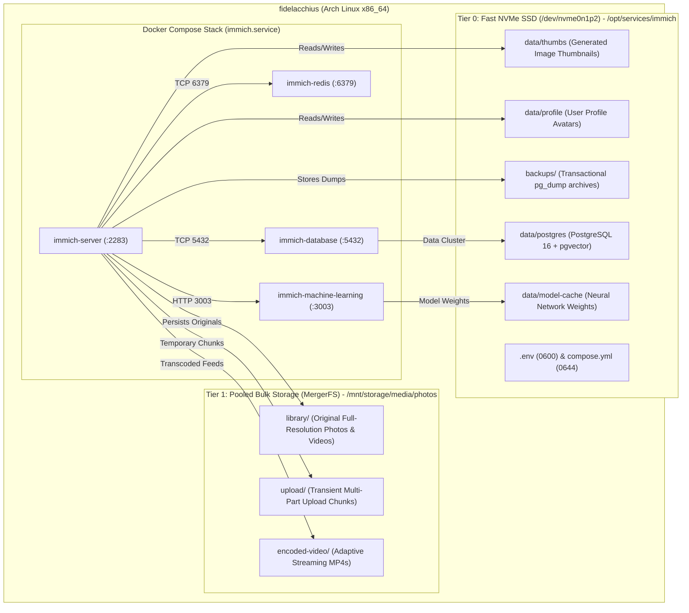
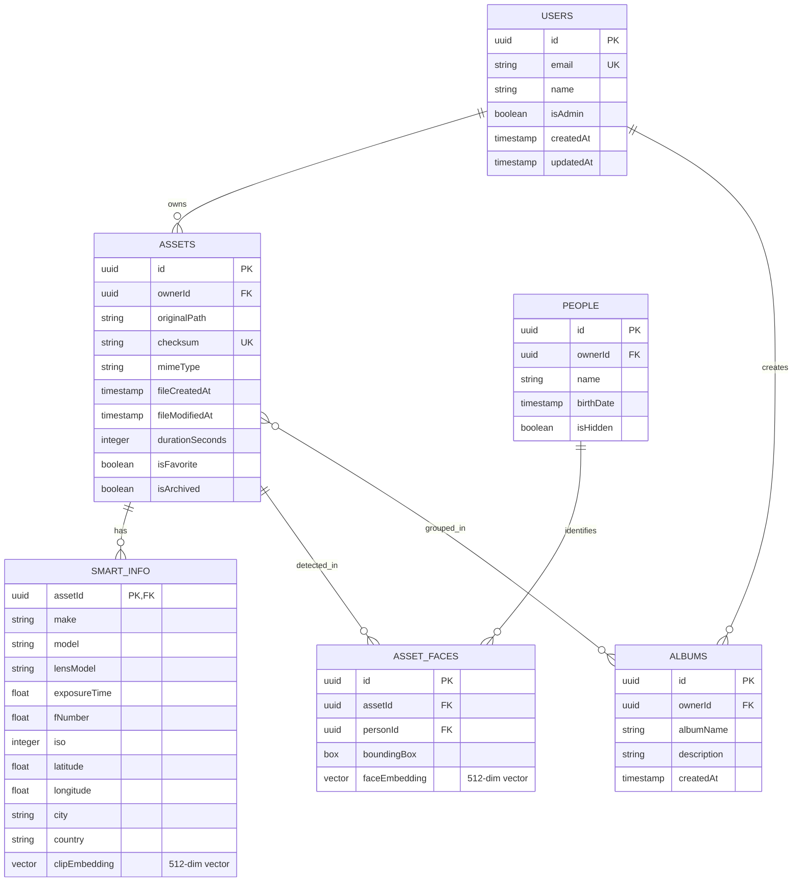
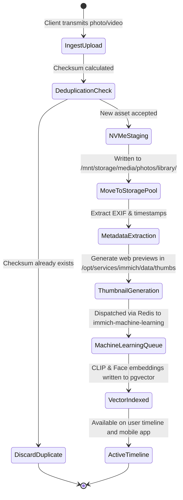
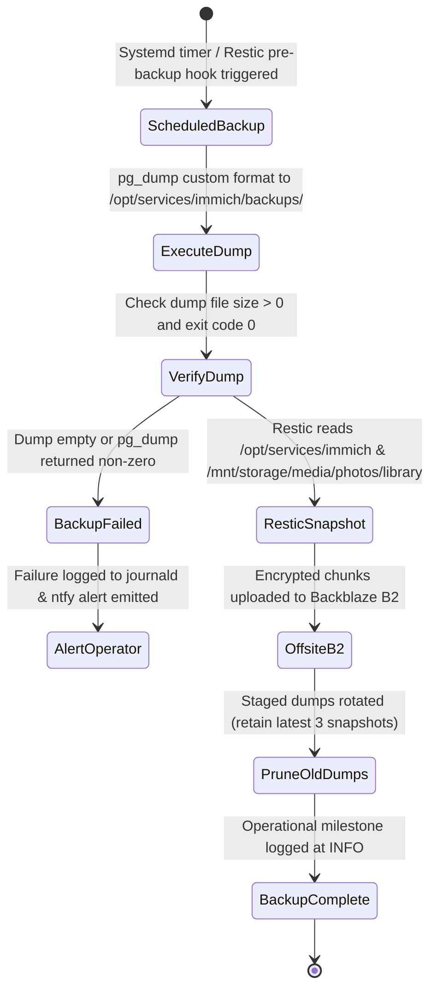

# Data Model & Storage Entity Specification: Immich Photo Management Platform

**Feature**: `013-immich-setup`  
**Date**: 2026-11-06  
**Status**: Completed  
**Governing Documents**: `specs/013-immich-setup/spec.md`, `specs/013-immich-setup/research.md`

---

## 1. Storage Topology & Filesystem Entity Model

The Immich photo platform spans two distinct physical storage tiers: high-speed NVMe flash storage and pooled parity-protected bulk storage.



### Storage Entities

| Entity / Directory | Host Path | Mode | Owner:Group | Storage Tier | Backup Inclusion | Purpose |
|---|---|---|---|---|---|---|
| **Service Root** | `/opt/services/immich` | `0755` | `root:root` | Tier 0 NVMe | Yes | Application compose stack and configuration |
| **Secrets File** | `/opt/services/immich/.env` | `0600` | `root:root` | Tier 0 NVMe | Yes (B2 Restic) | Isolated database passwords, keys, and paths |
| **Example Secrets** | `/opt/services/immich/.env.example` | `0644` | `root:root` | Tier 0 NVMe | Yes (Committed) | Sanitized reference template for `.env` |
| **Compose Manifest** | `/opt/services/immich/compose.yml` | `0644` | `root:root` | Tier 0 NVMe | Yes (Committed) | Multi-container Docker Compose definition |
| **Postgres Cluster** | `/opt/services/immich/data/postgres` | `0700` | `999:999` (postgres) | Tier 0 NVMe | Excluded (Live DB) | Relational database cluster with pgvector indices |
| **Thumbnail Cache** | `/opt/services/immich/data/thumbs` | `0755` | `1000:1001` | Tier 0 NVMe | Excluded (Regenerable) | WebP/JPEG thumbnails (small, medium, blurred) |
| **Model Cache** | `/opt/services/immich/data/model-cache` | `0755` | `1000:1001` | Tier 0 NVMe | Excluded (Downloadable) | Downloaded CLIP and facial recognition models |
| **Profile Avatars** | `/opt/services/immich/data/profile` | `0755` | `1000:1001` | Tier 0 NVMe | Yes | User custom avatars and profile icons |
| **DB Backup Staging** | `/opt/services/immich/backups` | `0750` | `root:root` | Tier 0 NVMe | Yes (B2 Restic) | Point-in-time PostgreSQL custom-format dumps |
| **Media Library** | `/mnt/storage/media/photos/library` | `2775` | `admin:storage` (`1000:1001`) | Tier 1 Bulk | Yes (B2 Restic) | Original, immutable photos, videos, Live Photos |
| **Upload Staging** | `/mnt/storage/media/photos/upload` | `2775` | `admin:storage` (`1000:1001`) | Tier 1 Bulk | Excluded (Transient) | Partial file uploads and client chunking |
| **Encoded Video** | `/mnt/storage/media/photos/encoded-video` | `2775` | `admin:storage` (`1000:1001`) | Tier 1 Bulk | Excluded (Regenerable) | Transcoded 720p/1080p MP4s for streaming |

---

## 2. Configuration Schema & Environment Variables

All operational secrets and paths are defined in `/opt/services/immich/.env` (mode `0600`) and rendered via Ansible from inventory.

```ini
# /opt/services/immich/.env
# Managed by Ansible - homelab2
# Core Environment Variables

# Container Application Runtime
IMMICH_VERSION=v1.118.2
DB_VERSION=pg16-v0.2.1
REDIS_VERSION=6.2-alpine

# Process Ownership
PUID=1000
PGID=1001

# Storage Paths (Host Mounts)
UPLOAD_LOCATION=/mnt/storage/media/photos
DATA_LOCATION=/opt/services/immich/data
BACKUP_LOCATION=/opt/services/immich/backups

# Database Credentials
DB_HOSTNAME=immich-database
DB_PORT=5432
DB_USERNAME=immich
DB_PASSWORD=<RANDOM_GENERATED_SECRET_32_HEX>
DB_DATABASE_NAME=immich

# In-Memory Cache
REDIS_HOSTNAME=immich-redis
REDIS_PORT=6379

# Machine Learning
IMMICH_MACHINE_LEARNING_URL=http://immich-machine-learning:3003

# Hardware Acceleration & Encoding
LIBVA_DRIVER_NAME=iHD
```

---

## 3. Core Application Domain Entities

Immich persists core domain entities inside PostgreSQL with `pgvector` indexing.



### Entity Attributes & Constraints

1. **User Account (`users`)**:
   - `id`: UUID (Primary Key).
   - `email`: String (Unique, case-insensitive). Required for mobile/web login.
   - `name`: Human-readable display name.
   - `isAdmin`: Boolean flag. Initial account created during bootstrap is Administrator.
   - `storageQuota`: Optional byte limit (defaults to unlimited in homelab).

2. **Media Asset (`assets`)**:
   - `id`: UUID (Primary Key).
   - `ownerId`: Foreign Key referencing `users(id)`.
   - `originalPath`: Path relative to `/mnt/storage/media/photos/library/<userId>/<year>/<month>/...`.
   - `checksum`: SHA-1 / SHA-256 binary digest. Enforces deduplication during ingest.
   - `mimeType`: Media type (`image/jpeg`, `image/png`, `image/heic`, `image/x-canon-cr2`, `video/mp4`, `video/quicktime`).
   - `fileCreatedAt`: Capture timestamp parsed from EXIF metadata.

3. **Smart Metadata & Vector Embeddings (`smart_info`)**:
   - `assetId`: Foreign Key referencing `assets(id)`.
   - Camera parameters: `make`, `model`, `lensModel`, `iso`, `fNumber`.
   - Geo-location: `latitude`, `longitude`, reverse-geocoded `city`, `state`, `country`.
   - `clipEmbedding`: 512-dimensional floating-point vector (`vector(512)` or `halfvec`) indexed using `pgvector` HNSW index for natural-language semantic photo search (e.g., "sunset over mountains", "birthday cake").

4. **Face Embedding & Recognition (`asset_faces` & `people`)**:
   - `personId`: Foreign Key referencing identified household member or contact.
   - `faceEmbedding`: 512-dimensional facial recognition feature vector.
   - Spatial bounding box within the asset image coordinate space.

5. **Backup Snapshot (`backup_records`)**:
   - Host-level disaster recovery metadata record representing a consistent point-in-time state.
   - Attributes: `snapshot_filename`, `timestamp_utc`, `dump_size_bytes`, `pgvector_version`, `restic_snapshot_id`.

---

## 4. State Lifecycles

### 4.1 Asset Ingestion Lifecycle



### 4.2 Backup & Disaster Recovery Lifecycle


