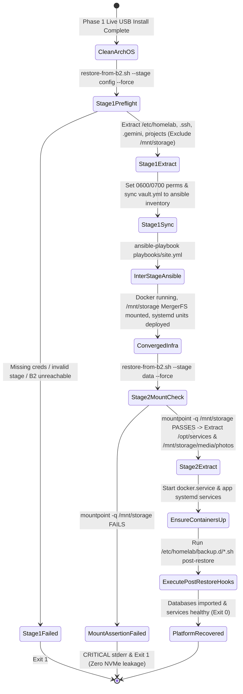

# Data Model: Staged Backblaze B2 Disaster Recovery Restoration

**Feature**: `014-staged-b2-restore`  
**Date**: 2026-11-10  
**Status**: Completed  

---

## 1. Entity Overview

The staged disaster recovery model extends the `homelab2` Backblaze B2 / Restic backup architecture with explicit restoration stages, path filter sets, mountpoint safety assertions, and post-restore hook orchestration.

```mermaid
erDiagram
    RESTORE_INVOCATION ||--|| RESTORE_STAGE : selects
    RESTORE_INVOCATION ||--|| BACKUP_CREDENTIALS : authenticates_with
    RESTORE_STAGE ||--o{ PATH_FILTER : defines
    RESTORE_STAGE ||--o| MOUNT_ASSERTION : enforces
    RESTORE_STAGE ||--o{ PERMISSION_RULE : applies
    RESTORE_STAGE ||--o{ POST_RESTORE_HOOK : triggers

    RESTORE_INVOCATION {
        string snapshot_id "latest | 8-char hex"
        string target_dir "/ (default) | custom path"
        string stage_arg "config | 1 | data | 2 | all"
        string include_path "optional subpath filter"
        boolean force "false | true"
        boolean dry_run "false | true"
    }

    RESTORE_STAGE {
        string canonical_name "STAGE_1_CONFIG | STAGE_2_DATA | STAGE_ALL"
        boolean requires_storage_mount "false | true"
        boolean syncs_inventory_vault "true | false"
        boolean executes_backup_hooks "false | true"
    }

    PATH_FILTER {
        string filter_type "INCLUDE | EXCLUDE"
        string path_pattern "/etc/homelab | /mnt/storage | ..."
        string stage_scope "STAGE_1_CONFIG | STAGE_2_DATA"
    }

    MOUNT_ASSERTION {
        string target_mountpoint "/mnt/storage"
        string check_command "mountpoint -q"
        int failure_exit_code 1
        string severity "CRITICAL"
    }

    PERMISSION_RULE {
        string target_path "/etc/homelab/vault.yml | /home/admin/.ssh | ..."
        string mode_octal "0600 | 0700 | 2775"
        string owner_group "root:root | admin:users | 1000:1001"
    }

    POST_RESTORE_HOOK {
        string hook_script "/etc/homelab/backup.d/*.sh"
        string required_service "docker.service / app.service"
        string argument "post-restore"
    }
```

---

## 2. Entity Specifications

### 2.1 Restore Stage (`RESTORE_STAGE`)

Defines the operational behavior, path boundaries, preconditions, and post-processing actions for each supported `--stage` value.

| Input Flag Values | Canonical Stage ID | Included Snapshot Roots | Excluded Snapshot Roots | Mountpoint Guard (`/mnt/storage`) | Vault Inventory Sync | Post-Restore Hooks |
|---|---|---|---|---|---|---|
| `config`, `1` | `STAGE_1_CONFIG` | `/etc/homelab`, `/home/admin/.ssh`, `/home/admin/.gemini`, `/home/admin/projects` | `/mnt/storage` | Skipped (`false`) | Executed (`true`) | Skipped (`false`) |
| `data`, `2` | `STAGE_2_DATA` | `/opt/services`, `/mnt/storage/media/photos` | None | Enforced (`true`) | Skipped (`false`) | Executed (`true`) |
| `all` (or omitted) | `STAGE_ALL` | Full snapshot (or `--include-path` subset) | None | Enforced when bulk storage is in scope | Executed (`true`) | Executed (`true`) |

**Validation Rules**:
- Case-insensitive matching: `CONFIG`, `Config`, `1` -> `STAGE_1_CONFIG`; `DATA`, `Data`, `2` -> `STAGE_2_DATA`; `ALL`, `All`, `""` -> `STAGE_ALL`.
- Any other value MUST be rejected immediately during argument parsing with exit code `1` and an error message to `stderr` listing valid stages (`config`, `1`, `data`, `2`, `all`).

---

### 2.2 Stage 1 Bootstrap Payload (`STAGE_1_CONFIG`)

The minimal set of host configuration, secrets, keys, and project repositories required to bootstrap Ansible convergence (`site.yml`) on a clean Arch Linux installation.

| Path | Contents | Post-Restore Mode | Post-Restore Owner | Purpose |
|---|---|---|---|---|
| `/etc/homelab` | `vault.yml`, `backup.env`, `monitoring.env`, `apps/`, `backup.d/` | Dir `0755`, secrets `0600` | `root:root` | Master host secrets and backup/monitoring configs |
| `/home/admin/.ssh` | `id_ed25519_github`, `id_ed25519_github.pub`, `authorized_keys` | Dir `0700`, private keys `0600`, `.pub` `0644` | `admin:users` | GitHub repository deploy key and operator SSH access |
| `/home/admin/.gemini` | `oauth_creds.json`, `google_accounts.json`, `antigravity-cli/settings.json` | Dir `0700`, JSON files `0600` | `admin:users` | Headless Google Antigravity OAuth & CLI settings |
| `/home/admin/projects` | `/home/admin/projects/homelab2` | Dir `0755` | `admin:users` | Local Infrastructure-as-Code repository checkout |
| `.../ansible/inventory/group_vars/all/vault.yml` | Synchronized copy of `/etc/homelab/vault.yml` | `0600` | `admin:users` | Satisfies `site.yml` controller preflight check |

---

### 2.3 Storage Mount Assertion (`MOUNT_ASSERTION`)

Runtime safety gate preventing bulk data restoration from writing into an unmounted `/mnt/storage` directory on the root NVMe drive.

| Property | Value | Description |
|---|---|---|
| `mount_path` | `${RESOLVED_TARGET%/}/mnt/storage` (`/mnt/storage` when `TARGET_DIR=/`) | Target pooled storage mountpoint path. |
| `validator_cmd` | `mountpoint -q "$MOUNT_PATH"` | Kernel mount table verification via `util-linux`. |
| `trigger_condition` | `STAGE_2_DATA`, or `STAGE_ALL` when `/mnt/storage` is in restoration scope and `DRY_RUN=false` | Evaluated prior to `restic restore`. |
| `failure_output` | `CRITICAL: Storage mountpoint '<mount_path>' is not an active mountpoint. Aborting restoration to prevent root NVMe disk leakage.` | Emitted to `stderr` per `.specify/memory/logging-standards.md`. |
| `failure_exit_code` | `1` | Immediate non-zero termination. |

---

### 2.4 Stage 2 Bulk Payload & Hook Execution (`STAGE_2_DATA`)

The high-capacity application state and pooled media dataset restored after `site.yml` has configured MergerFS, Docker, and systemd service units.

| Path | Storage Tier | Post-Restore Permissions | Post-Restore Action |
|---|---|---|---|
| `/opt/services` | Tier 0 Fast NVMe | `vaultwarden/data` `0700 1000:1000`; `*/.env` `0600` | Ensure `docker.service` and app units (`vaultwarden.service`, `frigate.service`, `immich.service`) are active |
| `/mnt/storage/media/photos` | Tier 1 MergerFS Pool | `2775 1000:1001` (`admin:storage`) | Direct extraction into active MergerFS pool |
| `/etc/homelab/backup.d/*.sh` | Root Config (`/etc/homelab`) | `0750 root:root` | Execute each executable script with `post-restore` (`10-vaultwarden.sh`, `20-frigate.sh`, `30-immich.sh`) |

---

## 3. State Transitions: End-to-End Bare-Metal Staged Recovery


