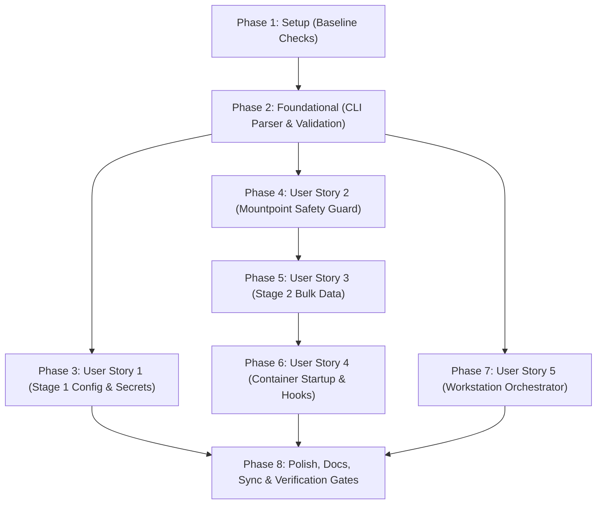

# Tasks: Staged Backblaze B2 Disaster Recovery Restoration

**Input**: Design documents from `/specs/014-staged-b2-restore/` (`spec.md`, `plan.md`, `research.md`, `data-model.md`, `quickstart.md`, `contracts/`)

**Prerequisites**: `plan.md` (required), `spec.md` (required for user stories), `research.md`, `data-model.md`, `contracts/`

**Documentation Impact**: `USER_FACING` — Updates operator-visible CLI flags (`--stage` on `scripts/restore-from-b2.sh` and `-Stage` on `scripts/restore-from-b2.ps1`), bare-metal recovery runbooks (`docs/full-restore-runbook.md`), disaster recovery guides (`docs/disaster-recovery-phase3.md`, `docs/operations.md`), `README.md`, and `ROADMAP.md` in the same change per Constitution Principle VII and `.specify/memory/coding-standards.md`.

**Tests**: In strict compliance with Constitution Principle III, ZERO automated unit test files, test suites, or mock frameworks are created. All verification is performed exclusively via static analysis (`bash -n`, `shellcheck`, `ansible-lint`), file parity checks (`cmp -s`), and live acceptance verification suites (`scripts/verify-phase5-backup.sh`, `scripts/verify-phase5-backup.ps1`, `ansible/playbooks/verify-phase5-backup.yml`) enforcing assertions `BK-001` through `BK-012`.

**Organization**: Tasks are grouped by user story to enable independent implementation, verification, and progressive delivery of each recovery stage.

---

## Phase 1: Setup (Shared Infrastructure & Baseline Verification)

**Purpose**: Verify pre-flight environment, establish baseline passing status for existing backup assertions (`BK-001` through `BK-008`), and confirm zero initial linter warnings.

- [x] T001 Inspect existing disaster recovery scripts and verify baseline backup assertions pass by executing `scripts/verify-phase5-backup.sh`
- [x] T002 Inspect and record pre-flight linter status across scripts and playbooks using `bash -n scripts/restore-from-b2.sh scripts/verify-phase5-backup.sh`, `shellcheck scripts/restore-from-b2.sh scripts/verify-phase5-backup.sh`, and `ansible-lint ansible/playbooks/verify-phase5-backup.yml`

---

## Phase 2: Foundational (Blocking Prerequisites)

**Purpose**: Core CLI argument parsing, stage normalization, and fail-closed validation in `scripts/restore-from-b2.sh` that MUST be completed before ANY user story can proceed.

**⚠️ CRITICAL**: No user story work can begin until this foundational parameter handling and fail-closed validation is in place.

- [x] T003 Implement `--stage` CLI parameter parsing and case-insensitive normalization in `scripts/restore-from-b2.sh` accepting `config`, `1`, `data`, `2`, and `all` (mapped to canonical IDs `STAGE_1_CONFIG`, `STAGE_2_DATA`, `STAGE_ALL`, defaulting to `all` when omitted) per FR-001 and `data-model.md` §2.1
- [x] T004 Implement fail-closed validation in `scripts/restore-from-b2.sh` rejecting invalid stage arguments with exit code `1` and printing valid stage options (`config`, `1`, `data`, `2`, `all`) to `stderr` prior to credential or repository operations per Principle II and FR-001
- [x] T005 [P] Add assertion `BK-011` (Invalid Stage Argument Rejection) to `scripts/verify-phase5-backup.sh` and `ansible/playbooks/verify-phase5-backup.yml` asserting `restore-from-b2.sh --stage invalid --dry-run` exits with code `1`
- [x] T006 Update usage synopsis function (`show_help`) in `scripts/restore-from-b2.sh` documenting `--stage <config|1|data|2|all>` options and updated stage behaviors per `staged-restore-contract.md` §2

**Checkpoint**: Foundational CLI parsing and fail-closed argument validation complete. User story implementation can now begin.

---

## Phase 3: User Story 1 - System Bootstrap & Secrets Restoration (Stage 1) (Priority: P1) 🎯 MVP

**Goal**: Enable a system administrator recovering a fresh or clean Arch Linux OS to execute `--stage config` (or `--stage 1`) to extract only `/etc/homelab`, `/home/admin/.ssh`, `/home/admin/.gemini`, and `/home/admin/projects`, sync `vault.yml` to the Ansible inventory, enforce strict `0600`/`0700` permissions and `admin:users` ownership, explicitly exclude `/mnt/storage`, and skip post-restore database hooks.

**Independent Test**: Execute `restore-from-b2.sh --stage config --dry-run` and verify that snapshot contents include `/etc/homelab/vault.yml` while strictly omitting `/mnt/storage` (Assertion `BK-009`); then execute non-destructive rehearsal `restore-from-b2.sh --stage 1 --target-dir /tmp/b2-stage1-test --include-path etc/homelab/vault.yml --force` and verify `vault.yml` is restored with permissions `0600 root:root`, `/tmp/b2-stage1-test/mnt/storage` does not exist, and no post-restore hooks execute (Assertion `BK-012`).

### Implementation for User Story 1

- [x] T007 [US1] Implement Stage 1 path inclusion (`/etc/homelab`, `/home/admin/.ssh`, `/home/admin/.gemini`, `/home/admin/projects`) and bulk storage exclusion (`--exclude /mnt/storage --exclude mnt/storage`) for `restic restore` in `scripts/restore-from-b2.sh` per FR-002, FR-003, and `data-model.md` §2.2
- [x] T008 [US1] Implement Stage 1 `--dry-run` snapshot listing in `scripts/restore-from-b2.sh` filtering output to Stage 1 paths and filtering out `/mnt/storage` per FR-011 and SC-001
- [x] T009 [US1] Implement Stage 1 post-restore permission enforcement in `scripts/restore-from-b2.sh` enforcing exact modes: `/etc/homelab/vault.yml`, `/etc/homelab/backup.env`, `/etc/homelab/monitoring.env` verbatim constraint `"0600 root:root"`; `/home/admin/.ssh` directory `"0700"`, private keys `"0600"`, public keys `"0644"`; `/home/admin/.gemini` directory `"0700"`, JSON credentials verbatim constraint `"0600"`; and ownership `"admin:users"` (fallback `"admin:admin"`) on `/home/admin/{.ssh,.gemini,projects}` when running as root per FR-004 and `data-model.md` §2.2
- [x] T010 [US1] Implement inventory vault synchronization in `scripts/restore-from-b2.sh` copying restored `/etc/homelab/vault.yml` to `<repo>/ansible/inventory/group_vars/all/vault.yml` with verbatim mode `"0600"` and owner `"admin"` for all discovered repo paths (`/home/admin/projects/homelab2`, `/home/admin/homelab2`, `/opt/homelab2`) when restoring to `/` per FR-004 and SC-004
- [x] T011 [P] [US1] Add assertion `BK-009` (Stage 1 Dry-Run Path Filtering) to `scripts/verify-phase5-backup.sh` and `ansible/playbooks/verify-phase5-backup.yml` asserting `restore-from-b2.sh --stage config --dry-run` includes `/etc/homelab/vault.yml` and excludes `/mnt/storage`
- [x] T012 [P] [US1] Add assertion `BK-012` (Stage 1 Non-Destructive Bootstrap Restore Rehearsal) to `scripts/verify-phase5-backup.sh` and `ansible/playbooks/verify-phase5-backup.yml` asserting `restore-from-b2.sh --stage 1 --target-dir /tmp/b2-stage1-test --include-path etc/homelab/vault.yml --force` restores `vault.yml` with mode `600`, leaves no `/mnt/storage` directory, and invokes zero post-restore hooks

**Checkpoint**: User Story 1 (Stage 1 Bootstrap & Secrets) is fully functional, independent, and verifiable on a clean host without container engines or bulk storage pools.

---

## Phase 4: User Story 2 - Storage Mountpoint Assertion & NVMe Leakage Prevention (Priority: P1)

**Goal**: Guarantee that bulk data extraction halts immediately before transferring files if `/mnt/storage` is not actively mounted, preventing catastrophic leakage of hundreds of gigabytes into the root NVMe drive.

**Independent Test**: Execute `restore-from-b2.sh --stage data --target-dir /tmp/b2-unmounted-test --force` (where `/tmp/b2-unmounted-test/mnt/storage` is an unmounted directory) and verify that the command immediately aborts with exit code `1` and emits `CRITICAL` mountpoint failure diagnostics to `stderr` prior to invoking `restic restore` (Assertion `BK-010`).

### Implementation for User Story 2

- [x] T013 [US2] Implement active mountpoint verification in `scripts/restore-from-b2.sh` evaluating `mountpoint -q "${RESOLVED_TARGET%/}/mnt/storage"` when `DRY_RUN=false` in Stage 2 (`data`/`2`) and in Stage All (`all`) when bulk storage is targeted per FR-005, FR-012, and `data-model.md` §2.3
- [x] T014 [US2] Implement fail-closed abort logic in `scripts/restore-from-b2.sh` emitting verbatim diagnostic message `CRITICAL: Storage mountpoint '<mount_path>' is not an active mountpoint. Aborting restoration to prevent root NVMe disk leakage.` to `stderr` and exiting immediately with exit code `1` before invoking `restic restore` per FR-006, SC-002, and SC-003
- [x] T015 [P] [US2] Add assertion `BK-010` (Stage 2 Unmounted Storage Guard) to `scripts/verify-phase5-backup.sh` and `ansible/playbooks/verify-phase5-backup.yml` verifying that attempting a Stage 2 restore against an unmounted target directory exits with code `1` and writes `CRITICAL` to `stderr`

**Checkpoint**: User Story 2 safety guard is fully enforced. Bulk restoration is strictly prevented from leaking into unmounted root filesystems.

---

## Phase 5: User Story 3 - Bulk Data & Media Restoration into Storage Pool (Stage 2) (Priority: P1)

**Goal**: Restore application service persistent state (`/opt/services`) and bulk family media (`/mnt/storage/media/photos`) into the active MergerFS storage pool once `site.yml` has configured storage and Docker.

**Independent Test**: Verify that Stage 2 `--dry-run` catalogs only `/opt/services` and `/mnt/storage/media/photos` files, and execute Stage 2 restore verifying that restored media directories enforce `2775 admin:storage` permissions and service states enforce `0700 1000:1000` / `0600` permissions.

### Implementation for User Story 3

- [x] T016 [US3] Implement Stage 2 path inclusion (`/opt/services` and `/mnt/storage/media/photos`) for `restic restore` in `scripts/restore-from-b2.sh` per FR-007 and `data-model.md` §2.4
- [x] T017 [US3] Implement Stage 2 `--dry-run` snapshot listing in `scripts/restore-from-b2.sh` cataloging candidate files under `/opt/services` and `/mnt/storage/media/photos` to standard output per FR-011
- [x] T018 [US3] Implement Stage 2 permissions and ownership enforcement in `scripts/restore-from-b2.sh` setting verbatim constraints: `/opt/services/vaultwarden/data` to `"0700"` owned by `"1000:1000"`; `/opt/services/*/.env` files to `"0600"`; and `/mnt/storage/media/photos` directory to `"2775"` owned by verbatim constraint `"1000:1001"` (`admin:storage`) when running as root per FR-007 and `data-model.md` §2.4

**Checkpoint**: User Stories 1, 2, and 3 are functional. Bulk data and media can be restored into active MergerFS storage pools.

---

## Phase 6: User Story 4 - Application Container Startup & Database Hook Execution (Priority: P2)

**Goal**: Following Stage 2 file extraction, automatically ensure required container engines and application service units are started, then execute all post-restore database hooks (`/etc/homelab/backup.d/*.sh post-restore`) to reconstitute relational databases from transactional backup dumps.

**Independent Test**: Execute Stage 2 on a system with restored database dumps, verify `docker.service` and application units (`vaultwarden.service`, `frigate.service`, `immich.service`) are active, and verify each hook in `/etc/homelab/backup.d/*.sh` runs with argument `post-restore` and reports successful completion.

### Implementation for User Story 4

- [x] T019 [US4] Implement container engine readiness check (`systemctl is-active docker.service || systemctl start docker.service`) and installed application service startup (`vaultwarden.service`, `frigate.service`, `immich.service` if unit files exist) in `scripts/restore-from-b2.sh` prior to invoking database hooks when restoring to `/` per FR-008 and `data-model.md` §2.4
- [x] T020 [US4] Implement post-restore hook execution loop in `scripts/restore-from-b2.sh` invoking every executable script in `/etc/homelab/backup.d/*.sh` with verbatim argument `"post-restore"`, logging action milestones at `INFO`, reporting warnings at `WARN` on non-zero hook exits, and completing disaster recovery per FR-008, SC-005, and `staged-restore-contract.md` §3.2

**Checkpoint**: Database hooks execute automatically after containers start, reconstituting live databases from restored dumps.

---

## Phase 7: User Story 5 - Workstation Remote Disaster Recovery Orchestration (Priority: P2)

**Goal**: Enable operators on a Windows/Linux desktop workstation to orchestrate bare-metal recovery remotely over SSH using unified `-Stage` flags, automatically propagating `--stage` to remote scripts without chassis-attached monitors or keyboards.

**Independent Test**: Execute `scripts/restore-from-b2.ps1 -HostAddress 192.168.4.57 -User admin -Stage config -DryRun` and verify that the script validates parameters, uploads the updated `restore-from-b2.sh`, dispatches the remote command with `--stage 'config' --dry-run`, and reports clean remote execution.

### Implementation for User Story 5

- [x] T021 [US5] Add `[ValidateSet("config", "1", "data", "2", "all")] [string]$Stage = "all"` parameter to `scripts/restore-from-b2.ps1` and propagate `--stage '$Stage'` to remote `/tmp/restore-from-b2.sh` invocation per FR-009 and SC-006
- [x] T022 [US5] Update parameter synopsis, help annotations, and console header logging in `scripts/restore-from-b2.ps1` to reflect staged disaster recovery orchestration per `staged-restore-contract.md` §1
- [x] T023 [P] [US5] Update workstation verification runner `scripts/verify-phase5-backup.ps1` help synopsis and logging to document execution of the expanded 12-assertion suite (`BK-001` through `BK-012`) per `verification-contract.md` §1

**Checkpoint**: Remote workstation orchestration provides complete feature parity with local execution across all stages.

---

## Phase 8: Polish & Cross-Cutting Concerns

**Purpose**: File synchronization to Ansible role assets, comprehensive human-facing operational runbook updates (`USER_FACING`), backward compatibility regression testing, and static analysis verification gates.

- [x] T024 [P] Synchronize `scripts/restore-from-b2.sh` to `ansible/roles/backup/files/restore-from-b2.sh` and verify file parity using `cmp -s` per Principle IV and `ansible/roles/backup/tasks/runner.yml`
- [x] T025 [P] Update `docs/full-restore-runbook.md` with the 3-phase staged bare-metal disaster recovery workflow (Stage 1 secrets -> `site.yml` convergence -> Stage 2 bulk data) per FR-010, Principle VII, and `coding-standards.md` §6
- [x] T026 [P] Update `docs/disaster-recovery-phase3.md` and `docs/operations.md` documenting `--stage config` / `--stage data` usage, mountpoint leakage prevention, and database hook execution per FR-010 and Principle VII
- [x] T027 [P] Update `README.md` and `ROADMAP.md` reflecting staged Backblaze B2 disaster recovery capabilities, updated CLI options, and Phase 5 milestone status per Principle VII and `plan.md`
- [x] T028 Verify backward compatibility of `--stage all` and omitted `--stage` with single-file restore operations (preserving `BK-008` behavior) in `scripts/restore-from-b2.sh` per FR-012
- [x] T029 Execute full static linting and syntax validation across all modified scripts and playbooks using `bash -n scripts/*.sh`, `shellcheck scripts/*.sh`, and `ansible-lint ansible/playbooks/verify-phase5-backup.yml ansible/roles/backup/` per Constitution Principle VII
- [x] T030 Run full acceptance verification gate `scripts/verify-phase5-backup.sh` (standard output and `--json` mode) verifying that all 12 assertions `BK-001` through `BK-012` pass per `verification-contract.md`

---

## Dependencies & Execution Order

### Phase Dependencies

- **Setup (Phase 1)**: No dependencies — inspects baseline status and linters.
- **Foundational (Phase 2)**: Depends on Setup completion — BLOCKS all user stories. Implements `--stage` CLI parsing, normalization, and fail-closed validation.
- **User Story 1 (Phase 3 - P1)**: Depends on Phase 2. Delivers Stage 1 secrets & bootstrap restore.
- **User Story 2 (Phase 4 - P1)**: Depends on Phase 2. Delivers `/mnt/storage` mountpoint assertion and NVMe leakage prevention. Can be implemented in parallel with US1.
- **User Story 3 (Phase 5 - P1)**: Depends on Phase 4 (mountpoint assertion MUST precede bulk data extraction). Delivers Stage 2 bulk payload extraction.
- **User Story 4 (Phase 6 - P2)**: Depends on Phase 5 (bulk data and database dumps MUST be extracted before container startup and hook import). Delivers container startup and hook execution.
- **User Story 5 (Phase 7 - P2)**: Depends on Phase 2 (PowerShell wrapper can be developed once parameter contract is defined; full integration depends on US1–US4).
- **Polish (Phase 8)**: Depends on all user stories (Phase 3 through Phase 7) being complete. Synchronizes Ansible role, updates all documentation, and runs full verification gates.

### User Story Dependencies



- **User Story 1 (P1)**: Can start after Phase 2 — No dependencies on other stories.
- **User Story 2 (P1)**: Can start after Phase 2 — Provides mountpoint assertion required before US3.
- **User Story 3 (P1)**: Depends on US2 mountpoint assertion — Restores bulk data into validated mount.
- **User Story 4 (P2)**: Depends on US3 bulk data — Starts containers and imports dumps via hooks.
- **User Story 5 (P2)**: Depends on Phase 2 parameter specification — Wraps remote execution.

---

## Parallel Execution Examples

### Parallel Example: Foundational & User Story 1
```bash
# Developer A implements Stage 1 path inclusion and permission enforcement:
Task: "T007 [US1] Implement Stage 1 path inclusion and bulk storage exclusion in scripts/restore-from-b2.sh"
Task: "T009 [US1] Implement Stage 1 post-restore permission enforcement in scripts/restore-from-b2.sh"

# Developer B concurrently writes the acceptance assertions in the verification suite:
Task: "T011 [P] [US1] Add assertion BK-009 to scripts/verify-phase5-backup.sh"
Task: "T012 [P] [US1] Add assertion BK-012 to scripts/verify-phase5-backup.sh"
```

### Parallel Example: User Story 2 & User Story 5
```bash
# Developer A implements the mountpoint guard in the shell script:
Task: "T013 [US2] Implement active mountpoint verification in scripts/restore-from-b2.sh"
Task: "T014 [US2] Implement fail-closed abort logic in scripts/restore-from-b2.sh"

# Developer B concurrently updates the PowerShell workstation orchestrator:
Task: "T021 [US5] Add [ValidateSet(...)] $Stage parameter to scripts/restore-from-b2.ps1"
Task: "T023 [P] [US5] Update workstation verification runner scripts/verify-phase5-backup.ps1"
```

### Parallel Example: Polish Phase
```bash
# All Polish documentation and synchronization tasks can proceed in parallel:
Task: "T024 [P] Synchronize scripts/restore-from-b2.sh to ansible/roles/backup/files/restore-from-b2.sh"
Task: "T025 [P] Update docs/full-restore-runbook.md with the 3-phase staged workflow"
Task: "T026 [P] Update docs/disaster-recovery-phase3.md and docs/operations.md"
Task: "T027 [P] Update README.md and ROADMAP.md"
```

---

## Implementation Strategy

### MVP First (User Story 1 Only)
1. Complete Phase 1: Setup (verify baseline `BK-001`–`BK-008`).
2. Complete Phase 2: Foundational (implement `--stage` CLI parsing, normalization, and fail-closed validation; assertion `BK-011`).
3. Complete Phase 3: User Story 1 (implement Stage 1 filtering, permission enforcement, inventory vault sync; assertions `BK-009` and `BK-012`).
4. **STOP and VALIDATE**: Execute `scripts/verify-phase5-backup.sh` to confirm `BK-009`, `BK-011`, and `BK-012` pass alongside `BK-001`–`BK-008`. At this point, bare-metal Stage 1 secrets recovery is 100% operational (MVP reached!).

### Incremental Delivery
1. Foundation + US1 (MVP) -> Host can restore secrets and sync inventory before Ansible.
2. Add US2 -> Storage mountpoint safety assertion prevents NVMe leakage (`BK-010` passes).
3. Add US3 -> Bulk application state and media restored into MergerFS.
4. Add US4 -> Docker and services started, database hooks automatically executed.
5. Add US5 -> Remote workstation PowerShell orchestration operational.
6. Polish -> Ansible backup role synchronized (`cmp -s`), documentation updated (`README.md`, `ROADMAP.md`, runbooks), linters and full acceptance suite verified (`BK-001`–`BK-012`).

---

## Notes

- `[P]` tasks = different files or decoupled tasks, zero merge conflicts.
- `[Story]` label maps every task in Phases 3–7 directly to `US1` through `US5` for end-to-end traceability.
- In strict adherence to Constitution Principle III, ZERO automated unit tests are written; verification is performed exclusively by linters (`bash -n`, `shellcheck`, `ansible-lint`), file comparison (`cmp -s`), and live acceptance suites (`verify-phase5-backup.sh`, `verify-phase5-backup.ps1`, `verify-phase5-backup.yml`).
- Every task description includes exact file paths and quotes data model constraints verbatim (`0600 root:root`, `0700`, `2775`, `1000:1001`, `mountpoint -q`, exit code `1`).
