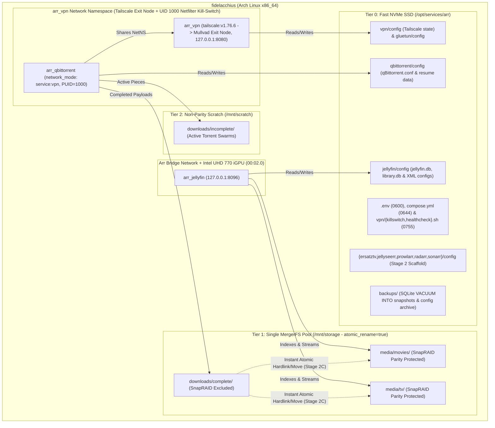
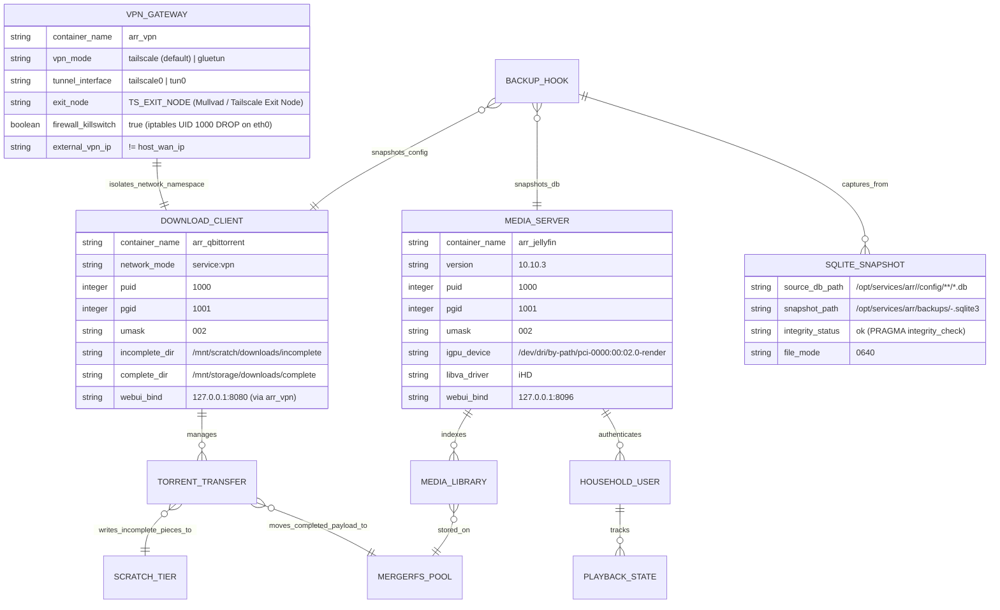
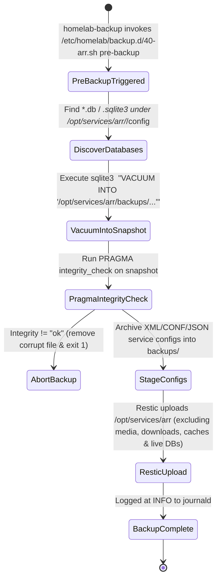

# Data Model & Storage Entity Specification: Media & Arr Stack — Stage 1

**Feature**: `015-media-arr-stage1`  
**Date**: 2026-11-17  
**Status**: Completed  
**Governing Documents**: `specs/015-media-arr-stage1/spec.md`, `specs/015-media-arr-stage1/research.md`

---

## 1. Three-Tier Storage Topology & Network Isolation Model

The Media & Arr Stack Stage 1 coordinates three distinct physical storage tiers (`FR-004`, `FR-005`, `FR-006`) and two isolated container network contexts (`FR-002`, `FR-007`).



### Storage Entities & Permission Matrix

| Entity / Directory | Host Path | Mode | Owner:Group | Storage Tier | SnapRAID Parity | Restic Offsite Backup | Purpose |
|---|---|---|---|---|---|---|---|
| **Service Root** | `/opt/services/arr` | `0755` | `root:root` | Tier 0 NVMe | N/A | Yes | Docker Compose stack root |
| **Secrets File** | `/opt/services/arr/.env` | `0600` | `root:root` | Tier 0 NVMe | N/A | Yes (Encrypted) | Isolated Tailscale auth key, exit node, VPN keys & env vars |
| **Example Secrets** | `/opt/services/arr/.env.example` | `0644` | `root:root` | Tier 0 NVMe | N/A | Yes (Committed) | Sanitized reference template for `.env` |
| **Compose Manifest** | `/opt/services/arr/compose.yml` | `0644` | `root:root` | Tier 0 NVMe | N/A | Yes (Committed) | Declarative Stage 1 Docker Compose manifest |
| **VPN Scripts Dir** | `/opt/services/arr/vpn` | `0755` | `root:root` | Tier 0 NVMe | N/A | Yes | Directory for `killswitch.sh`, `healthcheck.sh`, and `config/` |
| **Kill-Switch Script** | `/opt/services/arr/vpn/killswitch.sh` | `0755` | `root:root` | Tier 0 NVMe | N/A | Yes | Kernel `iptables`/`ip6tables` `UID 1000` kill-switch enforcement |
| **VPN Healthcheck** | `/opt/services/arr/vpn/healthcheck.sh` | `0755` | `root:root` | Tier 0 NVMe | N/A | Yes | Verifies `ExitNodeStatus.Online == true`, kill-switch & external IP |
| **Tailscale VPN State** | `/opt/services/arr/vpn/config` | `0700` | `root:root` | Tier 0 NVMe | N/A | Yes | Dedicated `tailscaled.state` for `fidelacchius-arr-vpn` |
| **Gluetun Config** | `/opt/services/arr/gluetun/config` | `0775` | `1000:1001` | Tier 0 NVMe | N/A | Yes | Optional standalone Gluetun VPN state directory |
| **qBittorrent Config** | `/opt/services/arr/qbittorrent/config` | `0775` | `1000:1001` | Tier 0 NVMe | N/A | Yes (DBs via snapshot) | `qBittorrent.conf`, categories, and torrent state |
| **Jellyfin Config** | `/opt/services/arr/jellyfin/config` | `0775` | `1000:1001` | Tier 0 NVMe | N/A | Configs Yes; Caches/Live DBs Excluded | `jellyfin.db`, `library.db`, XML configs, metadata |
| **Stage 2A Scaffold** | `/opt/services/arr/ersatztv/config` | `0775` | `1000:1001` | Tier 0 NVMe | N/A | Yes | Pre-created config dir for Stage 2A ErsatzTV |
| **Stage 2B Scaffold** | `/opt/services/arr/jellyseerr/config` | `0775` | `1000:1001` | Tier 0 NVMe | N/A | Yes | Pre-created config dir for Stage 2B Jellyseerr |
| **Stage 2C Scaffold** | `/opt/services/arr/{prowlarr,radarr,sonarr}/config` | `0775` | `1000:1001` | Tier 0 NVMe | N/A | Yes | Pre-created config dirs for Stage 2C Arr managers |
| **Backup Staging** | `/opt/services/arr/backups` | `0750` | `root:root` | Tier 0 NVMe | N/A | Yes (B2 Restic) | Online SQLite `VACUUM INTO` snapshots & config archives |
| **Scratch Downloads** | `/mnt/scratch/downloads/incomplete` | `2775` | `admin:storage` (`1000:1001`) | Tier 2 Scratch | **Excluded** (`/mnt/scratch/`) | **Excluded** | In-progress active torrent piece writes |
| **Complete Downloads** | `/mnt/storage/downloads/complete` | `2775` | `admin:storage` (`1000:1001`) | Tier 1 MergerFS | **Excluded** (`/downloads/`) | **Excluded** | Finished downloads awaiting library organization |
| **Movies Library** | `/mnt/storage/media/movies` | `2775` | `admin:storage` (`1000:1001`) | Tier 1 MergerFS | **Protected** | **Excluded** (Bulk media) | Finalized household movie collection |
| **TV Library** | `/mnt/storage/media/tv` | `2775` | `admin:storage` (`1000:1001`) | Tier 1 MergerFS | **Protected** | **Excluded** (Bulk media) | Finalized household TV series collection |

---

## 2. Configuration Schema & Environment Variables (`/opt/services/arr/.env`)

All operational parameters, Tailscale exit-node credentials, and optional standalone WireGuard keys are isolated in `/opt/services/arr/.env` (mode `0600`) and rendered via Ansible from `ansible/inventory/group_vars/all/{vars.yml,vault.yml}`.

```ini
# /opt/services/arr/.env
# Managed by Ansible - homelab2
# Mode: 0600 (root:root)

# VPN Mode Selection ("tailscale" default for Tailscale Mullvad / Exit Node; "gluetun" for standalone WireGuard)
ARR_VPN_MODE=tailscale

# Container Image Versions
TAILSCALE_VERSION=v1.76.6
GLUETUN_VERSION=v3.39.1
QBITTORRENT_VERSION=5.0.2
JELLYFIN_VERSION=10.10.3

# Unified Non-Root Process Ownership & Permissions (FR-006)
PUID=1000
PGID=1001
UMASK=002
TZ=America/New_York

# Loopback Port Bindings (FR-007)
ARR_HOST_BIND=127.0.0.1
JELLYFIN_HTTP_PORT=8096
QBITTORRENT_WEBUI_PORT=8080
GLUETUN_CONTROL_PORT=8000

# Storage Tier Paths (FR-004)
ARR_SERVICE_DIR=/opt/services/arr
ARR_SCRATCH_INCOMPLETE_DIR=/mnt/scratch/downloads/incomplete
ARR_STORAGE_ROOT=/mnt/storage
ARR_STORAGE_COMPLETE_DIR=/mnt/storage/downloads/complete
ARR_STORAGE_MOVIES_DIR=/mnt/storage/media/movies
ARR_STORAGE_TV_DIR=/mnt/storage/media/tv

# Hardware Acceleration (Intel Alder Lake-S UHD Graphics 770) (FR-003)
LIBVA_DRIVER_NAME=iHD

# Tailscale Mullvad / Exit Node VPN Configuration (Default: ARR_VPN_MODE=tailscale) (FR-002, FR-010)
TS_HOSTNAME=fidelacchius-arr-vpn
TS_AUTHKEY=<TS_AUTHKEY_FROM_VAULT>
TS_EXIT_NODE=<TS_EXIT_NODE_FROM_VAULT>
TS_STATE_DIR=/var/lib/tailscale
TS_USERSPACE=false
TS_ACCEPT_DNS=true
TS_EXTRA_ARGS=--exit-node=<TS_EXIT_NODE_FROM_VAULT> --exit-node-allow-lan-access=true --accept-dns=true

# Optional Standalone Gluetun VPN Configuration (Used only when ARR_VPN_MODE=gluetun)
VPN_SERVICE_PROVIDER=custom
VPN_TYPE=wireguard
VPN_ENDPOINT_IP=<VPN_ENDPOINT_IP_FROM_VAULT>
VPN_ENDPOINT_PORT=51820
WIREGUARD_PUBLIC_KEY=<WIREGUARD_PUBLIC_KEY_FROM_VAULT>
WIREGUARD_PRIVATE_KEY=<WIREGUARD_PRIVATE_KEY_FROM_VAULT>
WIREGUARD_ADDRESSES=10.2.0.2/32
WIREGUARD_PRESHARED_KEY=
SERVER_COUNTRIES=
OPENVPN_USER=
OPENVPN_PASSWORD=
FIREWALL=on
FIREWALL_OUTBOUND_SUBNETS=192.168.4.0/24
HTTP_CONTROL_SERVER_ADDRESS=:8000
```

---

## 3. Core Domain Entities & Relationships



### Entity Validation Rules

1. **VPN Gateway (`arr_vpn`)**:
   - Must hold `NET_ADMIN` (and `NET_RAW` in Tailscale mode) capability and `/dev/net/tun` device access.
   - In `tailscale` mode (default):
     - `iptables -C OUTPUT -o eth0 -m owner --uid-owner 1000 -j DROP` and `ip6tables -C OUTPUT ! -o lo -m owner --uid-owner 1000 -j DROP` must be active in the container network namespace (`FR-002`).
     - `tailscale status --json` must show `BackendState == "Running"` and `ExitNodeStatus.Online == true`.
   - Observed external IP (`docker exec arr_qbittorrent` / `docker exec arr_vpn`) must be a valid IPv4 address and must not equal the host WAN IP (`SC-002`).

2. **Download Client (`arr_qbittorrent`)**:
   - `HostConfig.NetworkMode` must equal `container:<arr_vpn_id>` (`service:vpn`).
   - Must run as `PUID=1000`, `PGID=1001` so all outbound network sockets are governed by the `--uid-owner 1000` netfilter kill-switch rules.
   - Must write active incomplete downloads to `/mnt/scratch/downloads/incomplete` (Tier 2) and move finished downloads to `/mnt/storage/downloads/complete` (Tier 1).

3. **Media Server (`arr_jellyfin`)**:
   - Must mount `/mnt/storage/media/movies` and `/mnt/storage/media/tv` from the single `/mnt/storage` MergerFS pool.
   - Must mount only the Intel UHD Graphics 770 PCI device nodes (`pci-0000:00:02.0-render` and `pci-0000:00:02.0-card`); discrete AMD GPU `03:00.0` must never appear in container device mappings.

---

## 4. State Lifecycles

### 4.1 Torrent Download & Media Library Lifecycle

```mermaid
stateDiagram-v2
    [*] --> MagnetOrTorrentAdded: Operator adds download in qBittorrent (or Stage 2C Arr)
    MagnetOrTorrentAdded --> VpnTunnelCheck: arr_vpn netfilter kill-switch + ExitNodeStatus gate
    VpnTunnelCheck --> BlockedByKillSwitch: ExitNode offline / tunnel down (UID 1000 dropped on eth0 & tailscale0; 0% host WAN leak)
    BlockedByKillSwitch --> VpnTunnelCheck: ExitNodeStatus.Online == true restored
    VpnTunnelCheck --> SwarmingOnScratch: Tunnel active -> Writes pieces to /mnt/scratch/downloads/incomplete
    SwarmingOnScratch --> DownloadCompleted: 100% pieces verified
    DownloadCompleted --> MovedToMergerFSComplete: Moved to /mnt/storage/downloads/complete (2775 admin:storage)
    MovedToMergerFSComplete --> AtomicLibraryImport: Hardlinked/renamed into /mnt/storage/media/{movies,tv} (same MergerFS mount)
    AtomicLibraryImport --> JellyfinIndexed: Jellyfin library scan indexes metadata & enables iHD QSV streaming
    JellyfinIndexed --> [*]
```



### 4.2 Online SQLite Snapshot & Backup Lifecycle (`40-arr.sh`)


